# Gemini & Antigravity Engineering Ecosystem: Machine-Readable Reference Manual

This document provides a single, unified, AI-optimized knowledge baseline of all tools, Model Context Protocol (MCP) servers, autonomous skills, CLI binaries, compilers, local GitHub repositories, long-term memory architectures, and operational guardrails configured in this environment.

---

## 1. Security & Operational Permissions Baseline

The agent operates under strict engineering and security contracts defined in [AGENTS.md](file:///home/unknownuser/AGENTS.md) and [GEMINI.md](file:///home/unknownuser/GEMINI.md):

* **Non-Root Execution**: Runs strictly as non-root user `unknownuser` (UID 1000). Privilege escalation (`sudo`, modifying `/etc/sudoers`) is prohibited.
* **Destructive Operations Approval Gate**: Explicit human sign-off is mandatory before executing:
  * File removals (`rm -rf` outside scratch/temp directories, block-level wipes).
  * Database destruction (`DROP DATABASE`, `DROP TABLE`, `TRUNCATE`).
  * Git history alteration (`git push --force`, resetting commits on shared branches).
* **Secrets & Isolation**: Private keys (`~/.ssh/**`, `*.pem`, `*.key`), credentials, and `.env*` files are isolated and ignored via `.geminiignore`.
* **Least Privilege**: System directories (`/etc`, `/usr`, `/var`, `/sys`, `/proc`) are read-only. Modifications are strictly confined to the active project workspace.

---

## 2. Model Context Protocol (MCP) Server Registry

Configured in [mcp_config.json](file:///home/unknownuser/.gemini/config/mcp_config.json) and active in the agent runtime:

| MCP Server | Transport & Command | Primary Tools / Exposed Capabilities | Use Cases |
| :--- | :--- | :--- | :--- |
| **`context7`** | `npx @upstash/context7-mcp@latest` | `resolve-library-id`, `query-docs` | Up-to-date documentation, API reference, and examples for external packages and frameworks. |
| **`firecrawl`** | Remote HTTP (`https://mcp.firecrawl.dev/v2/mcp`) | `firecrawl_scrape`, `firecrawl_search`, `firecrawl_parse` | Deep web crawling, JavaScript-rendered scraping, and clean markdown extraction. |
| **`git`** | `uvx mcp-server-git` | `git_status`, `git_diff_unstaged`, `git_diff_staged`, `git_diff`, `git_commit`, `git_add`, `git_reset`, `git_log`, `git_create_branch`, `git_checkout`, `git_show`, `git_branch` | Native Git repository state tracking, branch management, staging, and commit history. |
| **`linear`** | `npx mcp-server-linear` | `linear_create_issue`, `linear_bulk_update_issues`, `linear_edit_issue`, `linear_search_issues`, `linear_get_issue`, `linear_list_projects`, `linear_create_project_milestone`, `linear_create_comment` | Enterprise task boards, issue tracking, milestone tracking, and ticket updates. |
| **`playwright`** | `npx @playwright/mcp@latest --headless` | `browser_navigate`, `browser_click`, `browser_type`, `browser_fill_form`, `browser_take_screenshot`, `browser_snapshot`, `browser_network_requests`, `browser_console_messages`, `browser_evaluate` | Headless browser E2E test verification, visual layout snapshots, accessibility tree audits, and DOM inspection. |
| **`postgres`** | `uvx postgres-mcp --access-mode=restricted` | Restricted SQL execution, schema introspection, table structure inspection, index verification | Direct PostgreSQL database querying, query plan analysis, and database migration checks. |
| **`semgrep`** | `uvx semgrep-mcp` | Static application security testing (SAST), vulnerability analysis, OWASP scanning | Automatic security audits on git diffs to detect authorization flaws, IDOR, SQL injection, and secrets. |
| **`sentry`** | Remote SSE (`https://mcp.sentry.dev/sse`) | Telemetry monitoring, stack trace inspection, crash analysis | Real-time production application error tracking and distributed tracing. |
| **`serena`** | `uvx --from git+https://github.com/oraios/serena serena-mcp-server` | Semantic agent orchestration, multi-agent query routing, semantic indexing | External autonomous agent integration and semantic indexing. |
| **`thinking`** | `npx @modelcontextprotocol/server-sequential-thinking` | `sequentialthinking` | Step-by-step reasoning and trade-off analysis for complex architecture, algorithms, and migrations. |
| **`rea`** | `/home/unknownuser/.local/bin/rea mcp` | **200+ Reverse Engineering Tools**: `binary_overview`, `analyze_function`, `disassemble`, `decompile_jeb_item`, `procedure_assembly`, `list_frida_processes`, `start_frida_session`, `start_gdb_session`, `inspect_apktool_client`, `inspect_sqlite_database`, `inspect_pcap_capture` | Low-level binary disassembly, decompilation, dynamic instrumentation (Frida/GDB), APK analysis, and network packet forensics. |
| **`openviking`** | `node /home/unknownuser/OpenViking/agent-plugins/servers/openviking-mcp-server.mjs` | `openviking_remember`, `openviking_search`, `openviking_read`, `openviking_list`, `openviking_health` | Long-term memory storage, semantic vector retrieval, associative concept graphs, and cross-session knowledge retention. |
| **`speckit`** | `/home/unknownuser/.local/bin/specify mcp` | `specify_list_commands`, `specify_describe_command`, `specify_run_command`, `specify_version`, `specify_artifact_list`, `specify_artifact_info` | GitHub Spec Kit specification lifecycle governance, requirement definition, and task contract execution. |

---

## 3. Built-in Agent Tools & Subagent Hierarchy

### 3.1 Native Tools
* **`run_command`**: Runs bash shell commands in `/home/unknownuser`. Supports `RunPersistent` terminals (retaining shell variables across calls), `WaitMsBeforeAsync` timeouts, and `IsDaemon` background execution.
* **`view_file`**: Inspects files with line range slicing (`StartLine`, `EndLine`), byte offsets, and support for PDFs, text files, and images.
* **`write_to_file`**: Atomic file creation with `Overwrite` or `Append` modes and metadata tagging.
* **`replace_file_content`**: Precise contiguous block code replacement without rewriting full files, preventing hallucination.
* **`search_web`**: Live Google search queries for current facts, library updates, and real-time documentation.
* **`read_url_content`**: Fetches HTTP URLs directly and converts HTML to clean, LLM-digestible markdown.
* **`schedule`**: Triggers one-shot timers (`DurationSeconds`, `TimerCondition`) or recurring cron jobs (`CronExpression`, `MaxIterations`, `IsDaemon`).
* **`manage_task`**: Monitors, inputs (`send_input`), lists, or terminates (`kill`) background tasks.
* **`ask_question`**: Renders interactive UI modals with structured options and write-ins to clarify user requirements.
* **`call_mcp_tool` / `list_resources` / `read_resource`**: Universal interface for invoking lazy-loaded MCP tools.

### 3.2 Specialist Subagents
Subagents are invoked concurrently via `invoke_subagent` or defined dynamically via `define_subagent`:

| Subagent Name | Role | Responsibilities |
| :--- | :--- | :--- |
| **`architect`** | Systems Architect | System planning, technology trade-offs, microservice boundaries, latency/throughput profiling. |
| **`frontend-specialist`** | UI/UX Engineer | Next.js/React engineering, Tailwind CSS styling, `motion` animations, WCAG AA compliance. |
| **`backend-specialist`** | Backend Specialist | API design, service architecture, payload validation, reliability engineering, fault tolerance. |
| **`database-specialist`** | Database Specialist | Schema modeling, index strategies, zero-downtime migrations, `EXPLAIN (ANALYZE, BUFFERS)`. |
| **`security-reviewer`** | DevSecOps Auditor | Threat modeling, vulnerability scanning, secret detection, and permissions auditing. |
| **`test-engineer`** | Test Engineer | Regression test automation, Red-Green-Refactor TDD loops, Playwright E2E suites. |
| **`code-reviewer`** | Code Reviewer | Independent diff inspection, regression risk analysis, cyclomatic complexity reduction. |
| **`scion-hypervisor`** | Team Orchestrator | Google Cloud Scion containerized sandbox manager for isolated multi-agent worktrees. |
| **`image-generator`** | Visual Media Specialist | Asset creation, diagram generation, and image editing. |
| **`self`** | Cloned Agent | General-purpose worker inheriting parent tools and system prompt for parallel exploratory subtasks. |

---

## 4. Local CLI Toolchain, Compilers & Runtimes

### 4.1 CLI Binaries ([~/.local/bin/](file:///home/unknownuser/.local/bin/))
* **`agy` / `gemini`**: Antigravity CLI and Gemini autonomous agent runtime.
* **`archify`**: Visual architecture engine that parses source code ASTs into interactive C4, sequence, and ERD diagrams.
* **`specify`**: GitHub Spec Kit CLI for task specification scaffolding and requirement contracts.
* **`openspec`**: OpenSpec CLI for proposal, implementation, verification, and spec synchronization.
* **`impeccable`**: Frontend design system auditor for typography, color tokens, responsive spacing, and visual polish.
* **`uipro`**: UI/UX Pro Max intelligence engine with design matrices and style palettes.
* **`promptfoo`**: Automated LLM evaluation, grading, and adversarial red-teaming tool.
* **`rea` & `rea-agents`**: Reverse Engineer Anything CLI for disassembly, decompilation, and binary instrumentation.
* **`heretic`**: LLM safety surgery tool for directional refusal abliteration and feature steering.
* **`higgsfield`**: Scalable GPU cluster orchestration tool for distributed ZeRO-3 and FSDP model training.
* **`mirofish`**: Multi-agent swarm intelligence simulator for parallel digital universe modeling.
* **`nanochat`**: Minimalist full-stack GPT-2 training, fine-tuning, and benchmarking harness.
* **`openrecall`**: Local, privacy-first desktop visual recording and semantic activity search CLI.

### 4.2 Compilers & Language Environments
* **Rust Toolchain** ([~/.cargo/bin/](file:///home/unknownuser/.cargo/bin/)):
  * `rustc` & `cargo` (Rust 1.80+)
  * `rust-analyzer` (LSP server for code intelligence)
  * `cargo-audit` (Vulnerability auditing for `Cargo.lock`)
  * `cargo-clippy` (Strict static analysis linter)
  * `cargo-fmt` (Code formatter)
  * `cargo-miri` (Undefined behavior and memory safety interpreter)
  * `rust-gdb` & `rust-lldb` (Native debuggers)
* **C/C++ Toolchain** (`/tmp/opencode/toolchain/bin/`):
  * `gcc`, `g++` (`x86_64-conda-linux-gnu-gcc/g++`)
* **Java Toolchain** (`/tmp/opencode/toolchain/bin/`):
  * `java` (JVM runtime) & `javac` (compiler)
* **Node.js & JavaScript**:
  * Node.js v22.19.0, `npm`, `npx`
* **Python Tooling**:
  * Python 3.12, `uv` (fast package installer), `uvx` (tool runner).

---

## 5. Workspace GitHub Repositories & Reference Codebases

Located across [/home/unknownuser/](file:///home/unknownuser/) and [~/ai-agent-resources/](file:///home/unknownuser/ai-agent-resources/):

| Project Name | Path | Architecture & Core Capabilities |
| :--- | :--- | :--- |
| **`Sunbron` (Sunborn)** | [~/Sunbron](file:///home/unknownuser/Sunbron) | **Distributed Semantic Execution Gateway & Autonomic Cache**: Built with Rust 1.80+ and Next.js 15. Provides sub-millisecond hot-path inference caching, conformal risk-controlled semantic retrieval, and self-learning policy promotion. |
| **`Delta-`** | [~/Delta-](file:///home/unknownuser/Delta-) | **Institutional Quantitative Trading OS**: Terminal-only architecture featuring an 11-screen Ratatui TUI (Rust + Tokio async IPC), a 12-stage alpha/portfolio pipeline, microsecond limit order books, and three-way fill reconciliation. |
| **`CarbonQ`** | [~/CarbonQ](file:///home/unknownuser/CarbonQ) | **Enterprise Carbon Accounting Platform**: Reference implementation for GHG Protocol Scope 3 and ISO 14064-1. Implements Mondrian CQR conformal prediction, Mahalanobis OOD detection, C++ TreeSHAP waterfalls, and a Playwright-verified Next.js dashboard. |
| **`21st`** | [~/21st](file:///home/unknownuser/21st) | **21st.dev UI Component Catalog**: Modern React/Tailwind components located at `apps/web/components/ui` (`aurora-background`, `shimmer-button`, `command-menu`, `sidebar`, `text-morph`, `text-shimmer`, `dialog`). |
| **`archify`** | [~/archify](file:///home/unknownuser/archify) | Visual architecture engine generating interactive C4, sequence, and ERD diagrams from codebase ASTs. |
| **`OpenSpec`** | [~/OpenSpec](file:///home/unknownuser/OpenSpec) | Spec-driven development framework managing proposals, specifications, task trees, and verification cycles. |
| **`spec-kit`** | [~/spec-kit](file:///home/unknownuser/spec-kit) | Specification bootstrapping and task contract management library. |
| **`superpowers`** | [~/superpowers](file:///home/unknownuser/superpowers) | Superpowers v7.0.0 software engineering methodology (TDD, brainstorming, worktrees, systematic debugging). |
| **`impeccable`** | [~/impeccable](file:///home/unknownuser/impeccable) | Design system engine providing 24 design commands and live browser inspection rules. |
| **`ponytail`** | [~/ponytail](file:///home/unknownuser/ponytail) | YAGNI minimalist development framework and shortcut technical debt tracking engine. |
| **`mattpocock-skills`** | [~/mattpocock-skills](file:///home/unknownuser/mattpocock-skills) | Expert TypeScript engineering, domain modeling, and spec implementation skills. |
| **`agency-agents`** | [~/agency-agents](file:///home/unknownuser/agency-agents) | Roster of 282 autonomous multidisciplinary specialist agent personas. |
| **`OpenViking`** | [~/OpenViking](file:///home/unknownuser/OpenViking) | Persistent long-term vector memory, associative knowledge graphs, and experience recall engine. |
| **`promptfoo`** | [~/promptfoo](file:///home/unknownuser/promptfoo) | LLM prompt engineering, security red-teaming, and benchmark evaluation suite. |
| **`rea`** | [~/rea](file:///home/unknownuser/rea) | Reverse Engineer Anything framework for binary, web, and mobile forensics. |
| **`higgsfield`** | [~/higgsfield](file:///home/unknownuser/higgsfield) | Distributed GPU cluster training orchestration platform. |
| **`nanochat`** | [~/nanochat](file:///home/unknownuser/nanochat) | Minimalist LLM pre-training, fine-tuning, and evaluation harness. |
| **`heretic`** | [~/heretic](file:///home/unknownuser/heretic) | LLM refusal abliteration and directional safety surgery framework. |
| **`MiroFish`** | [~/MiroFish](file:///home/unknownuser/MiroFish) | Multi-agent swarm intelligence simulator for parallel digital universe modeling. |
| **`openrecall`** | [~/openrecall](file:///home/unknownuser/openrecall) | Privacy-preserving local desktop screen recorder with semantic activity search. |
| **`anydoc`** | [~/anydoc](file:///home/unknownuser/anydoc) | Universal schema-agnostic document AST compiler and publisher written in Rust. |
| **`claude-code`** | [~/claude-code](file:///home/unknownuser/claude-code) | Claude Code reference architecture, plugin definitions, and agent hooks. |
| **`ai-agent-resources`** | [~/ai-agent-resources](file:///home/unknownuser/ai-agent-resources) | Curated collection containing `understand-anything`, `claude-mem`, `agentmemory`, `browser-use`, `agent-reach`, `freellmapi`, and `diagram-design`. |

---

## 6. The Skills Ecosystem (1,540+ Skills)

Installed across [~/.agents/skills/](file:///home/unknownuser/.agents/skills/), [~/skills/](file:///home/unknownuser/skills/), and [~/.gemini/config/skills/](file:///home/unknownuser/.gemini/config/skills/):

```
1,540+ Total Active Skills
 ├── The Agency Roster (282 Skills)      → Full multidisciplinary agent roles
 ├── Cybersecurity (818 Skills)          → Penetration testing, forensics, cloud security
 ├── Scientific & ML (177 Skills)        → Bioinformatics, genomics, quantum, materials
 ├── Superpowers v7.0.0                  → TDD, brainstorming, worktrees, plan execution
 ├── Frontend & UI Design                → 21st UI, motion, impeccable, webapp-testing
 ├── Spec-Driven & Minimalist Dev        → OpenSpec, SpecKit, Ponytail debt tracking
 └── Memory & Experience Retention       → OpenViking, claude-mem, agentmemory, openrecall
```

### 6.1 The Agency Specialist Roster (282 Skills)
Autonomous roles ready for invocation via `agency-<slug>`:
* **Frontend & UX**: `agency-frontend-developer`, `agency-ux-architect`, `agency-ui-designer`, `agency-section-508-accessibility-specialist`.
* **Backend & Systems**: `agency-backend-architect`, `agency-api-platform-engineer`, `agency-realtime-collaboration-engineer`, `agency-software-architect`.
* **Database & Cloud**: `agency-database-optimizer`, `agency-devops-automator`, `agency-sre-site-reliability-engineer`, `agency-platform-engineer`.
* **Mobile & Spatial**: `agency-mobile-app-builder`, `agency-visionos-spatial-engineer`, `agency-macos-spatial-metal-engineer`, `agency-xr-immersive-developer`.
* **Game Development**: `agency-godot-gameplay-scripter`, `agency-unreal-systems-engineer`, `agency-unity-architect`, `agency-roblox-systems-scripter`, `agency-game-audio-engineer`.
* **Executive & Strategy**: `agency-chief-of-staff`, `agency-financial-analyst`, `agency-compliance-auditor`, `agency-legal-document-review`, `agency-discovery-coach`, `agency-brand-guardian`.

### 6.2 Cybersecurity & Vulnerability Auditing (818 Skills)
* **Application Security**: `exploiting-sql-injection-with-sqlmap`, `exploiting-server-side-request-forgery`, `performing-csrf-attack-simulation`, `exploiting-websocket-vulnerabilities`, `performing-graphql-security-assessment`.
* **Active Directory & Identity**: `analyzing-active-directory-acl-abuse`, `hunting-for-dcsync-attacks`, `detecting-golden-ticket-forgery`, `detecting-kerberoasting-attacks`, `relaying-ntlm-for-adcs-esc8`.
* **Cloud & Container Defense**: `auditing-aws-s3-bucket-permissions`, `auditing-kubernetes-cluster-rbac`, `detecting-aws-iam-privilege-escalation`, `detecting-container-escape-with-falco-rules`.
* **Forensics & Incident Response**: `extracting-windows-event-logs-artifacts`, `analyzing-docker-container-forensics`, `building-detection-rule-with-splunk-spl`, `building-detection-rules-with-sigma`, `performing-memory-forensics-with-volatility3`.

### 6.3 Scientific Computing & Bioinformatics (177 Skills)
* **Genomics & Single-Cell**: `anndata`, `scanpy`, `scvelo`, `biopython`, `scikit-bio`, `pysam`, `deeptools`, `geniml`, `gtars`, `primer-design`, `pathway-enrichment`.
* **Chemistry & Materials**: `rdkit`, `datamol`, `deepchem`, `pymatgen`, `medchem`, `matchms`, `molfeat`, `pycalphad`.
* **Mathematical Modeling & Physics**: `qiskit`, `cirq`, `pennylane`, `simpy`, `sympy`, `shap`, `torch-geometric`, `statsmodels`.

### 6.4 Core Engineering Methodology (Superpowers)
* **`brainstorming`**: Exploratory design thinking before coding.
* **`tdd`**: Test-driven development with strict Red-Green-Refactor cycles.
* **`make-plan` & `executing-plans`**: Phased task execution plans with documentation discovery.
* **`subagent-driven-development` & `dispatching-parallel-agents`**: Concurrent task delegation.
* **`systematic-debugging` & `diagnosing-bugs`**: Root cause analysis and minimal reproductions.
* **`using-git-worktrees` & `finishing-a-development-branch`**: Isolated workspaces and clean branch integration.

---

## 7. Plugins, Automated Quality Hooks & Interactive Slash Commands

### 7.1 The `engineering-excellence` Plugin
Installed in [~/.gemini/config/plugins/engineering-excellence/](file:///home/unknownuser/.gemini/config/plugins/engineering-excellence/):

#### Active Lifecycle Hooks (`hooks.json`)
```json
{
  "pre-change-check": {
    "PreToolUse": [{ "matcher": "replace_file_content", "hooks": [{ "command": "./scripts/pre-change-check.sh" }] }]
  },
  "post-edit-quality": {
    "PostToolUse": [{ "matcher": "write_to_file", "hooks": [{ "command": "./scripts/post-edit-quality.sh" }] }]
  },
  "pre-release-gate": {
    "PreToolUse": [{ "matcher": "run_command", "hooks": [{ "command": "./scripts/pre-release-gate.sh" }] }]
  }
}
```
* **`pre-change-check`**: Validates target line ranges and syntax before executing `replace_file_content`.
* **`post-edit-quality`**: Auto-formats files and verifies syntax immediately after `write_to_file`.
* **`pre-release-gate`**: Blocks privilege escalation, root commands, and destructive actions before `run_command` executes.

### 7.2 Interactive Slash Commands
Configured in [~/.gemini/commands/](file:///home/unknownuser/.gemini/commands/):

| Command | Underlying Engine | Action & Focus |
| :--- | :--- | :--- |
| **`/architect`** | Sequential Thinking + Archify | System planning, trade-off analysis, latency/throughput evaluation. |
| **`/hero-ui`** | 21st.dev + Motion + UI Pro Max | Scaffolds intentional UI components with fluid animations. |
| **`/tdd`** | TDD Red-Green-Refactor | Red: failing test; Green: minimal code; Refactor: clean design. |
| **`/sec-audit`** | Semgrep SAST + OWASP | Static security audit of git diffs for authorization and secrets. |
| **`/db-tune`** | PostgreSQL Buffers & Indexing | Analyzes queries using `EXPLAIN (ANALYZE, BUFFERS)` and validates index coverage. |
| **`/archify`** | Archify Engine | Generates visual C4, ERD, and sequence flow diagrams. |
| **`/speckit`** | Specify CLI + SpecKit MCP | Scaffolds project specifications, user stories, and contracts. |
| **`/ponytail`** | Ponytail Framework | Enforces minimalist YAGNI code and maintains a debt ledger. |
| **`/impeccable`** | Impeccable Polish Engine | Audits typography, layout spacing, color palettes, and polish gates. |
| **`/promptfoo`** | Promptfoo CLI | Runs automated LLM test suites, grading, and red-teaming. |
| **`/mirofish`** | MiroFish Engine | Multi-agent parallel simulation for trend and event forecasting. |
| **`/nanochat`** | Nanochat Harness | Pre-trains minimal GPT models and evaluates loss/perplexity. |
| **`/heretic`** | Heretic Abliteration | Directional refusal surgery and safety steering on open weights. |
| **`/understand`** | Understand-Anything AST | Interactive codebase knowledge graphs and symbol navigation. |
| **`/rhel-ops`** | RHEL Sysadmin Engine | Enterprise Linux admin: systemd, SELinux, firewalld, package management. |
| **`/ask-matt`** | Matt Pocock Suite | Expert TypeScript design, domain modeling, and spec enforcement. |
| **`/goal`** | Autonomous Goal Mode | Long-running task loop that does not stop until completion. |
| **`/plan`** | Multi-Phase Planning | Step-by-step roadmap creation prior to modifying files. |
| **`/grill-me`** | Adversarial Interviewer | Stress-tests user design decisions and edge cases. |
| **`/teamwork-preview`** | Scion Orchestration | Coordinates multi-agent squads across containerized worktrees. |

---

## 8. Continuous Memory & Long-Term Context Architectures

Four distinct memory systems maintain cross-session state and knowledge:

1. **`OpenViking`** ([~/OpenViking](file:///home/unknownuser/OpenViking)):
   * Vector-based associative memory using `openviking-mcp-server.mjs`.
   * CLI: `ov dream` (nightly memory consolidation and associative graph clustering).
   * Paper Ingestion: `ov-add-paper` converts arXiv and scientific PDFs into structured claim-evidence graphs.
2. **`claude-mem`** ([~/ai-agent-resources/claude-mem](file:///home/unknownuser/ai-agent-resources/claude-mem)):
   * Passive background session observer that records architectural decisions and injects relevant context into subsequent sessions.
3. **`agentmemory`** ([~/ai-agent-resources/agentmemory](file:///home/unknownuser/ai-agent-resources/agentmemory)):
   * Structured key-value and vector memory accessible via local REST API and skills (`mem-search`, `remember`, `forget`).
4. **`openrecall`** ([~/openrecall](file:///home/unknownuser/openrecall)):
   * Continuous local visual desktop recorder that semantically indexes screen activity, browser tabs, and editor changes.

---

## 9. End-to-End Project Blueprints

```mermaid
flowchart TD
    subgraph Blueprint_FullStack["Blueprint 1: Full-Stack Web App"]
        S1["/speckit Spec"] --> S2["/hero-ui + 21st Components"]
        S2 --> S3["Postgres MCP + /db-tune"]
        S3 --> S4["Playwright E2E + /sec-audit"]
    end

    subgraph Blueprint_Quant["Blueprint 2: High-Performance Quant / Systems Engine"]
        Q1["Reference Delta- Architecture"] --> Q2["Rust Tokio Core Engine"]
        Q2 --> Q3["Ratatui TUI Interface"]
        Q3 --> Q4["cargo-audit + cargo-miri Gates"]
    end

    subgraph Blueprint_ML["Blueprint 3: Enterprise ML & Conformal AI"]
        M1["Reference CarbonQ Invariants"] --> M2["Mondrian CQR Uncertainty + TreeSHAP"]
        M2 --> M3["Higgsfield GPU Cluster Training"]
        M3 --> M4["Promptfoo Red-Teaming & Evals"]
    end
```



### Blueprint 1: Production Full-Stack Web Application
1. **Contract Scoping**: Run `/speckit` to define user journeys, schema contracts, and API specifications.
2. **Frontend Construction**: Use `/hero-ui` to pull components from `~/21st/apps/web/components/ui`. Apply `motion` for layout transitions and consult `uipro` for color harmony.
3. **Backend & Persistence**: Connect PostgreSQL via `postgres-mcp`, model migrations with `/db-tune`, and consult `context7` for API references.
4. **Quality Gates**: Execute headless E2E verification via `playwright-mcp`, run `/impeccable` for visual audits, and verify zero vulnerabilities with `/sec-audit` (Semgrep).

### Blueprint 2: High-Performance Systems / Quantitative Trading Engine
1. **Architecture Planning**: Reference [~/Delta-](file:///home/unknownuser/Delta-) for Tokio async IPC, microsecond limit order books, and pre-trade risk firewalls.
2. **Core Implementation**: Build in Rust using the installed toolchain (`rustc`, `cargo`, `cargo-clippy`).
3. **User Interface**: Build a terminal-only dashboard using Ratatui.
4. **Safety & Invariants**: Enforce Red-Green-Refactor cycles via `/tdd`, audit dependencies with `cargo-audit`, and verify memory safety with `cargo-miri`.

### Blueprint 3: Scientific ML & Conformal Uncertainty Pipeline
1. **System Modeling**: Reference [~/CarbonQ](file:///home/unknownuser/CarbonQ) for non-parametric uncertainty estimation (Mondrian CQR + online ACI) and C++ TreeSHAP attribution.
2. **Domain Operations**: Utilize bioinformatics and materials skills (`scanpy`, `rdkit`, `pymatgen`, `simpy`).
3. **Distributed Training**: Provision multi-GPU training clusters with `higgsfield` (FSDP / ZeRO-3).
4. **Evaluation & Safety**: Evaluate model alignment and adversarial resilience with `promptfoo` and `heretic`.

### Blueprint 4: Multi-Agent Autonomous Teams
1. **Container Isolation**: Use `/teamwork-preview` and `scion-hypervisor` to spin up isolated containerized worktrees for each agent.
2. **Specialized Delegation**: Assign parallel tasks to Agency roles (`agency-frontend-developer`, `agency-backend-architect`, `agency-code-reviewer`).
3. **Continuous Knowledge**: Share memory and sync state across sessions using `openviking-mcp-server` and `claude-mem`.

---

## 10. Sunborn Empirical Evidence Invariants & Reproduction Artifacts

The Sunborn verification harness strictly distinguishes between two distinct evidence scopes to ensure scientific integrity:

### 10.1 Live Gateway Decision Path (`SemanticCacheBench`, $N = 124$)
* **Execution Scope**: Dispatched over live HTTP RPC to the active Sunborn Gateway daemon (`execution_mode: "live_gateway_rpc"`).
* **Provenance Contract**: Declares `provenance_type: "LIVE_GATEWAY_DECISION_PATH"`.
* **Dataset Scope**: 124 queries across 8 categories (whitespace, paraphrasing, negation, numerical, temporal, entity substitution, cross-lingual, semantic nuance).
* **Empirical Results (Direct from `benchmark_run.json`)**:
  * **$B3$ Sunborn Multi-Tier Calibrated Engine**:
    * $TP = 15$, $FP = 0$, $TN = 84$, $FN = 25$
    * **Precision**: $100.0\%$ (95% Wilson CI: $[79.61\%, 100.0\%]$)
    * **False-Hit Rate**: $0.0\%$ (95% Wilson CI: $[0.0\%, 3.0\%]$)
    * **Recall**: $37.5\%$ (95% Wilson CI: $[24.22\%, 52.97\%]$)
    * **Cost Savings**: $12.09\%$ (Total cost: $\$0.681265$ vs. $\$0.775000$ baseline)
  * **$B2$ Naive Cosine Baseline ($\tau = 0.70$)**:
    * $TP = 40$, $FP = 60$, $TN = 24$, $FN = 0$
    * **Precision**: $40.00\%$ (95% Wilson CI: $[30.94\%, 49.80\%]$)
    * **False-Hit Rate**: $48.39\%$ (60 false hits out of 124 queries, 95% Wilson CI: $[39.77\%, 57.10\%]$)
    * **Recall**: $100.0\%$ (95% Wilson CI: $[91.24\%, 100.0\%]$)
    * **Cost Savings**: $80.63\%$ (Total cost: $\$0.150100$)

### 10.2 Frozen Offline Temporal Evaluation (`SemanticCacheBench-T`, $N = 19$)
* **Execution Scope**: Frozen stateful mutation suite evaluating multi-epoch schema drift and cache invalidation.
* **Provenance Contract**: Declares `provenance_type: "FROZEN_OFFLINE_BENCHMARK_EVALUATION"`.
* **Scenario Scope**: 19 sequential mutation scenarios across 6 phases.
* **Empirical Results (Direct from `run_manifest.json`)**:
  * **$B3$ Sunborn Proof-Carrying Temporal Reuse Engine**:
    * $TP = 2$, $FP = 0$, $TN = 13$, $FN = 4$
    * **Precision**: $100.0\%$ (95% Wilson CI: $[34.24\%, 100.0\%]$)
    * **False-Hit Rate**: $0.0\%$ (95% Wilson CI: $[0.0\%, 16.82\%]$)
    * **Recall**: $33.33\%$ (95% Wilson CI: $[9.68\%, 70.00\%]$)
    * **Cost Savings**: $10.52\%$ (Total cost: $\$0.106252$ vs. $\$0.118750$ baseline)
  * **$B2$ Naive Cosine Baseline ($\tau = 0.75$, Blind to Temporal Mutation)**:
    * $TP = 6$, $FP = 12$, $TN = 1$, $FN = 0$
    * **Precision**: $33.33\%$ (95% Wilson CI: $[16.28\%, 56.25\%]$)
    * **False-Hit Rate**: $63.16\%$ (12 false hits out of 19 scenarios, 95% Wilson CI: $[41.04\%, 80.85\%]$)
    * **Recall**: $100.0\%$ (95% Wilson CI: $[60.97\%, 100.0\%]$)
    * **Cost Savings**: $94.72\%$ (Total cost: $\$0.006268$)

### 10.3 Certificate Authentication & Attestation Semantics
* **Declared Attestation Type**: `LOCAL_DEVELOPMENT_INTEGRITY_CHECK`
* **Declared Signing Algorithm**: `NONE_UNAUTHENTICATED_LOCAL_DIGEST`
* **HMAC Signature**: `null` (unauthenticated local integrity check)
* **Outcome Classification**: `INTEGRITY_VERIFIED_UNAUTHENTICATED` (digest, Git tree, AST canonical dataset contracts, and 12-field baseline derivation verified; no cryptographic signature claimed).

