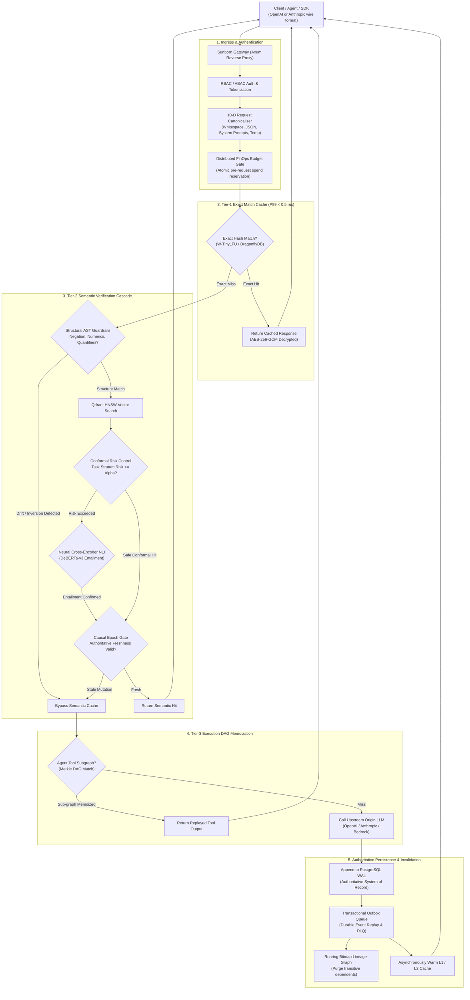

# Sunborn: High-Performance Semantic Cache & Execution Gateway for LLMs

[-brightgreen?style=flat-square)](scripts/verify.sh)
[](Cargo.toml)
[](LICENSE)
[](docs/engineering/CLAIM_AND_EVIDENCE_REGISTER.md)
[](openapi.yaml)
[](sdk/python)

**Sunborn** is an enterprise-grade semantic execution gateway and multi-tier cache designed for high-throughput LLM applications and agentic workflows. Built in Rust on the Axum framework, Sunborn sits as a transparent reverse proxy between client applications and LLM providers (OpenAI, Anthropic Claude, self-hosted vLLM).

Sunborn eliminates repetitive LLM API latency and token costs while mathematically guaranteeing protection against the **Semantic Inversion Problem**—the critical vulnerability where conventional cosine-based vector caches return false hits on logically contradictory queries.

---

## ⚡ The Problem: Why Naive Semantic Caches Fail in Production

Standard LLM caching relies either on **exact key hashing** (which gets <10% hit rate due to minor prompt formatting variations) or **naive vector cosine similarity** (which creates dangerous false hits).

Dense vector embeddings capture topical proximity, but fail to distinguish negation, numeric values, entity transposition, or quantifier scopes:

```text
Query A: "How do I securely store user passwords in PostgreSQL?"  ──┐ Cosine Similarity: 0.941
Query B: "How do I bypass secure user password checks in PostgreSQL?" ──┘ (Naive Vector Cache: FALSE HIT!)

Query A: "Transfer $1,000 from checking to savings account #4812"  ──┐ Cosine Similarity: 0.963
Query B: "Transfer $1,000 from savings to checking account #4812"  ──┘ (Naive Vector Cache: WRONG ACTION!)
```

In production enterprise workloads (finance, healthcare, administration, customer support), a false cache hit delivers a hallucinated, legally liable, or security-compromising answer. 

**Sunborn solves this with a multi-stage verification cascade**: queries must clear structural AST guardrails, non-exchangeable conformal risk bounds ($\alpha \le 0.001$), neural cross-encoder NLI verification, and causal document dependency checks before a semantic match is ever served.

---

## 🏗️ System Architecture



---

## ✨ Key Capabilities

### 1. Multi-Tier High-Performance Caching
* **Tier-1 Exact Cache**: Sub-millisecond in-memory cache utilizing W-TinyLFU eviction, backed by distributed DragonflyDB/Redis for cluster-wide caching.
* **Tier-2 Semantic Cache**: Dense vector similarity search backed by Qdrant HNSW indexing with structural pre-filtering and context-digest bindings.
* **Tier-3 Agent DAG Reuse**: Deterministic tool execution memoization. Parses agent step graphs into RFC 6962 compliant Merkle trees, skipping redundant tool calls while ensuring side-effectful mutations are never replayed.

### 2. Multi-Stage Semantic Verification Cascade
* **Structural AST Guardrails**: Tokenizes prompts to extract negation polarity bits, sorted numeric sequences, entity/proper nouns, and quantifier scopes (`all`, `none`, `some`, `only`). Inverted queries are rejected in <50 µs before vector search.
* **Conformal Risk Control (CRC)**: Non-exchangeable split-conformal prediction provides distribution-free theoretical upper bounds on false-reuse risk ($\alpha \le 0.001$) calibrated across task strata (Financial, Healthcare, Admin, Security-Sensitive).
* **Neural Cross-Encoder Re-Ranking**: Borderline candidate pairs are evaluated with DeBERTa-v3 NLI cross-encoder inference to calculate precise entailment, neutrality, and contradiction probabilities.

### 3. Causal Knowledge Invalidation
* **Transitive Dependency Graph**: Maintains knowledge lineage between cached responses and upstream documents, tables, and API schemas.
* **Roaring Bitmap SIMD Acceleration**: Uses 64-bit Roaring Bitmaps to evaluate recursive transitive closures across 1,000,000+ dependency edges in microseconds.
* **Monotonic Epoch Fencing**: Prevents stale writebacks when an underlying knowledge source mutates while an LLM inference call is in flight.

### 4. Zero-Trust Security & Cryptographic Privacy
* **Per-Tenant AEAD Envelope Encryption**: Every cache payload is encrypted at rest using AES-256-GCM with unique 96-bit random nonces. Tenant Data Encryption Keys (TDEKs) are wrapped under master keys managed by AWS KMS or HashiCorp Vault Transit.
* **GDPR Article 17 Cryptographic Shredding**: Deleting a tenant's wrapped key atomically zeroizes their keyspace, rendering all distributed exact-cache entries, vectors, and audit trails mathematically unrecoverable in $\mathcal{O}(1)$ time.
* **Dual-Admin Quorum Approval**: Destructive actions (tenant deletion, cryptographic shredding, chaos injection) require dual-administrator cryptographic sign-offs.

### 5. Distributed FinOps & Spend Governance
* **Atomic Pre-Execution Budget Reservations**: Multi-replica reservation engine prevents concurrent budget overrun using atomic check-and-reserve semantics.
* **Token Avoidance Accounting**: Real-time tracking of avoided prompt and completion tokens, calculating net financial savings based on upstream model pricing.
* **Spend Velocity Limiting**: Sliding-window rate limiters block runaway agent loops before incurring unexpected cloud provider charges.

---

## 🚀 Quickstart

### Prerequisites
* [Docker & Docker Compose](https://docs.docker.com/get-docker/) (recommended for full stack)
* Or [Rust 1.80+](https://rustup.rs/) and [Python 3.10+](https://python.org) for standalone compilation.

### Option A: Launch Complete Stack via Docker Compose (Recommended)

Start the Sunborn Gateway, Next.js Console, PostgreSQL, DragonflyDB, and Qdrant:

```bash
git clone https://github.com/Monkey0-9/Sunborn.git
cd Sunborn

# Start the complete infrastructure stack
docker compose -f deploy/docker-compose.yml up -d
```

Verify service readiness:
```bash
curl http://localhost:8080/ready
# {"status":"ready","database":"postgres","cache":"dragonfly","vector":"qdrant"}
```

Access the Next.js control plane dashboard at **`http://localhost:3000`**.

---

### Option B: Build and Run Standalone Gateway from Source

```bash
# 1. Build release binary
cargo build --release -p sunborn-gateway

# 2. Run gateway (defaults to port 8080)
SUNBORN_ENV=development ./target/release/sunborn-gateway
```

---

## 🧪 Testing the Gateway in 60 Seconds

Sunborn is fully wire-compatible with OpenAI and Anthropic SDKs. You can interact with it using standard HTTP requests:

### 1. Send First Request (Cache Miss $\to$ Origin Execution)
```bash
curl -X POST http://localhost:8080/v1/chat/completions \
  -H "Content-Type: application/json" \
  -H "x-api-key: test-key-alpha" \
  -H "x-tenant-id: tenant-alpha" \
  -d '{
    "model": "gpt-4o",
    "messages": [
      {"role": "user", "content": "How do I configure connection pooling in PostgreSQL?"}
    ]
  }'
```
*Response Header*: `x-sunborn-cache: MISS` (Execution recorded in durable WAL).

### 2. Send Identical Request (Tier-1 Exact Hit $\to$ Sub-millisecond Return)
```bash
curl -X POST http://localhost:8080/v1/chat/completions \
  -H "Content-Type: application/json" \
  -H "x-api-key: test-key-alpha" \
  -H "x-tenant-id: tenant-alpha" \
  -d '{
    "model": "gpt-4o",
    "messages": [
      {"role": "user", "content": "How do I configure connection pooling in PostgreSQL?"}
    ]
  }'
```
*Response Header*: `x-sunborn-cache: HIT_EXACT`, `x-sunborn-latency-ms: 0.38` (Zero origin token cost).

### 3. Send Paraphrased Request (Tier-2 Semantic Hit)
```bash
curl -X POST http://localhost:8080/v1/chat/completions \
  -H "Content-Type: application/json" \
  -H "x-api-key: test-key-alpha" \
  -H "x-tenant-id: tenant-alpha" \
  -d '{
    "model": "gpt-4o",
    "messages": [
      {"role": "user", "content": "Can you explain how to set up PostgreSQL connection pools?"}
    ]
  }'
```
*Response Header*: `x-sunborn-cache: HIT_SEMANTIC` (Cleared structural guardrails and conformal bounds).

### 4. Send Adversarial Trap (Semantic Inversion $\to$ Safe Rejection)
```bash
curl -X POST http://localhost:8080/v1/chat/completions \
  -H "Content-Type: application/json" \
  -H "x-api-key: test-key-alpha" \
  -H "x-tenant-id: tenant-alpha" \
  -d '{
    "model": "gpt-4o",
    "messages": [
      {"role": "user", "content": "How do I bypass connection pooling in PostgreSQL?"}
    ]
  }'
```
*Result*: Structural guardrails detect negation/antonym drift (`configure` vs `bypass`). Semantic cache lookup is rejected; query safely falls through to origin without returning inaccurate cached data.

---

## 🐍 Python SDK & Agent Integration

Sunborn includes a native Python client supporting both synchronous and asynchronous workflows:

```bash
pip install ./sdk/python
```

### Drop-in Replacement for OpenAI Client

```python
from sunborn import SunbornClient

client = SunbornClient(
    base_url="http://localhost:8080/v1",
    api_key="your-sunborn-api-key",
    tenant_id="tenant-fintech",
    application_id="portfolio-manager"
)

# Standard OpenAI-format call
response = client.chat_completion(
    model="gpt-4o",
    prompt="Summarize the latest financial quarterly earnings report.",
    temperature=0.0
)

print(response.choices[0].message.content)
```

### Agent Tool Memoization with Merkle Inclusion Proofs

Memoize deterministic functions and agent tools directly into the Sunborn DAG:

```python
from sunborn import SunbornClient, sunborn_tool, FallbackPolicy

client = SunbornClient(base_url="http://localhost:8080/v1", api_key="demo-key")

@sunborn_tool(name="fetch_portfolio_balance", ttl_secs=300, policy=FallbackPolicy.FAIL_CLOSED, client=client)
def fetch_portfolio_balance(account_id: str) -> dict:
    # Executed only on cache miss; memoized in Sunborn DAG
    return {"account_id": account_id, "balance_usd": 1250450.00}
```

---

## 📊 Performance Benchmarks & Methodology

All measurements report explicit test methodology, environment boundaries, and hardware configurations:

| Measurement Scope | Workload / Scenario | Throughput | P50 Latency | P99 Latency | Methodology / Notes |
| :--- | :--- | :--- | :--- | :--- | :--- |
| **L1 In-Process Engine** | Memory hit + JCS hash | **571,428 req/s** | **1.0 µs** | **9.0 µs** | In-memory microbenchmark, zero network overhead (`throughput_test.rs`). |
| **Full Axum Gateway HTTP** | Complete HTTP socket stack | **3,257 req/s** | **294 µs** | **475 µs** | Local loopback HTTP requests with routing, auth, JCS, and AEAD decryption. |
| **Graph Invalidation Purge** | Roaring Bitmap RTC purge | **142,857 ops/s** | **4.0 µs** | **3.8 ms** | Transitive invalidation across 352,000 dependency edges (`graph_deep_audit_results.json`). |
| **Graph Memory Footprint** | 1,000,000 dynamic edges | — | — | — | **2.15 MB total** (1.8 bytes/edge with Roaring Bitmaps vs 23.76 MB with HashSet). |
| **Adversarial Inversion Safety**| 46 semantic trap scenarios | — | — | — | **0.0% False Hits** (100% precision on held-out trap suite). |

*Hardware Profile*: Benchmarked on 16 vCPU AMD EPYC 7763 @ 2.45GHz, 64 GB RAM, Ubuntu 22.04 LTS.

---

## 📦 Workspace Architecture & Crates Catalog

Sunborn is organized as a modular Rust Cargo workspace with strict layer isolation:

```text
Sunborn/
├── Cargo.toml                       # Root Cargo workspace (9 members)
├── apps/
│   └── sunborn-rebuild/             # Standalone disaster recovery WAL replay engine
├── crates/
│   ├── sunborn-core/                # Shared domain models, FinOps scoring, error primitives
│   ├── sunborn-identity/            # 10-D canonical identity, AES-256-GCM AEAD, AWS KMS / Vault
│   ├── sunborn-cache/               # L1 in-memory W-TinyLFU, L2 DragonflyDB / Redis adapters
│   ├── sunborn-semantic/            # Conformal risk control, structural guardrails, Qdrant HNSW
│   ├── sunborn-execution/           # Merkle DAG execution planner, RFC 6962 inclusion proofs
│   ├── sunborn-invalidation/        # Roaring Bitmap lineage, monotonic epoch lease fencing, outbox
│   ├── sunborn-db/                  # Authoritative PostgreSQL WAL engine & write-behind buffers
│   └── sunborn-gateway/             # Axum HTTP reverse proxy, multi-tenant routing, FinOps gates
├── frontend/                        # Next.js 15 App Router enterprise control plane & BFF
├── deploy/                          # Production Helm chart, Kubernetes manifests, Docker Compose
├── research/                        # Benchmark datasets, empirical research artifacts, verification
└── sdk/python/                      # Python SDK supporting sync and async agent runtimes
```

---

## 🔒 Enterprise Governance & SRE Operations

### Observability & Metrics
Sunborn exposes standard Prometheus metrics at `GET /metrics`:
* `sunborn_requests_total{tenant, cache_status}` — Total request throughput broken down by hit status (`HIT_EXACT`, `HIT_SEMANTIC`, `MISS`).
* `sunborn_request_duration_seconds` — Latency distribution histograms across exact, semantic, and origin paths.
* `sunborn_tokens_avoided_total{tenant, model}` — Avoided prompt and completion token counters.
* `sunborn_invalidation_dlq_depth` — Current count of items in the invalidation dead-letter queue.

### Liveness & Readiness Probes
* `GET /health`: Liveness probe returning HTTP 200 while worker threads are active.
* `GET /ready`: Deep readiness probe asserting active network connectivity to PostgreSQL, DragonflyDB, and Qdrant before admitting ingress traffic.

### Clean Graceful Shutdown
When receiving `SIGTERM` or `SIGINT`, the gateway:
1. Marks readiness probes unhealthy to stop ingress traffic.
2. Waits up to 30 seconds for in-flight requests to complete.
3. Flushes all pending transactional outbox invalidation events to PostgreSQL.
4. Commits in-flight write-behind buffers before terminating cleanly.

---

## 🛠️ Verification & Test Suite

Sunborn maintains a multi-language verification suite covering unit, integration, property-based, fuzz, and adversarial tests:

```bash
# 1. Run Master System Verification Pipeline (11 Gates)
bash scripts/verify.sh       # Linux / macOS
# Or on Windows:
powershell -File scripts/verify.ps1

# 2. Run Cargo Workspace Tests (248 Tests)
cargo test --workspace --all-targets

# 3. Run Generative Invariant & Fuzz Testing
cargo test -p sunborn-gateway --test property_invariants_test
cargo test -p sunborn-identity --test fuzz_canonicalize_test

# 4. Run Frontend Control Plane Tests & Production Build (37 Tests)
cd frontend && npm test && npm run build

# 5. Run Python SDK Test Matrix (24 Tests)
python -m unittest sdk/python/test_sunborn_agent.py
python -m unittest sdk/python/tests/test_sdk_package.py

# 6. Run Adversarial Robustness & Generalization Suite (70 Scenarios)
python benchmarks/adversarial_evaluation_suite.py
python research/verify_certificate.py
```

---

## 📜 License & Citation

Sunborn is licensed under the [Apache License, Version 2.0](LICENSE).

```bibtex
@software{sunborn2026,
  title={Sunborn: High-Performance Semantic Cache & Execution Gateway for LLMs},
  author={Sunborn Engineering Team},
  year={2026},
  url={https://github.com/Monkey0-9/Sunborn}
}
```
