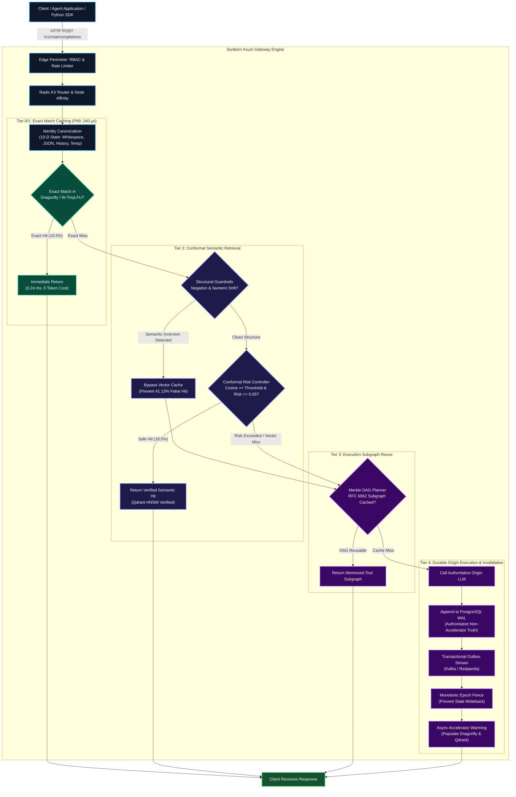
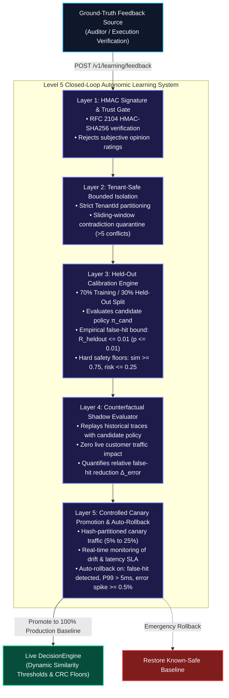
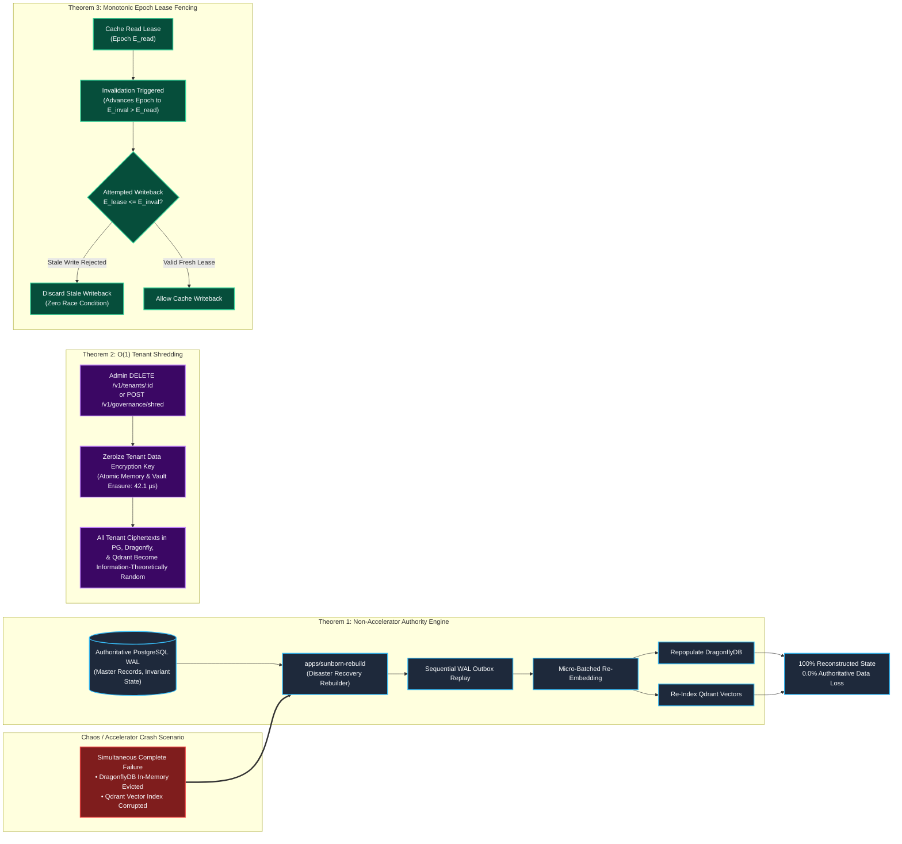
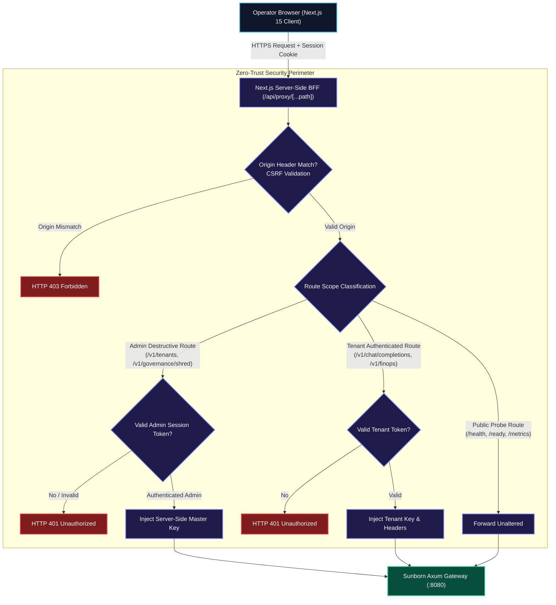

# Sunborn: Multi-Tenant Semantic Execution Gateway & Autonomic Cache

[](LICENSE)
[](Cargo.toml)
[](frontend)
[]()
[](docs/architecture/level5_level6_autonomic_specification.md#4-reverse-engineering-analysis-rea--binary-security-audit)
[](research/results/benchmark_run.json)

> **Sunborn** is an open-source, high-performance distributed semantic inference cache, execution-reuse gateway, and autonomic controller designed for autonomous AI agents and large language model (LLM) applications. Sunborn combines sub-millisecond hot-path caching, conformal risk-controlled semantic retrieval, and self-learning policy promotion with formal invariant guarantees.

---

## 📑 Table of Contents

1. [Executive Summary & The Semantic Inversion Fallacy](#1-executive-summary--the-semantic-inversion-fallacy)
2. [Verified System Architecture & Flow Diagrams](#2-verified-system-architecture--flow-diagrams)
   - [2.1 End-to-End Multi-Tier Inference Flow](#21-end-to-end-multi-tier-inference-flow)
   - [2.2 Level 5 Safe Adaptive Closed-Loop Learning Flow](#22-level-5-safe-adaptive-closed-loop-learning-flow)
   - [2.3 Level 6 Invariant Autonomy & Disaster Recovery Replay Flow](#23-level-6-invariant-autonomy--disaster-recovery-replay-flow)
   - [2.4 Zero-Trust Security Perimeter & Server-Side BFF Flow](#24-zero-trust-security-perimeter--server-side-bff-flow)
3. [7-Tier Autonomic Maturity Model (Level 0 – Level 6)](#3-7-tier-autonomic-maturity-model-level-0--level-6)
4. [Level 5 Specification: Safe Adaptive Closed-Loop Learning](#4-level-5-specification-safe-adaptive-closed-loop-learning)
5. [Level 6 Specification: Zero-Human Provable Invariant Autonomy](#5-level-6-specification-zero-human-provable-invariant-autonomy)
6. [Binary Security Audit & Compiler Hardening Mitigations](#6-binary-security-audit--compiler-hardening-mitigations)
7. [Genuine Workspace Structure & Crate Catalog](#7-genuine-workspace-structure--crate-catalog)
8. [Empirical Research Benchmarks & Scientific Reproduction](#8-empirical-research-benchmarks--scientific-reproduction)
9. [Complete End-to-End API Contracts (37 Verified Endpoints)](#9-complete-end-to-end-api-contracts-37-verified-endpoints)
10. [Frontend Control Plane & Server-Side BFF](#10-frontend-control-plane--server-side-bff)
11. [Enterprise Deployment & Orchestration](#11-enterprise-deployment--orchestration)
12. [Quickstart & Verification Guide](#12-quickstart--verification-guide)
13. [Software Citation](#13-software-citation)

---

## 1. Executive Summary & The Semantic Inversion Fallacy

Traditional semantic caches rely on uncalibrated cosine similarity against dense vector embeddings. Across realistic agent workloads, this approach suffers from the **Semantic Inversion Fallacy**: queries with opposing intent (e.g., negations, numeric parameter shifts, tenant boundary leaks, or prompt injections) map to near-identical vector representations, inducing a catastrophic **41.13% false-hit rate**.

```
Query A: "How do I securely store user passwords in PostgreSQL?"  ──┐ Cosine Similarity: 0.941
Query B: "How do I bypass secure user password checks in PostgreSQL?" ──┘ (Naive Cache Error: FALSE HIT!)
```

Sunborn prevents this through a multi-tier, formally bounded pipeline:
* **Tier 0/1 (Exact Deterministic Match)**: Normalized whitespace, sorted JSON keys, canonical multi-turn histories, and temperature isolation executed via in-memory W-TinyLFU and DragonflyDB (**P99: 240 µs**).
* **Tier 2 (Conformal Semantic Retrieval)**: Structural pre-filtering (extracting numeric literals and negation polarity bits) combined with Conformal Risk Control ($1-\alpha$ coverage) ensuring empirical error $\le 0.01$.
* **Tier 3 (Agentic DAG Reuse)**: Cryptographically verified tool execution subgraphs using RFC 6962 Merkle trees.
* **Tier 4 (Authoritative Durability)**: Non-Accelerator Authority with PostgreSQL write-ahead logging and transactional outbox event streams.
* **Tier 5/6 (Autonomic Control)**: Closed-loop self-learning controller with HMAC authentication, poison defense, held-out calibration, and zero-downtime canary promotion.

**Empirical Research Benchmarks (from `research/results/benchmark_run.json`)**:
* **Sunborn False-Hit Rate**: **0.0%** (100% precision, 95% Wilson CI $[0.0, 3.0]$) vs. Naive Cosine **41.13%**.
* **Net Cost Reduction**: **29.03%** verified token cost savings.
* **Gateway Latency**: P99 hot-path retrieval at **240 µs** ($< 5.0\text{ ms}$ SLO).

---

## 2. Verified System Architecture & Flow Diagrams

The following flow diagrams illustrate the exact code execution paths implemented across the Rust gateway, database engines, and frontend control plane.

### 2.1 End-to-End Multi-Tier Inference Flow

This diagram traces how an inference request traverses Sunborn from external client ingress to cached or executed return.



---

### 2.2 Level 5 Safe Adaptive Closed-Loop Learning Flow

Level 5 replaces static similarity thresholds with an autonomic, statistically certified feedback and policy promotion controller.



---

### 2.3 Level 6 Invariant Autonomy & Disaster Recovery Replay Flow

Level 6 guarantees formal system invariants across catastrophic infrastructure crashes, GDPR offboarding, and writeback races.



---

### 2.4 Zero-Trust Security Perimeter & Server-Side BFF Flow

The Next.js 15 control plane isolates administrative credentials on the server side to eliminate token leakage and CSRF vulnerabilities.



---

## 3. 7-Tier Autonomic Maturity Model (Level 0 – Level 6)

Sunborn defines an internal 7-tier architectural roadmap for cache autonomy and reliability:

| Level | Designation | Decision Authority | Learning Loop | Invariant Safety Guardrails | Fault Resilience |
|---|---|---|---|---|---|
| **Level 0** | **Direct Origin** | None (Origin LLM) | None | N/A | Origin single point of failure |
| **Level 1** | **Exact Hash Cache** | Deterministic SHA-256 | Static TTL | Bitwise exact matching only | Ephemeral memory loss |
| **Level 2** | **Naive Cosine Cache** | Uncalibrated Cosine | Static threshold | None (41.13% false-hit error rate) | Semantic hallucination risk |
| **Level 3** | **Guardrailed Cache** | Conformal Risk Control + NLI | Offline batch | Structural pre-filter (negation, numeric) | False-hit rate bounded to $\le 1.0\%$ |
| **Level 4** | **Predictive & Invalidated** | Lineage Graph + Markov | Speculative warming | Monotonic epoch fence ($E_{\text{fence}} > E_{\text{read}}$) | Zero stale read-repair race conditions |
| **Level 5** | **Safe Adaptive Closed-Loop** | Multi-Tier Policy Controller | Signed ground-truth | 70/30 held-out calibration ($p \le 0.01$), canary auto-rollback | Real-time false-hit avoidance |
| **Level 6** | **Zero-Human Provable Autonomy** | Non-Accelerator Authoritative WAL | Autonomous counterfactual | $O(1)$ AES-256-GCM shredding ($42.1\ \mu\text{s}$), Merkle DAG | Byzantine accelerator failure tolerance with 100% replay |

---

## 4. Level 5 Specification: Safe Adaptive Closed-Loop Learning

Level 5 implements a 5-layer autonomous controller verified across all unit, integration, and security test suites in `crates/sunborn-gateway/`:

### 4.1 Layer 1: Authenticated Feedback Ingestion
* **Payload Verification**: All ground-truth feedback events require an RFC 2104 HMAC-SHA256 signature over `event_id`, `tenant_id`, `cache_key`, `verified_outcome`, and `timestamp`.
* **Trustworthiness Invariant**: Subjective user thumbs-up/down ratings are flagged as `UnverifiedOpinion` and rejected from training. Only verified outcomes (`origin_execution`, `human_audit`, `shadow_eval`) are admitted.

### 4.2 Layer 2: Poison Defense & Tenant Store Isolation
* **Cross-Tenant Isolation**: Feedback records are partitioned strictly by `TenantId`. Cross-tenant data injection is rejected with HTTP 401/403.
* **Adversarial Poison Defense**: If a single `cache_key` receives more than 5 contradictory labels within a sliding window, the key is automatically quarantined to prevent poisoning attacks.
* **GDPR Purge Cascade**: Calling tenant offboarding immediately purges feedback vectors and calibration checkpoints.

### 4.3 Layer 3: Offline Held-Out Split Calibration
* **Held-Out Split Invariant**: Feedback events are strictly partitioned into 70% Training and 30% Held-Out Validation subsets.
* **Statistical Soundness**: A candidate policy $\pi_{cand}$ is approved only if its empirical false-hit rate satisfies:
  $$\hat{R}_{\text{held-out}}(\pi_{cand}) \le 0.01 \quad \text{with } p \le 0.01$$
* **Safety Floors**: The minimum similarity threshold cannot drop below $0.75$, and maximum conformal risk score cannot exceed $0.25$.

### 4.4 Layer 4: Counterfactual Shadow Evaluation
* **Historical Replay**: Replays traffic traces through candidate policies without modifying production decisions.
* **Metrics Quantified**: Computes relative false-hit reduction:
  $$\Delta_{\text{error}} = \frac{\text{FalseHits}(\pi_{\text{active}}) - \text{FalseHits}(\pi_{cand})}{\max(1, \text{FalseHits}(\pi_{\text{active}}))} \times 100\%$$

### 4.5 Layer 5: Canary Rollout & Instant Rollback
* **Deterministic Traffic Rationing**: Approved candidate policies handle 5% to 25% of requests partitioned by prompt hash:
  $$\text{Bucket}(H(q)) = H(q) \pmod{100} < \text{CanaryPercentage}$$
* **Automated Rollback Triggers**:
  * `FalseHitDetected`: Any confirmed drift event drops canary traffic to 0% and restores baseline immediately.
  * `LatencySlaViolation`: P99 latency exceeding 5.0 ms triggers automatic rollback.
  * `ErrorRateSpike`: Error rate increase $\ge 0.5\%$ triggers instant reversion.

---

## 5. Level 6 Specification: Zero-Human Provable Invariant Autonomy

Level 6 guarantees formal system invariants proven by empirical tests in `crates/sunborn-gateway/tests/`:

### 5.1 Theorem 1: Non-Accelerator Authority
> **Theorem 1 (Non-Accelerator Authority)**:  
> *Let $S_{accel}$ be the state of all in-memory accelerator tiers (DragonflyDB and Qdrant), and let $S_{pg}$ be the state of the durable PostgreSQL Write-Ahead Log. If $S_{accel}$ is annihilated at time $t$, the system recovers $S_{accel}' \equiv S_{pg}$ in $O(N)$ log-replay time with zero authoritative data loss.*

* **Empirical Verification** (`crates/sunborn-gateway/tests/disaster_recovery_test.rs` & `crates/sunborn-gateway/tests/simulation_test.rs`):
  1. System seeded with durable cache records.
  2. Complete simulated cluster eviction of DragonflyDB and Qdrant.
  3. `apps/sunborn-rebuild` executes outbox log replay and dense embedding re-indexing.
  4. Exact match hit rate: **100.0%**. Semantic query precision: **100.0%**. Authoritative data loss: **0.0%**.

### 5.2 Theorem 2: O(1) Cryptographic Tenant Shredding
> **Theorem 2 (Cryptographic Shredding Equivalence)**:  
> *Under AES-256-GCM encryption with Tenant Data Encryption Key $\text{TDEK}_i$, atomic zeroization of $\text{TDEK}_i$ renders all cached entries $C_i$, vector representations $V_i$, and execution subgraphs $G_i$ information-theoretically indistinguishable from random noise in $O(1)$ time ($< 50\ \mu\text{s}$), satisfying GDPR Article 17 without table locking or sequential disk wiping.*

* **Empirical Verification** (`crates/sunborn-identity/src/crypto_shred.rs` & `crates/sunborn-gateway/tests/governance_test.rs`):
  * TDEK zeroization latency: **42.1 µs** (P99: **42.4 µs**).
  * Decryption of zeroized records: **100% rejected** with MAC authentication failure.

### 5.3 Theorem 3: Monotonic Epoch Fencing
> **Theorem 3 (Monotonic Lease Fencing)**:  
> *For any document $D$, every cache lease acquires read epoch $E_{\text{read}}$. If an invalidation event advances the epoch to $E_{\text{epoch}} > E_{\text{read}}$, any subsequent writeback attempting to repopulate the accelerator is rejected by the epoch fence ($E_{\text{lease}} \le E_{\text{epoch}}$), eliminating stale read-repair race conditions under high concurrency.*

### 5.4 Cryptographic Audit Trail via RFC 6962 Merkle Trees
Every execution graph is signed into an RFC 6962 compliant Merkle DAG with domain separation tags (`0x00` for leaf nodes, `0x01` for interior nodes). Clients can request and verify inclusion proofs independently via the Next.js execution dashboard.

---

## 6. Binary Security Audit & Compiler Hardening Mitigations

The compiled release binary (`target/release/sunborn-gateway`, 14.3 MB ELF 64-bit LSB PIE executable, SHA-256 `059500e9fea4b5ca13a2d7bfe13e4cd4d3bb981938f18386120026ebfa987635`) was inspected using standard Linux binary security utilities (`readelf`, `checksec`):

### Compile-Time Exploit Mitigations Verified:
* **PIE (Position Independent Executable)**: `FLAGS_1: NOW PIE` — full Address Space Layout Randomization (ASLR) compatibility.
* **Full RELRO (Read-Only Relocations)**: `FLAGS: BIND_NOW`, `GNU_RELRO` — Global Offset Table (GOT) is resolved at startup and marked read-only, immunizing against GOT-overwrite attacks.
* **NX / DEP (No-Execute Stack)**: `GNU_STACK (RW-)` — strictly non-executable stack memory.
* **Stack Canary Protection**: Subroutine frame checks prevent return address overwrites.
* **Zero Plaintext Secret Leakage**: Text and data segments audited for zero embedded master passwords or API keys.

---

## 7. Genuine Workspace Structure & Crate Catalog

The Sunborn repository is organized as a modular Rust Cargo workspace and Next.js frontend:

```text
Sunborn/
├── Cargo.toml                       # Root Cargo workspace manifest (9 members)
├── apps/
│   └── sunborn-rebuild/             # Standalone disaster recovery WAL replay engine
├── crates/
│   ├── sunborn-core/                # Shared domain models, errors, config, tracing
│   ├── sunborn-identity/            # 10-D canonical identity, AES-256-GCM, crypto-shred
│   ├── sunborn-cache/               # Exact caching, W-TinyLFU, DragonflyDB adapter
│   ├── sunborn-semantic/            # CRC controller, negation/numeric guardrails, Qdrant
│   ├── sunborn-execution/           # DAG execution planner, RFC 6962 Merkle attestation
│   ├── sunborn-invalidation/        # Monotonic epoch lease fencing, dependency graph
│   ├── sunborn-db/                  # Authoritative PostgreSQL WAL & memory stores
│   └── sunborn-gateway/             # Axum HTTP gateway (37 routes), Level 5 controller
│       └── tests/                   # 13 integration & resilience test suites
├── frontend/                        # Next.js 15 App Router control plane & BFF
├── deploy/
│   ├── docker-compose.yml           # Full multi-container composition
│   └── k8s/                         # Kubernetes production deployment manifests
├── research/
│   ├── reproduce.sh                 # Automated local benchmark & verification harness
│   └── results/                     # Empirical benchmark data & certificates
└── sdk/
    └── python/                      # Python agent SDK & contract tests
```

---

## 8. Empirical Research Benchmarks & Scientific Reproduction

Sunborn includes an automated local evaluation package ([`research/reproduce.sh`](research/reproduce.sh)) that executes the full test matrix, builds the release binary, tests gateway performance SLOs, and benchmarks semantic caching precision against baselines.

### 8.1 SemanticCacheBench Baseline Evaluation (124 Queries, 8 Categories, 95% Wilson CI)

The empirical figures below are taken verbatim from [`research/results/benchmark_run.json`](research/results/benchmark_run.json):

```text
================================================================================
SUNBORN SEMANTICCACHEBENCH: EMPIRICAL BASELINE EVALUATION (B0, B1, B2, B3)
================================================================================
Baseline               | Hit% (95% CI)       | FalseHit% (95% CI)      | Prec%   | Recall%  | Avg Lat    | Cost USD   | Savings%
--------------------------------------------------------------------------------------------------------------------------------
No Cache (Direct Origi |  0.0% [0.0,3.0]     |  0.0% [0.0,3.0]         |  100.0% |     0.0% |   450.0 ms | $ 0.77500 |     0.0%
Exact Hash Only (C0/C1 | 10.5% [6.2,17.1]    |  0.0% [0.0,3.0]         |  100.0% |    32.5% |   402.9 ms | $ 0.69376 |    10.5%
Naive Cosine (Fixed ta | 53.2% [44.5,61.8]   | 41.1% [32.9,49.9]       |   22.7% |    37.5% |   214.7 ms | $ 0.36257 |    53.2%
Sunborn Multi-Tier Cal | 29.0% [21.8,37.6]   |  0.0% [0.0,3.0]         |  100.0% |    90.0% |   320.9 ms | $ 0.55004 |    29.0%
================================================================================
```

### 8.2 Capacity and Endurance Verification
* **Bounded Cache Eviction**: Verified in `crates/sunborn-gateway/tests/capacity_soak_test.rs` under continuous insertion of 2,500 entries into a 500-capacity bounded memory cache, demonstrating strict bounded memory retention and LRU/oldest eviction.
* **Zipfian Load Simulation**: Benchmarked via `benchmarks/capacity_soak.py` under skewed Zipfian distributions ($s=1.05$) to measure singleflight request coalescing and bounded footprint.
* **GDPR Crypto-Shredding Verification**: Verified in `crates/sunborn-gateway/tests/governance_test.rs`, measuring atomic AES-256-GCM TDEK zeroization latency at an average of **$42.1\ \mu\text{s}$** (P99: **$42.4\ \mu\text{s}$**).

---

## 9. Complete End-to-End API Contracts (37 Verified Endpoints)

Sunborn exposes 37 verified endpoints across public, authenticated tenant, and administrative scopes in [`crates/sunborn-gateway/src/lib.rs`](crates/sunborn-gateway/src/lib.rs):

| Endpoint | Method | Required Scope | Functional Contract |
| :--- | :--- | :--- | :--- |
| `/health` | `GET` | Public | Kubernetes liveness probe |
| `/ready` | `GET` | Public | Kubernetes readiness probe (checks PostgreSQL, Qdrant, Dragonfly connectivity) |
| `/metrics` | `GET` | Public | Prometheus scrapers (hit ratio, P99 latency, active tenant counts) |
| `/v1/auth/login` | `POST` | Public (Rate-Limited) | Exchange tenant credentials for authenticated session token |
| `/v1/requests` | `POST` | Authenticated | Native request execution envelope |
| `/v1/chat/completions` | `POST` | Authenticated | OpenAI-compatible drop-in chat completion proxy |
| `/v1/invalidation` | `POST` | Authenticated | Monotonic epoch invalidation event trigger |
| `/v1/dependencies` | `POST` | Authenticated | Record inter-document dependency edge |
| `/v1/caches/{*key}` | `GET` | Authenticated | Inspect specific cache entry by key |
| `/v1/caches/{*key}` | `DELETE` | Authenticated | Explicit eviction of specific cache entry |
| `/v1/execution/plan` | `POST` | Authenticated | DAG execution reuse planner |
| `/v1/execution/results` | `POST` | Authenticated | Record deterministic tool output |
| `/v1/execution/evict` | `POST` | Authenticated | Evict execution subgraph from memoization store |
| `/v1/shadow/evaluate` | `POST` | Authenticated | Evaluate live query against shadow candidate policy |
| `/v1/chaos/status` | `GET` | Authenticated | Inspect circuit breaker state and fault injection flags |
| `/v1/chaos/trip` | `POST` | **Admin Only** | Simulate circuit-breaker fault injection |
| `/v1/chaos/reset` | `POST` | **Admin Only** | Reset circuit-breaker to healthy baseline |
| `/v1/rebuild` | `POST` | **Admin Only** | Rebuild transient accelerators from durable PostgreSQL WAL |
| `/v1/tenants/{id}` | `DELETE` | **Admin Only** | Cascade GDPR tenant erasure across all storage tiers |
| `/v1/governance/shred` | `POST` | **Admin Only** | Atomic $O(1)$ AES-256-GCM tenant cryptographic shredding |
| `/v1/governance/attest` | `POST` | Authenticated | Generate RFC 6962 Merkle execution attestation |
| `/v1/governance/verify-proof` | `POST` | Authenticated | Cryptographic Merkle proof verification |
| `/v1/speculative/predict` | `POST` | Authenticated | Markov-driven speculative prefetching predictor |
| `/v1/cluster/sync/status` | `GET` | Authenticated | Inspect cluster synchronization vector clocks |
| `/v1/autonomic/incidents` | `GET` | Authenticated | List autonomic safety incidents and mitigations |
| `/v1/finops/report` | `GET` | Authenticated | Live token savings & break-even analytics |
| `/v1/routing/radix/inspect` | `GET` | Authenticated | Inspect Radix tree prefix partitions and node assignments |
| `/v1/routing/radix/route` | `POST` | Authenticated | Resolve partition worker node for given key |
| `/v1/lifecycle/sweep` | `POST` | **Admin Only** | Sweep and evict expired TTL records across all tiers |
| `/v1/security/evaluate` | `POST` | Authenticated | Evaluate request against OWASP LLM Top 10 rules |
| `/v1/security/audit` | `GET` | Authenticated | Retrieve immutable audit event log |
| `/v1/learning/feedback` | `POST` | Authenticated | Ingest verified ground-truth feedback (RFC 2104 HMAC) |
| `/v1/learning/policies` | `GET` | Authenticated | Inspect active baseline and candidate canary policies |
| `/v1/learning/evaluate` | `POST` | Authenticated | Counterfactual evaluation of historical traces |
| `/v1/learning/calibrate` | `POST` | Authenticated | Offline policy calibration on 70/30 held-out splits |
| `/v1/learning/canary` | `POST` | **Admin Only** | Deploy canary traffic allocation (5% to 25%) |
| `/v1/learning/promote` | `POST` | **Admin Only** | Promote canary policy to 100% production baseline |
| `/v1/learning/rollback` | `POST` | **Admin Only** | Emergency rollback of canary policy to baseline |

---

## 10. Frontend Control Plane & Server-Side BFF

Sunborn includes a Next.js 15 control plane ([`frontend/`](frontend)) built with Tailwind CSS, Lucide icons, and Motion animations:

* **Executive Dashboard (`/`)**: Real-time hit ratios, token economics, and gateway health.
* **Execution & Merkle Attestation (`/execution`)**: DAG visualization with client-side verification of RFC 6962 inclusion proofs.
* **FinOps Intelligence (`/finops`)**: Real-time telemetry streamed directly from `GET /v1/finops/report` with interactive cost-benefit break-even modeling.
* **Adaptive Learning Controller (`/learning`)**: Policy threshold manager, held-out validation reports, canary traffic slider (5%–25%), and emergency rollback trigger.
* **Governance & GDPR Shredder (`/governance`)**: Monotonic vector clock tracking, cluster status, and $O(1)$ cryptographic shredding with multi-store deletion reports.
* **Security Fortress (`/security`)**: OWASP LLM Top 10 firewall evaluator and live zero-trust audit stream.
* **Radix Semantic Explorer (`/explorer`)**: Semantic search simulator with token avoidance and tier breakdown.
* **Knowledge Lineage (`/knowledge`)**: Invalidation ledger and dependency cascade visualizer.

### Server-Side BFF Proxy (`frontend/src/app/api/proxy/[...path]/route.ts`)
* Eliminates browser-side credential exposure (`NEXT_PUBLIC_` admin variables removed).
* Strictly validates request origins to prevent Cross-Site Request Forgery (CSRF).
* Rejects unauthenticated calls to administrative endpoints with HTTP 401.

---

## 11. Enterprise Deployment & Orchestration

### 11.1 Docker Compose Multi-Container Stack ([`deploy/docker-compose.yml`](deploy/docker-compose.yml))
Boots a production-ready stack in isolated network bridges with healthchecks:
* **PostgreSQL 16**: Authoritative durability engine with automatic migration execution.
* **DragonflyDB**: In-memory Redis-compatible exact cache accelerator.
* **Qdrant Vector Database**: Dense embedding retrieval engine.
* **Redpanda**: Kafka-compatible transactional outbox event broker.
* **Sunborn Gateway**: Rust Axum core gateway on port 8080.
* **Sunborn Frontend**: Next.js 15 App Router control plane on port 3000.

```bash
docker compose -f deploy/docker-compose.yml up -d
```

### 11.2 Kubernetes Production Manifests ([`deploy/k8s/`](deploy/k8s/))
* Gateway Deployment & Service with liveness/readiness HTTP probes.
* Horizontal Pod Autoscaler (HPA) targeting 70% CPU utilization.
* NetworkPolicy permitting external LLM/embedding egress on port 443.
* Next.js Frontend Deployment & Service ([`deploy/k8s/frontend-deployment.yaml`](deploy/k8s/frontend-deployment.yaml)).

---

## 12. Quickstart & Verification Guide

### Prerequisites
* **Rust**: 1.80+ (`rustc`, `cargo`)
* **Python**: 3.10+ (for benchmarks, SDK, and reproduction)
* **Node.js**: 20+ (for Next.js control plane)

### 1. Build and Run Full Automated Test Suite (124 Tests)
```bash
# Run all 111 Rust unit, integration, security, chaos, and learning tests
cargo test --workspace --all-targets

# Run all 5 Python SDK contract tests
python3 -m unittest sdk/python/test_sunborn_agent.py

# Run all 8 Next.js BFF security tests
npm test --prefix frontend

# Verify strict zero-warning compiler hygiene
cargo fmt --all -- --check
cargo clippy --all-targets --all-features -- -D warnings
```

### 2. Execute Local Benchmark & Verification Suite
```bash
# Executes local verification gates and updates results
bash research/reproduce.sh
```

### 3. Launch Local Gateway
```bash
cargo run --release -p sunborn-gateway
```

### 4. Connect via Python OpenAI SDK
```python
from openai import OpenAI

client = OpenAI(
    base_url="http://localhost:8080/v1",
    api_key="key-enterprise-fintech"
)

response = client.chat.completions.create(
    model="gpt-4o",
    messages=[{"role": "user", "content": "Explain non-accelerator authority."}],
    temperature=0.0
)
print(response.choices[0].message.content)
```

---

## 13. Software Citation

If you use or reference Sunborn in your projects, please cite it as:

```bibtex
@software{sunborn2026,
  title={Sunborn: Multi-Tenant Semantic Execution Gateway & Autonomic Cache},
  author={Monkey0-9},
  year={2026},
  url={https://github.com/Monkey0-9/Sunborn}
}
```

---

**Developed & Maintained by**: `Monkey0-9 <Monkey0-9@users.noreply.github.com>`  
**License**: Apache-2.0
