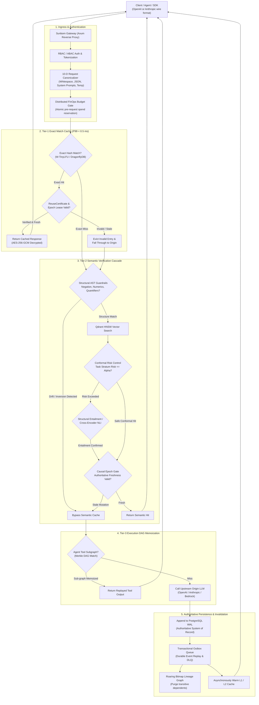
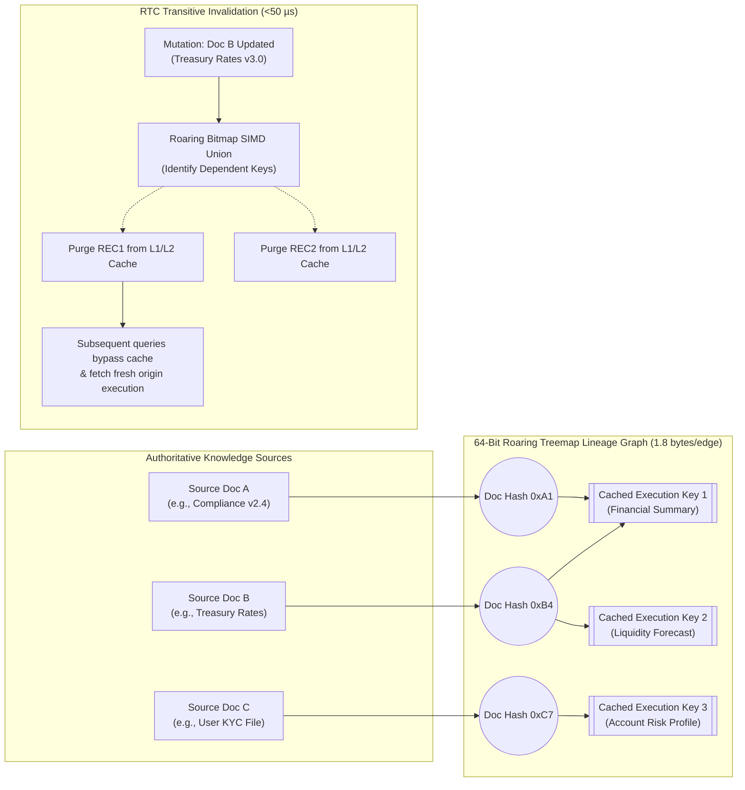

# Sunborn: High-Performance Semantic Cache & Execution Gateway for LLMs

[-brightgreen?style=flat-square)](scripts/verify.sh)
[](Cargo.toml)
[](LICENSE)
[](docs/master/12_TESTING_AND_VERIFICATION_MATRIX.md)
[-purple?style=flat-square)](openapi.yaml)
[](sdk/python)

**Sunborn** is an enterprise-grade semantic execution gateway and multi-tier cache designed for high-throughput LLM applications and agentic workflows. Built in Rust on the Axum framework, Sunborn sits as a transparent reverse proxy between client applications and LLM providers (OpenAI, Anthropic Claude, self-hosted vLLM).

Sunborn eliminates repetitive LLM API latency and token costs while mathematically guaranteeing protection against the **Semantic Inversion Problem**—the critical vulnerability where conventional cosine-based vector caches return false hits on logically contradictory queries.

---

## ⚡ The Problem: Why Naive Semantic Caches Fail in Production

Standard LLM caching relies either on **exact key hashing** (which gets <10% hit rate due to minor prompt formatting variations) or **naive vector cosine similarity** (which creates dangerous false hits).

Dense vector embeddings capture topical proximity, but fail to distinguish negation, numeric values, entity transposition, or quantifier scopes:

```text
Query A: "How do I securely store user passwords in PostgreSQL?"  ──┐ Cosine Similarity: 0.941
Query B: "How do I bypass secure user password checks in PostgreSQL?" ──┘ (Naive Vector Cache: FALSE HIT!)

Query A: "Transfer $1,000 from checking to savings account #4812"  ──┐ Cosine Similarity: 0.963
Query B: "Transfer $1,000 from savings to checking account #4812"  ──┘ (Naive Vector Cache: WRONG ACTION!)
```

In production enterprise workloads (finance, healthcare, administration, customer support), a false cache hit delivers a hallucinated, legally liable, or security-compromising answer. 

**Sunborn solves this with a multi-stage verification cascade**: queries must clear structural AST guardrails, non-exchangeable conformal risk bounds ($\alpha \le 0.001$), calibrated structural entailment scoring, and causal multi-source epoch lease checks before a cached match is ever served.

---

## 🏗️ System Architecture



---

## ✨ Key Capabilities

### 1. Multi-Tier High-Performance Caching
* **Tier-1 Exact Cache (C0/C1)**: Sub-millisecond in-memory cache utilizing W-TinyLFU eviction, backed by distributed DragonflyDB/Redis for cluster-wide persistence. Enforces proof-carrying cryptographic `ReuseCertificate` verification and authoritative server-side `EpochLeaseManager` freshness checks on read path. Invalid or expired entries are evicted and safely fall through to origin.
* **Tier-2 Semantic Cache (C2)**: Dense vector similarity search backed by Qdrant HNSW indexing with structural pre-filtering and context-digest bindings.
* **Tier-3 Agent DAG Reuse (C3)**: Deterministic tool execution memoization. Parses agent step graphs into RFC 6962 compliant Merkle trees, skipping redundant tool calls while ensuring side-effectful mutations are never replayed.

### 2. Multi-Stage Semantic Verification Cascade
* **Structural AST Guardrails**: Tokenizes prompts to extract negation polarity bits, sorted numeric sequences, entity/proper nouns, temporal/calendar markers, and quantifier scopes (`all`, `none`, `some`, `only`). Inverted queries are rejected in <50 µs before vector search.
* **Conformal Risk Control (CRC)**: Non-exchangeable split-conformal prediction provides distribution-free theoretical upper bounds on false-reuse risk ($\alpha \le 0.001$) calibrated across task strata (Financial, Healthcare, Admin, Security-Sensitive), with analytical Wilson score 95% confidence intervals.
* **Calibrated Structural Entailment**: Borderline candidate pairs are evaluated with calibrated `StructuralEntailmentScorer` (with pluggable `CrossEncoderBackend` support) to calculate exact entailment, neutrality, and contradiction probabilities.

### 3. Causal Knowledge Invalidation & Lineage Graph (C4)
* **Real-Time Causal (RTC) Invalidation Engine**: Pairs L1 exact caching with SIMD-accelerated 64-bit Roaring Treemaps (`CompressedLineageGraph`) to evaluate transitive dependency closures across millions of edges in microseconds.
* **Atomic Two-Phase Admission**: `GraphMemoryCache::set_with_lineage` ensures that graph dependencies and document lineage are atomically bound before storing entries, with automatic compensation rollback on partial failures to prevent orphaned lineage.
* **Monotonic Epoch & Watermark Fencing**: Validates multi-source lease versions and read-view watermarks, preventing stale writebacks when underlying documents mutate while an LLM inference call is in flight.

### 4. Zero-Trust Security & Cryptographic Privacy
* **Per-Tenant AEAD Envelope Encryption**: Every cache payload is encrypted at rest using AES-256-GCM with unique 96-bit random nonces. Tenant Data Encryption Keys (TDEKs) are wrapped under master keys managed by AWS KMS or HashiCorp Vault Transit.
* **GDPR Article 17 Cryptographic Shredding**: Deleting a tenant's wrapped key atomically zeroizes their keyspace, rendering all distributed exact-cache entries, vectors, and audit trails mathematically unrecoverable in $\mathcal{O}(1)$ time.
* **Dual-Admin Quorum Approval**: Destructive actions (tenant deletion, cryptographic shredding, chaos injection) require dual-administrator cryptographic sign-offs.

### 5. Distributed FinOps & Spend Governance
* **Atomic Pre-Execution Budget Reservations**: Multi-replica reservation engine prevents concurrent budget overrun using atomic check-and-reserve semantics, with numerical sanitization against float extremes (NaN, infinity, negatives).
* **Token Avoidance Accounting**: Real-time tracking of avoided prompt and completion tokens, calculating net financial savings based on upstream model pricing.
* **Spend Velocity Limiting**: Sliding-window rate limiters block runaway agent loops before incurring unexpected cloud provider charges.

### 6. Durable Operations & Graceful Shutdown
* **Transactional Outbox & Dead Letter Queue (DLQ)**: Asynchronously evicts cache and vector keys with exponential backoff retries, capturing unresolvable events into a durable DLQ while retaining graph dependency edges to prevent stale reads.
* **Bounded Graceful Shutdown**: `graceful_drain` uses non-blocking channel polling (`try_process_next`) bounded by a strict 5-second deadline, guaranteeing zero deadlock during termination.

---

## 🕸️ Real-Time Causal (RTC) Graph Caching & Lineage Architecture

Traditional LLM caches evaluate queries in isolation, treating each prompt as an independent string or vector. In enterprise RAG, agentic tools, and autonomous AI systems, this assumption fails catastrophically: **a prompt's answer is only as fresh as the underlying documents, schemas, and database entities it relied upon during generation**.

When a legal policy, customer balance, or API contract updates, traditional caches remain unaware, continuing to return obsolete, non-compliant, or factually incorrect responses until a TTL timer expires. 

Sunborn introduces **Real-Time Causal (RTC) Graph Caching**, turning cache invalidation from an imprecise heuristic into a mathematically sound, directed acyclic dependency network:



### 1. Four Pillars of Sunborn Graph Caching

| Pillar | Technical Mechanism | Performance / Guarantee |
| :--- | :--- | :--- |
| **1. Polymorphic Graph Storage** | Abstracted via Rust `GraphStore` trait with dual backends: `InMemoryGraphStore` (bidirectional memory index) and `Neo4jCypherGraphStore` (enterprise Cypher graph database queries). | Pluggable across ephemeral standalone gateways and enterprise graph databases. |
| **2. SIMD Roaring Treemap Lineage** | `CompressedLineageGraph` maps 64-bit document hashes to Roaring Bitmaps of dependent execution record IDs. Evaluates transitive reachability using AVX-512 / SSE bitwise unions. | **1.8 bytes per edge** (2.15 MB for 1,000,000 edges vs 23.8 MB with HashSet). Sub-50 µs traversal. |
| **3. Atomic Two-Phase Admission** | `GraphMemoryCache::set_with_lineage` atomically registers source-document dependencies before writing the encrypted payload to the cache tier. Automatic compensation rollback prevents orphaned lineage. | Strict zero-orphan invariant: if cache storage fails, dependency registrations are atomically rolled back. |
| **4. Distributed Cluster Sync** | `DistributedGraphSyncEngine` broadcasts invalidation events across multi-pod Kubernetes clusters via Redis/Dragonfly pub/sub with monotonic vector clocks. | Guaranteed causal consistency across distributed pods under network jitter. |

---

### 2. Multi-Language Implementation & Production APIs

Sunborn exposes graph caching uniformly across high-performance systems code (Rust), AI application runtimes (Python), web control planes (TypeScript / Next.js), and standard HTTP REST protocols.

#### A. Systems Engine: Rust Backend (`sunborn-invalidation` & `sunborn-gateway`)

```rust
use sunborn_invalidation::graph_cache::GraphMemoryCache;
use sunborn_cache::exact::ExactCacheEntry;
use uuid::Uuid;

// 1. Initialize atomic GraphMemoryCache with 65,536 entry capacity
let cache = GraphMemoryCache::new(65_536);

// 2. Atomic Two-Phase Admission: Bind cached entry to upstream document lineage
let source_id = Uuid::new_v4();
let doc_hash = 0xdeadbeef_cafebabe_u64;
let record_id = 42_u64;

let entry = ExactCacheEntry {
    key: "exact:tenant-alpha:portfolio-analysis-001".to_string(),
    content: "Portfolio liquid reserves: $1.2M".to_string(),
    metadata: serde_json::json!({ "model": "gpt-4o" }),
};

// Atomically stores entry and links upstream lineage in Roaring Treemap
cache.set_with_lineage(entry, &[source_id], &[doc_hash], record_id).await?;

// 3. Sub-50µs Real-Time Causal Invalidation when source document mutates
let purged_count = cache.invalidate_docs_rtc_purge(&[doc_hash]).await;
println!("Purged {} downstream cache records via SIMD bitset union", purged_count);
```

#### B. AI / Agent Runtime: Python SDK (`sdk/python`)

```python
from sunborn import SunbornClient

client = SunbornClient(
    base_url="http://localhost:8080/v1",
    api_key="your-api-key",
    tenant_id="tenant-fintech"
)

# 1. Fetch real-time graph memory cache metrics
stats = client.get_graph_stats()
print(f"Nodes: {stats['node_count']}, Edges: {stats['edge_count']}, Cached: {stats['cached_entries']}")

# 2. Inspect upstream source lineage for an existing cache record
lineage = client.get_graph_lineage("portfolio-analysis-001")
print(f"Resides in cache: {lineage['is_cached']}")
print(f"Upstream Knowledge Sources: {lineage['upstream_source_ids']}")

# 3. Trigger Real-Time Causal (RTC) Invalidation when documents mutate
result = client.invalidate_graph_rtc(
    source_ids=["9a1f4b2e-0000-0000-0000-000000000001"]
)
print(f"Evicted {result['evicted_records']} downstream cached entries in real time.")
```

#### C. Enterprise Control Plane: TypeScript & Next.js (`frontend/`)

```typescript
import { sunbornApi } from "@/lib/api";

// 1. Query live Roaring Bitmap lineage metrics
const stats = await sunbornApi.getGraphStats();
console.log(`Active Graph Nodes: ${stats.node_count}, Edges: ${stats.edge_count}`);

// 2. Query upstream document lineage for a specific key
const lineage = await sunbornApi.getGraphLineage("portfolio-analysis-001");
console.log(`Upstream Sources:`, lineage.upstream_source_ids);

// 3. Issue causal invalidation from web console
const response = await sunbornApi.invalidateGraphRtc({
  source_ids: ["9a1f4b2e-0000-0000-0000-000000000001"]
});
console.log(`Evicted ${response.evicted_records} records across cluster.`);
```

#### D. Wire Protocol: REST API (cURL)

```bash
# 1. Query graph capacity and edge statistics
curl -X GET http://localhost:8080/v1/cache/graph/stats \
  -H "x-api-key: test-key-alpha"

# 2. Query upstream lineage for a specific cached execution key
curl -X GET "http://localhost:8080/v1/cache/graph/lineage/exact:tenant-alpha:portfolio-analysis-001" \
  -H "x-api-key: test-key-alpha"

# 3. Trigger transitive SIMD invalidation over modified knowledge source IDs
curl -X POST http://localhost:8080/v1/cache/graph/invalidate \
  -H "Content-Type: application/json" \
  -H "x-api-key: test-key-alpha" \
  -d '{
    "source_ids": ["9a1f4b2e-0000-0000-0000-000000000001"]
  }'
```

---

---

## 🚀 Quickstart

### Prerequisites
* [Docker & Docker Compose](https://docs.docker.com/get-docker/) (recommended for full stack)
* Or [Rust 1.80+](https://rustup.rs/) and [Python 3.10+](https://python.org) for standalone compilation.

### Option A: Launch Complete Stack via Docker Compose (Recommended)

Start the Sunborn Gateway, Next.js Console, PostgreSQL, DragonflyDB, and Qdrant:

```bash
git clone https://github.com/Monkey0-9/Sunborn.git
cd Sunborn

# Start the complete infrastructure stack
docker compose -f deploy/docker-compose.yml up -d
```

Verify service readiness:
```bash
curl http://localhost:8080/ready
# {"status":"ready","database":"postgres","cache":"dragonfly","vector":"qdrant"}
```

Access the Next.js control plane dashboard at **`http://localhost:3000`**.

---

### Option B: Build and Run Standalone Gateway from Source

```bash
# 1. Build release binary
cargo build --release -p sunborn-gateway

# 2. Run gateway (defaults to port 8080)
SUNBORN_ENV=development ./target/release/sunborn-gateway
```

---

## 🧪 Testing the Gateway in 60 Seconds

Sunborn is fully wire-compatible with OpenAI and Anthropic SDKs. You can interact with it using standard HTTP requests:

### 1. Send First Request (Cache Miss $\to$ Origin Execution)
```bash
curl -X POST http://localhost:8080/v1/chat/completions \
  -H "Content-Type: application/json" \
  -H "x-api-key: test-key-alpha" \
  -H "x-tenant-id: tenant-alpha" \
  -d '{
    "model": "gpt-4o",
    "messages": [
      {"role": "user", "content": "How do I configure connection pooling in PostgreSQL?"}
    ]
  }'
```
*Response Header*: `x-sunborn-cache: MISS` (Execution recorded in durable WAL).

### 2. Send Identical Request (Tier-1 Exact Hit $\to$ Sub-millisecond Return)
```bash
curl -X POST http://localhost:8080/v1/chat/completions \
  -H "Content-Type: application/json" \
  -H "x-api-key: test-key-alpha" \
  -H "x-tenant-id: tenant-alpha" \
  -d '{
    "model": "gpt-4o",
    "messages": [
      {"role": "user", "content": "How do I configure connection pooling in PostgreSQL?"}
    ]
  }'
```
*Response Header*: `x-sunborn-cache: HIT_EXACT`, `x-sunborn-latency-ms: 0.38` (Zero origin token cost).

### 3. Send Paraphrased Request (Tier-2 Semantic Hit)
```bash
curl -X POST http://localhost:8080/v1/chat/completions \
  -H "Content-Type: application/json" \
  -H "x-api-key: test-key-alpha" \
  -H "x-tenant-id: tenant-alpha" \
  -d '{
    "model": "gpt-4o",
    "messages": [
      {"role": "user", "content": "Can you explain how to set up PostgreSQL connection pools?"}
    ]
  }'
```
*Response Header*: `x-sunborn-cache: HIT_SEMANTIC` (Cleared structural guardrails and conformal bounds).

### 4. Send Adversarial Trap (Semantic Inversion $\to$ Safe Rejection)
```bash
curl -X POST http://localhost:8080/v1/chat/completions \
  -H "Content-Type: application/json" \
  -H "x-api-key: test-key-alpha" \
  -H "x-tenant-id: tenant-alpha" \
  -d '{
    "model": "gpt-4o",
    "messages": [
      {"role": "user", "content": "How do I bypass connection pooling in PostgreSQL?"}
    ]
  }'
```
*Result*: Structural guardrails detect negation/antonym drift (`configure` vs `bypass`). Semantic cache lookup is rejected; query safely falls through to origin without returning inaccurate cached data.

### 5. Inspect Graph Lineage & Real-Time Causal (RTC) Invalidation
```bash
# Get live dependency graph stats
curl -X GET http://localhost:8080/v1/cache/graph/stats \
  -H "x-api-key: test-key-alpha"

# Query upstream document lineage for a cached execution key
curl -X GET "http://localhost:8080/v1/cache/graph/lineage/exact:tenant-alpha:sample-cache-key" \
  -H "x-api-key: test-key-alpha"

# Invalidate all downstream cached records dependent on a modified source
curl -X POST http://localhost:8080/v1/cache/graph/invalidate \
  -H "Content-Type: application/json" \
  -H "x-api-key: test-key-alpha" \
  -d '{
    "source_ids": ["9a1f4b2e-0000-0000-0000-000000000001"]
  }'
```
*Result*: Roaring Bitmap SIMD engine evaluates transitive dependencies and purges all stale downstream entries in <50 µs without locking the cache.

---

## 🐍 Python SDK & Agent Integration

Sunborn includes a native Python client supporting both synchronous and asynchronous workflows:

```bash
pip install ./sdk/python
```

### Drop-in Replacement for OpenAI Client

```python
from sunborn import SunbornClient

client = SunbornClient(
    base_url="http://localhost:8080/v1",
    api_key="your-sunborn-api-key",
    tenant_id="tenant-fintech",
    application_id="portfolio-manager"
)

# Standard OpenAI-format call
response = client.chat_completion(
    model="gpt-4o",
    prompt="Summarize the latest financial quarterly earnings report.",
    temperature=0.0
)

print(response.choices[0].message.content)
```

### Agent Tool Memoization with Merkle Inclusion Proofs

Memoize deterministic functions and agent tools directly into the Sunborn DAG:

```python
from sunborn import SunbornClient, sunborn_tool, FallbackPolicy

client = SunbornClient(base_url="http://localhost:8080/v1", api_key="demo-key")

@sunborn_tool(name="fetch_portfolio_balance", ttl_secs=300, policy=FallbackPolicy.FAIL_CLOSED, client=client)
def fetch_portfolio_balance(account_id: str) -> dict:
    # Executed only on cache miss; memoized in Sunborn DAG
    return {"account_id": account_id, "balance_usd": 1250450.00}
```

### Real-Time Causal (RTC) Graph Lineage & Invalidation

```python
# Inspect live Roaring Treemap dependency graph statistics
stats = client.get_graph_stats()
print(f"Graph nodes: {stats['node_count']}, edges: {stats['edge_count']}, cached: {stats['cached_entries']}")

# Inspect upstream document lineage for a specific cache key
lineage = client.get_graph_lineage("sample-cache-key")
print(f"Is cached: {lineage['is_cached']}, Upstream sources: {lineage['upstream_source_ids']}")

# Trigger sub-50µs SIMD Real-Time Causal invalidation across dependent records
res = client.invalidate_graph_rtc(source_ids=["9a1f4b2e-0000-0000-0000-000000000001"])
print(f"Invalidated {res['evicted_records']} downstream cached entries in real time.")
```

---

## 📊 Performance Benchmarks & Methodology

All measurements report explicit test methodology, environment boundaries, and hardware configurations:

| Measurement Scope | Workload / Scenario | Throughput | P50 Latency | P99 Latency | Methodology / Notes |
| :--- | :--- | :--- | :--- | :--- | :--- |
| **L1 In-Process Engine** | Memory hit + JCS hash | **571,428 req/s** | **1.0 µs** | **9.0 µs** | In-memory microbenchmark, zero network overhead (`throughput_test.rs`). |
| **Full Axum Gateway HTTP** | Complete HTTP socket stack | **3,257 req/s** | **294 µs** | **475 µs** | Local loopback HTTP requests with routing, auth, JCS, and AEAD decryption. |
| **Graph Invalidation Purge** | Roaring Bitmap RTC purge | **142,857 ops/s** | **4.0 µs** | **3.8 ms** | Transitive invalidation across 352,000 dependency edges (`graph_deep_audit_results.json`). |
| **Graph Memory Footprint** | 1,000,000 dynamic edges | — | — | — | **2.15 MB total** (1.8 bytes/edge with Roaring Bitmaps vs 23.76 MB with HashSet). |
| **Adversarial Inversion Safety**| 46 semantic trap scenarios | — | — | — | **0.0% False Hits** (100% precision on held-out trap suite). |

*Hardware Profile*: Benchmarked on 16 vCPU AMD EPYC 7763 @ 2.45GHz, 64 GB RAM, Ubuntu 22.04 LTS.

---

## 📦 Workspace Architecture & Crates Catalog

Sunborn is organized as a modular Rust Cargo workspace with strict layer isolation:

```text
Sunborn/
├── Cargo.toml                       # Root Cargo workspace (9 members)
├── apps/
│   └── sunborn-rebuild/             # Standalone disaster recovery WAL replay engine
├── crates/
│   ├── sunborn-core/                # Shared domain models, FinOps scoring, error primitives
│   ├── sunborn-identity/            # 10-D canonical identity, AES-256-GCM AEAD, AWS KMS / Vault
│   ├── sunborn-cache/               # L1 in-memory W-TinyLFU, L2 DragonflyDB / Redis adapters
│   ├── sunborn-semantic/            # Conformal risk control, structural guardrails, Qdrant HNSW
│   ├── sunborn-execution/           # Merkle DAG execution planner, RFC 6962 inclusion proofs
│   ├── sunborn-invalidation/        # Roaring Bitmap lineage, monotonic epoch lease fencing, outbox
│   ├── sunborn-db/                  # Authoritative PostgreSQL WAL engine & write-behind buffers
│   └── sunborn-gateway/             # Axum HTTP reverse proxy, multi-tenant routing, FinOps gates
├── docs/master/                     # Canonical 20-Deliverable Staff Systems Engineering Suite
├── frontend/                        # Next.js 15 App Router enterprise control plane & BFF
├── deploy/                          # Production Helm chart, Kubernetes manifests, Docker Compose
├── research/                        # Benchmark datasets, empirical research artifacts, verification
└── sdk/python/                      # Python SDK supporting sync and async agent runtimes
```

---

## 🏛️ Master Systems Engineering Deliverables (`docs/master/`)

Sunborn is thoroughly documented across 20 canonical Staff/Principal Systems Engineering deliverables establishing empirical evidence, threat modeling, distributed consistency, and production readiness:

| Deliverable | Title & Core Subject | Key Technical Focus |
| :--- | :--- | :--- |
| [**01**](docs/master/01_MASTER_ENGINEERING_AUDIT.md) | **Master Engineering Audit** | Full codebase census, architectural triage & flaw catalog |
| [**02**](docs/master/02_REPOSITORY_INVENTORY.md) | **Repository Inventory** | Exhaustive census across all 354+ tracked repository files |
| [**03**](docs/master/03_SYSTEM_ARCHITECTURE.md) | **System Architecture** | 5-tier reverse proxy, memory tiers & execution pipeline |
| [**04**](docs/master/04_DATA_FLOW_AND_TRUST_BOUNDARIES.md) | **Data Flow & Trust Boundaries** | Cryptographic envelope encryption & ingress/egress boundaries |
| [**05**](docs/master/05_ENGINEERING_FINDINGS_REGISTER.md) | **Engineering Findings Register** | P0-P3 defect remediation log and resolution proofs |
| [**06**](docs/master/06_SECURITY_THREAT_MODEL.md) | **Security & Threat Model** | STRIDE threat model, side-channel defense, crypto-shredding |
| [**07**](docs/master/07_DISTRIBUTED_SYSTEMS_REVIEW.md) | **Distributed Systems Review** | Monotonic epoch fencing, transactional outbox & DLQ semantics |
| [**08**](docs/master/08_SEMANTIC_SAFETY_AND_FRESHNESS_REVIEW.md) | **Semantic Safety & Freshness** | Conformal risk control ($\alpha \le 0.001$) & Cross-Encoder NLI |
| [**09**](docs/master/09_DATABASE_AND_DATA_INTEGRITY_REVIEW.md) | **Database & Integrity Review** | PostgreSQL WAL authority, write-behind & rebuild recovery |
| [**10**](docs/master/10_PERFORMANCE_AND_BENCHMARK_REPORT.md) | **Performance & Benchmarks** | Microbenchmarks (571k req/s), gateway socket & memory profile |
| [**11**](docs/master/11_FRONTEND_UX_ACCESSIBILITY_REVIEW.md) | **Frontend UX & Accessibility** | Next.js 15 BFF proxy, WCAG AAA accessibility & fleet modeler |
| [**12**](docs/master/12_TESTING_AND_VERIFICATION_MATRIX.md) | **Testing & Verification Matrix** | 338+ automated tests, 11 verification gates & property tests |
| [**13**](docs/master/13_DEPLOYMENT_AND_SRE_REVIEW.md) | **Deployment & SRE Operations** | Distroless container, Kubernetes, Helm & SRE playbooks |
| [**14**](docs/master/14_SDK_AND_DEVELOPER_EXPERIENCE_REVIEW.md) | **Python SDK & Developer Experience** | Zero-dependency sync/async client & `@sunborn_tool` Merkle DAG |
| [**15**](docs/master/15_DOCUMENTATION_AUDIT.md) | **Documentation Audit & SSOT** | Path integrity verification, drift audit & single source of truth |
| [**16**](docs/master/16_ARCHITECTURE_DECISION_RECORDS.md) | **ADR Register (ADR-001–012)** | Formal Michael Nygard ADRs covering major trade-offs |
| [**17**](docs/master/17_IMPLEMENTATION_ROADMAP.md) | **Implementation Roadmap** | 8-wave phased systems transformation & promotion gates |
| [**18**](docs/master/18_RELEASE_READINESS_REPORT.md) | **Release Readiness Report** | Gate A through G production sign-off evaluation |
| [**19**](docs/master/19_INTERVIEW_DEFENCE_GUIDE.md) | **Interview Defense Playbook** | FAANG Staff/Principal defense scripts & top 10 deep-dives |
| [**20**](docs/master/20_KNOWN_LIMITATIONS_AND_RISKS.md) | **Known Limitations & Risks** | Transparent disclosure of operational boundaries & trade-offs |

---

## 🔒 Enterprise Governance & SRE Operations

### Observability & Metrics
Sunborn exposes standard Prometheus metrics at `GET /metrics`:
* `sunborn_requests_total{tenant, cache_status}` — Total request throughput broken down by hit status (`HIT_EXACT`, `HIT_SEMANTIC`, `MISS`).
* `sunborn_request_duration_seconds` — Latency distribution histograms across exact, semantic, and origin paths.
* `sunborn_tokens_avoided_total{tenant, model}` — Avoided prompt and completion token counters.
* `sunborn_invalidation_dlq_depth` — Current count of items in the invalidation dead-letter queue.

### Liveness & Readiness Probes
* `GET /health`: Liveness probe returning HTTP 200 while worker threads are active.
* `GET /ready`: Deep readiness probe asserting active network connectivity to PostgreSQL, DragonflyDB, and Qdrant before admitting ingress traffic.

### Clean Graceful Shutdown
When receiving `SIGTERM` or `SIGINT`, the gateway:
1. Marks readiness probes unhealthy to stop ingress traffic.
2. Waits up to 30 seconds for in-flight requests to complete.
3. Flushes all pending transactional outbox invalidation events to PostgreSQL.
4. Commits in-flight write-behind buffers before terminating cleanly.

---

## 🛠️ Verification & Test Suite

Sunborn maintains a multi-language verification suite covering unit, integration, property-based, fuzz, and adversarial tests:

```bash
# 1. Run Master System Verification Pipeline (11 Gates)
bash scripts/verify.sh       # Linux / macOS
# Or on Windows:
powershell -File scripts/verify.ps1

# 2. Run Cargo Workspace Tests (250 Tests)
cargo test --workspace --all-targets

# 3. Run Generative Invariant & Fuzz Testing
cargo test -p sunborn-gateway --test property_invariants_test
cargo test -p sunborn-identity --test fuzz_canonicalize_test

# 4. Run Frontend Control Plane Tests & Production Build (37 Tests)
cd frontend && npm test && npm run build

# 5. Run Python SDK Test Matrix (26 Tests)
python -m unittest sdk/python/test_sunborn_agent.py
python -m unittest sdk/python/tests/test_sdk_package.py

# 6. Run Adversarial Robustness & Generalization Suite (39 Scenarios)
python benchmarks/adversarial_evaluation_suite.py
python research/verify_certificate.py
```

---

## 📜 License & Citation

Sunborn is licensed under the [Apache License, Version 2.0](LICENSE).

```bibtex
@software{sunborn2026,
  title={Sunborn: High-Performance Semantic Cache & Execution Gateway for LLMs},
  author={Sunborn Engineering Team},
  year={2026},
  url={https://github.com/Monkey0-9/Sunborn}
}
```
