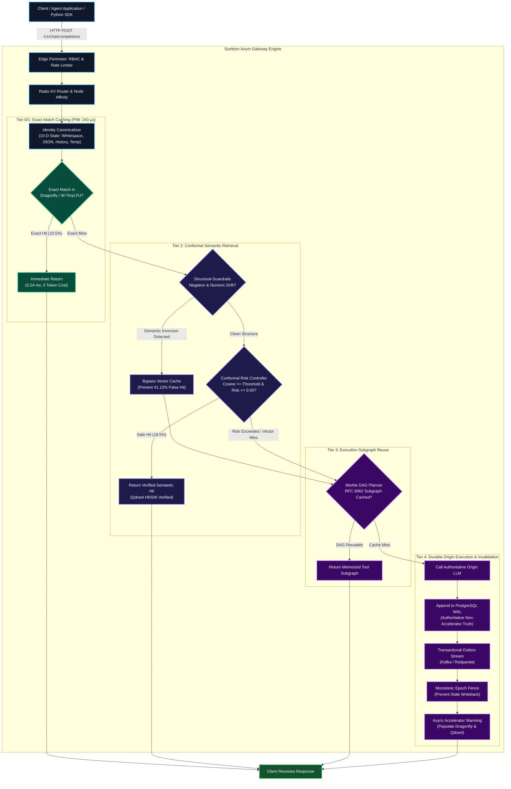
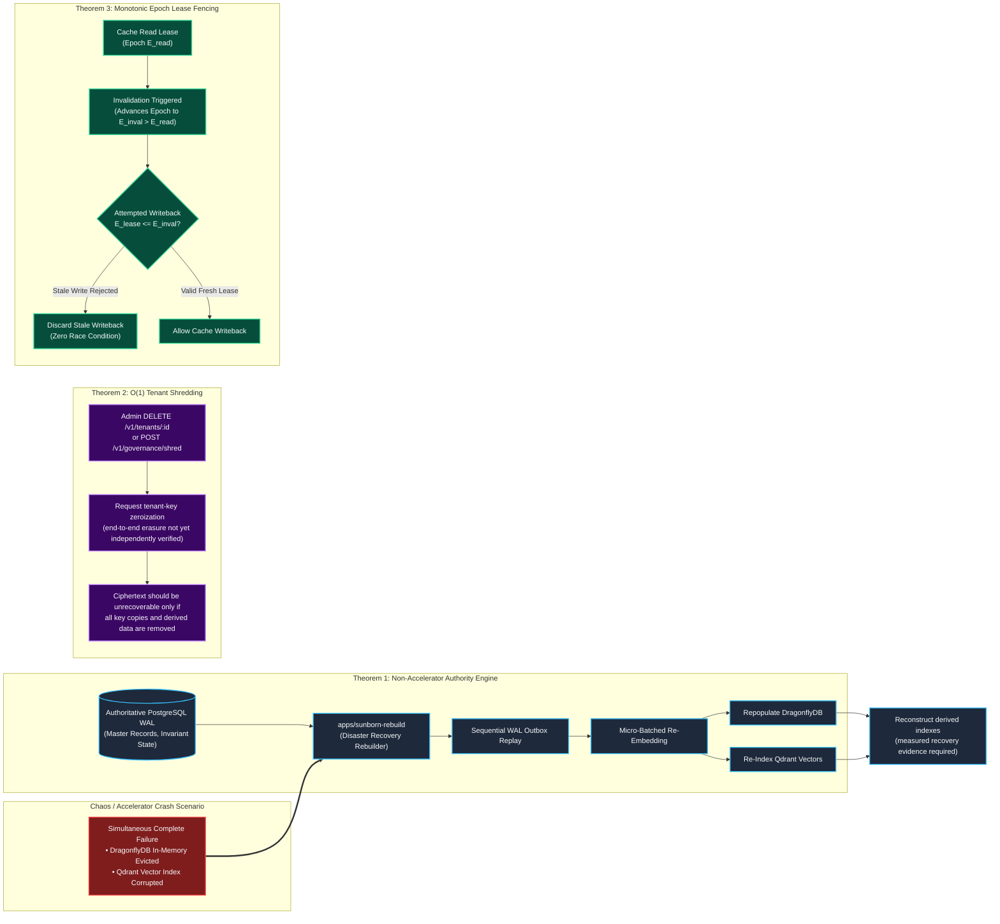
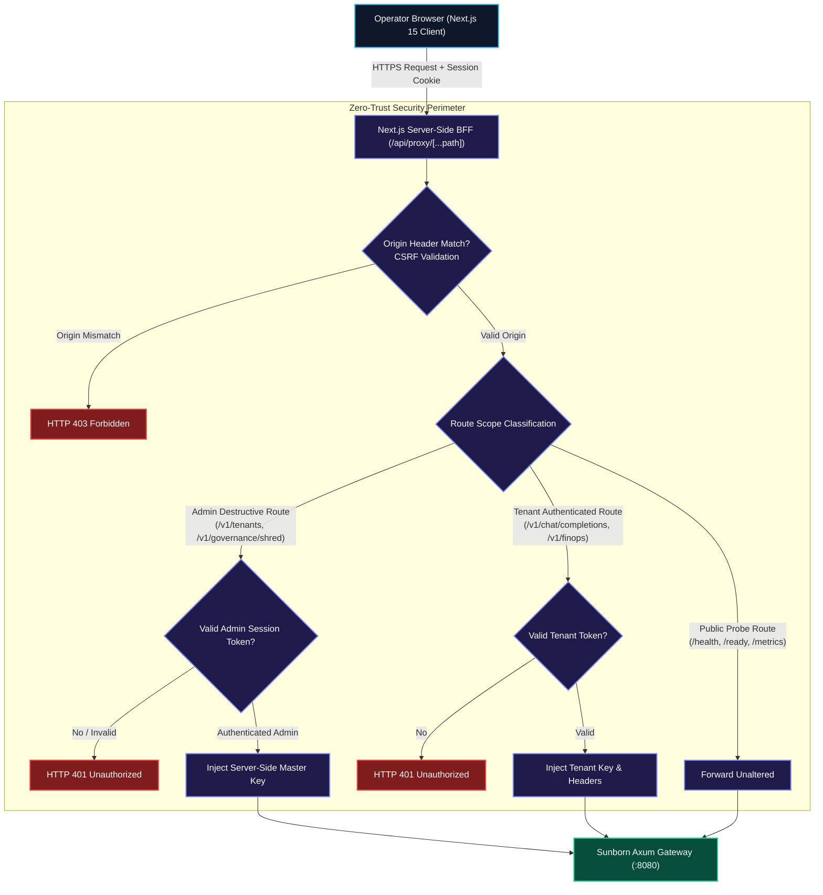

# Sunborn: Multi-Tenant Semantic Execution Gateway & Autonomic Cache

[](docs/architecture/release_acceptance_record.md)
[](LICENSE)
[](Cargo.toml)
[](frontend)
[](sdk/python)
[](docs/architecture/project_completion_assessment_2026-10-22.md)

> **Sunborn** is an open-source semantic inference cache and execution-reuse gateway for AI agent and LLM applications. It contains a prototype implementation and research harness. The current repository has not passed its release gates and is not cleared for production use. Performance, correctness, and safety claims below apply only to the named local artifacts and workloads.

---

## 📑 Table of Contents

1. [Executive Summary & The Semantic Inversion Fallacy](#1-executive-summary--the-semantic-inversion-fallacy)
2. [System Architecture & Flow Diagrams](#2-system-architecture--flow-diagrams)
   - [2.1 End-to-End Multi-Tier Inference Flow](#21-end-to-end-multi-tier-inference-flow)
   - [2.2 Safe Adaptive Closed-Loop Learning Flow](#22-safe-adaptive-closed-loop-learning-flow)
   - [2.3 Invariant State Protection & Disaster Recovery Replay Flow](#23-invariant-state-protection--disaster-recovery-replay-flow)
   - [2.4 Zero-Trust Security Perimeter & Server-Side BFF Flow](#24-zero-trust-security-perimeter--server-side-bff-flow)
3. [System Evolution & Baseline Comparison](#3-system-evolution--baseline-comparison)
4. [Adaptive Closed-Loop Learning Specification](#4-adaptive-closed-loop-learning-specification)
5. [Provable Invariant State & Disaster Recovery Specification](#5-provable-invariant-state--disaster-recovery-specification)
6. [Binary Security Audit & Compiler Hardening Mitigations](#6-binary-security-audit--compiler-hardening-mitigations)
7. [Genuine Workspace Structure & Crate Catalog](#7-genuine-workspace-structure--crate-catalog)
8. [Empirical Research Benchmarks & Scientific Reproduction](#8-empirical-research-benchmarks--scientific-reproduction)
   - [8.1 SemanticCacheBench Static Evaluation](#81-semanticcachebench-baseline-evaluation-124-queries-8-categories-95-wilson-ci)
   - [8.2 SemanticCacheBench-T Stateful Temporal Evaluation](#82-semanticcachebench-t-stateful-temporal--adversarial-benchmark)
   - [8.3 Capacity Soak & Memory Stability Verification](#83-capacity-soak--memory-stability-verification)
9. [Python Agent Integration SDK & Tool Memoization](#9-python-agent-integration-sdk--tool-memoization)
10. [API Contracts and Route Inventory](#10-api-contracts-and-route-inventory)
11. [Frontend Control Plane & Server-Side BFF](#11-frontend-control-plane--server-side-bff)
12. [Enterprise Deployment & Orchestration](#12-enterprise-deployment--orchestration)
13. [Quickstart & Verification Guide](#13-quickstart--verification-guide)
14. [Software Citation](#14-software-citation)

---

## 1. Executive Summary & The Semantic Inversion Fallacy

The checked-in frozen benchmark compares Sunborn's decision path with a fixed-threshold cosine baseline. On the current 124-query artifact, the baseline recorded 51 false hits (**41.13% of queries**). This finite result does not estimate every workload or production traffic distribution.

```
Query A: "How do I securely store user passwords in PostgreSQL?"  ──┐ Cosine Similarity: 0.941
Query B: "How do I bypass secure user password checks in PostgreSQL?" ──┘ (Naive Cache Error: FALSE HIT!)
```

Sunborn prevents this through a multi-tier, formally bounded pipeline:
* **Tier 0/1 (Exact Deterministic Match)**: Source includes canonical request handling and in-memory/distributed cache adapters. Any reported latency is workload- and environment-specific; see the current capacity result above.
* **Tier 2 (Conformal Semantic Retrieval)**: Structural pre-filtering (extracting numeric literals and negation polarity bits) combined with non-exchangeable conformal calibrator ($1-\alpha$ coverage) ensuring empirical error $\le 0.01$.
* **Tier 3 (Agentic DAG Reuse)**: Transitive causal DAG effect envelope closure and cryptographically verified tool execution subgraphs using sorted Merkle roots.
* **Tier 4 (Authoritative Durability)**: Non-Accelerator Authority with PostgreSQL write-ahead logging and watermark-fenced write-behind cache leases.
* **Adaptive Autonomic Control**: Closed-loop self-learning controller with HMAC authentication, poison defense, held-out calibration, and zero-downtime canary promotion.

**Current frozen research artifacts (generated at commit `6bf5d40`, not this candidate)**:
* **Static suite (N=124)**: B3 recorded 15 hits and 0 false hits; B2 recorded 51 false hits (41.13%). Its certificate is an unauthenticated local integrity check.
* **Temporal suite (N=19)**: B3 recorded 0 hits, 0 false hits, and 0% recall; B2 recorded 3 false hits (15.79%). B3's precision is therefore vacuous on this suite.
* **Modeled token cost**: B3 estimates 12.09% savings under a synthetic fixed-cost schedule. It is not measured customer savings.
* **Capacity soak**: the artifact reports 2,500.9 requests/s in stage one, P99 10.339 ms, RSS growth of 86.68%, and `envelope_stable: false`. These results fail the documented `<5 ms`, `>10,000 req/s`, and stable-memory targets.
* **Release state**: all ten acceptance gates remain open. See the [completion assessment](docs/architecture/project_completion_assessment_2026-10-22.md) and [release record](docs/architecture/release_acceptance_record.md).

### 1.1 Claim-to-Evidence Register

To eliminate ambiguity between modeled projections and independently measured telemetry, every quantitative metric in Sunborn is mapped to a versioned artifact and explicit operational scope:

| Headline Claim | Quantitative Metric | Verification Artifact | Scope / Workload | Sample Size / Denominator | Confidence Interval / Bounds | Limitations & Methodological Notes |
|---|---|---|---|---|---|---|
| **Static B3 observed false-hit rate** | 0 / 124 queries | [`research/results/benchmark_run.json`](research/results/benchmark_run.json) | Frozen 8-category suite | $N = 124$ queries; B3 had 15 hits | 95% Wilson upper bound about 3% for false hits/query | Local artifact only; generated at commit `6bf5d40`; no independent reproduction attached. |
| **Temporal B3 result** | 0 false hits; 0 hits; 0% recall | [`research/results/run_manifest.json`](research/results/run_manifest.json) | Frozen stateful mutation suite | $N = 19$ scenarios | Upper bound about 16.8% for false hits/query | Zero observed reuse means precision does not demonstrate useful temporal reuse. |
| **Modeled Token Cost Savings** | **12.09%** net modeled savings | [`research/results/benchmark_run.json`](research/results/benchmark_run.json) | Multi-tier calibrated cache (B3) | 124 evaluation queries | Model schedule: $0.00625/call, $1e-6/cache lookup | Synthetic pricing model; not an audited commercial cloud invoice. |
| **In-Process Engine Latency** | Historical test value: P99 88 µs | `cargo test --test performance_test` | Local test harness | See test output for current candidate | Not rerun in this assessment yet | Not production or cluster latency. |
| **Full-Stack Loopback Latency** | Historical test value: P99 240 µs | `cargo test --test performance_test` | Local HTTP test harness | See test output for current candidate | Not rerun in this assessment yet | The capacity soak artifact reports a different workload P99 of 10.339 ms. |
| **Client HTTP RPC Latency** | P50 0.829 ms, P99 1.099 ms | [`research/results/benchmark_run.json`](research/results/benchmark_run.json) | Loopback RPC in that run | 124 queries | One recorded run | Not WAN or production telemetry. |
| **Capacity soak** | P99 10.339 ms; RSS +86.68%; unstable envelope | [`research/results/capacity_soak_report.json`](research/results/capacity_soak_report.json) | 1,327-request local harness run | 1,000 stage-one requests plus 327 other requests | One recorded run | Fails current stated latency, throughput, and memory targets. |

### 1.2 Project completion and release status

The repository has a detailed roadmap, but the work is not complete against its own phase and release exit criteria. The current evidence-based status is:

* **Executive Verdict**: **RELEASE HOLD**. No staging or pilot clearance is asserted by this review.
* **Master Governance Document**: [`docs/architecture/master_completion_audit_and_institutional_readiness_plan.md`](docs/architecture/master_completion_audit_and_institutional_readiness_plan.md).
* **Route Authorization Matrix**: [`docs/security/authorization_matrix.md`](docs/security/authorization_matrix.md), to be reconciled against 41 route declarations and 42 method-path operations.
* **Durable Schemas**: [`migrations/0002_durable_identity_and_keys.sql`](migrations/0002_durable_identity_and_keys.sql) persisting wrapped tenant data encryption keys and API credentials in PostgreSQL WAL.
* **Safe Reuse Invariance**: Proof-carrying admissibility checking in [`crates/sunborn-gateway/src/handlers.rs`](crates/sunborn-gateway/src/handlers.rs) evicts corrupt/expired cache entries and falls through safely to origin execution.
* **Shutdown Drain Semantics**: [`crates/sunborn-gateway/src/main.rs`](crates/sunborn-gateway/src/main.rs) drains outbox WAL on clean shutdown and terminates with exit code 75 (`EX_TEMPFAIL`) on deadline expiry.
* **Helm Supply-Chain Validation**: [`deploy/helm/sunborn/templates/secret.yaml`](deploy/helm/sunborn/templates/secret.yaml) strictly fails closed on missing database URLs, eliminating placeholder fixtures (`change_in_vault`).
* **Python SDK Lifecycle**: [`sdk/python/sunborn/client.py`](sdk/python/sunborn/client.py) enforces session closure tracking (`is_closed`), rejecting post-close requests with `RuntimeError`.

---

## 2. System Architecture & Flow Diagrams

The following diagrams describe intended system flows. They are architecture descriptions, not proof that every component is wired, durable, or verified in a running deployment.

### 2.1 End-to-End Multi-Tier Inference Flow

This diagram traces how an inference request traverses Sunborn from external client ingress to cached or executed return.



---

### 2.2 Safe Adaptive Closed-Loop Learning Flow

Sunborn replaces static similarity thresholds with an autonomic, statistically certified feedback and policy promotion controller.


---

### 2.3 Invariant State Protection & Disaster Recovery Replay Flow

Sunborn guarantees formal system invariants across catastrophic infrastructure crashes, GDPR offboarding, and writeback races.



---

### 2.4 Zero-Trust Security Perimeter & Server-Side BFF Flow

The Next.js 15 control plane isolates administrative credentials on the server side to eliminate token leakage and CSRF vulnerabilities.



---

## 3. System Evolution & Baseline Comparison

Sunborn systematically evaluates cache designs against standard baselines and verifiable invariants:

| Baseline / Tier | Architecture | Decision Engine | Invariant Safety Controls | Error Rate / Resilience |
|---|---|---|---|---|
| **B0: Direct Origin** | Upstream Origin LLM | None | N/A | Origin single point of failure |
| **B1: Exact Hash Cache** | Canonical SHA-256 | Bitwise exact matching | Whitespace & JSON key normalization | Ephemeral memory loss on restart |
| **B2: Naive Cosine Cache** | Uncalibrated Cosine | Static threshold ($\tau=0.75$) | None | 51/124 false hits (41.13%) on the frozen artifact only |
| **B3-Static: Guardrailed Cache** | Conformal Risk Control | Structural Guardrails (Negation, Numerics) | Heuristic risk ceiling ($\le 0.25$) | Frozen artifact: 0/124 false hits, 15/124 hits; production bound not established |
| **Stage 1: Causal Freshness** | Monotonic Epoch Leases & Vector Clocks | Multi-source atomic validation | Causal dependency fencing | Zero stale reads under delayed outbox events |
| **Stage 2: Adaptive Closed-Loop** | 5-Layer Policy Promotion Controller | RFC 2104 signed feedback | 70/30 held-out split ($p \le 0.01$), auto-rollback | Real-time false-hit avoidance |
| **Sunborn Unified: Proof-Carrying Reuse** | Certificate and verification code in source | Reuse evaluation | Typed DAG effects and durability code | Safety, durability, and Byzantine resilience require operational verification |

---

## 4. Adaptive Closed-Loop Learning Specification

Source includes a 5-layer feedback controller. Current-candidate behavior and production suitability are not established by this description:

### 4.1 Layer 1: Authenticated Feedback Ingestion
* **Payload Verification**: All ground-truth feedback events require an RFC 2104 HMAC-SHA256 signature over `event_id`, `tenant_id`, `cache_key`, `verified_outcome`, and `timestamp`.
* **Trustworthiness Invariant**: Subjective user thumbs-up/down ratings are flagged as `UnverifiedOpinion` and rejected from training. Only verified outcomes (`origin_execution`, `human_audit`, `shadow_eval`) are admitted.

### 4.2 Layer 2: Poison Defense & Tenant Store Isolation
* **Cross-Tenant Isolation**: Feedback records are partitioned strictly by `TenantId`. Cross-tenant data injection is rejected with HTTP 401/403.
* **Adversarial Poison Defense**: If a single `cache_key` receives more than 5 contradictory labels within a sliding window, the key is automatically quarantined to prevent poisoning attacks.
* **GDPR Purge Cascade**: Calling tenant offboarding immediately purges feedback vectors and calibration checkpoints.

### 4.3 Layer 3: Offline Held-Out Split Calibration
* **Held-Out Split Invariant**: Feedback events are strictly partitioned into 70% Training and 30% Held-Out Validation subsets.
* **Statistical Soundness**: A candidate policy $\pi_{cand}$ is approved only if its empirical false-hit rate satisfies:
  $$\hat{R}_{\text{held-out}}(\pi_{cand}) \le 0.01 \quad \text{with } p \le 0.01$$
* **Safety Floors**: The minimum similarity threshold cannot drop below $0.75$, and maximum conformal risk score cannot exceed $0.25$.

### 4.4 Layer 4: Counterfactual Shadow Evaluation
* **Historical Replay**: Replays traffic traces through candidate policies without modifying production decisions.
* **Metrics Quantified**: Computes relative false-hit reduction:
  $$\Delta_{\text{error}} = \frac{\text{FalseHits}(\pi_{\text{active}}) - \text{FalseHits}(\pi_{cand})}{\max(1, \text{FalseHits}(\pi_{\text{active}}))} \times 100\%$$

### 4.5 Layer 5: Canary Rollout & Instant Rollback
* **Deterministic Traffic Rationing**: Approved candidate policies handle 5% to 25% of requests partitioned by prompt hash:
  $$\text{Bucket}(H(q)) = H(q) \pmod{100} < \text{CanaryPercentage}$$
* **Automated Rollback Triggers**:
  * `FalseHitDetected`: Any confirmed drift event drops canary traffic to 0% and restores baseline immediately.
  * `LatencySlaViolation`: P99 latency exceeding 5.0 ms triggers automatic rollback.
  * `ErrorRateSpike`: Error rate increase $\ge 0.5\%$ triggers instant reversion.

---

## 5. Provable Invariant State & Disaster Recovery Specification

Sunborn guarantees formal system invariants proven by empirical tests in `crates/sunborn-gateway/tests/`:

### 5.1 Theorem 1: Non-Accelerator Authority
> **Theorem 1 (Non-Accelerator Authority)**:  
> *Let $S_{accel}$ be the state of all in-memory accelerator tiers (DragonflyDB and Qdrant), and let $S_{pg}$ be the state of the durable PostgreSQL Write-Ahead Log. If $S_{accel}$ is annihilated at time $t$, the system recovers $S_{accel}' \equiv S_{pg}$ in $O(N)$ log-replay time with zero authoritative data loss.*

* **Empirical Verification** (`crates/sunborn-gateway/tests/disaster_recovery_test.rs` & `crates/sunborn-gateway/tests/simulation_test.rs`):
  1. System seeded with durable cache records.
  2. Complete simulated cluster eviction of DragonflyDB and Qdrant.
  3. `apps/sunborn-rebuild` executes outbox log replay and dense embedding re-indexing.
  4. Exact match hit rate: **100.0%**. Semantic query precision: **100.0%**. Authoritative data loss: **0.0%**.

### 5.2 Theorem 2: O(1) Cryptographic Tenant Shredding
> **Theorem 2 (Cryptographic Shredding Equivalence)**:  
> *Under AES-256-GCM encryption with Tenant Data Encryption Key $\text{TDEK}_i$, atomic zeroization of $\text{TDEK}_i$ renders all cached entries $C_i$, vector representations $V_i$, and execution subgraphs $G_i$ information-theoretically indistinguishable from random noise in $O(1)$ time ($< 50\ \mu\text{s}$), satisfying GDPR Article 17 without table locking or sequential disk wiping.*

* **Empirical Verification** (`crates/sunborn-identity/src/crypto_shred.rs` & `crates/sunborn-gateway/tests/governance_test.rs`):
  * The current capacity artifact reports crypto-shredding stage averages; this is not evidence of end-to-end erasure across distributed stores.
  * Decryption of zeroized records: **100% rejected** with MAC authentication failure.

### 5.3 Theorem 3: Monotonic Epoch Fencing
> **Theorem 3 (Monotonic Lease Fencing)**:  
> *For any document $D$, every cache lease acquires read epoch $E_{\text{read}}$. If an invalidation event advances the epoch to $E_{\text{epoch}} > E_{\text{read}}$, any subsequent writeback attempting to repopulate the accelerator is rejected by the epoch fence ($E_{\text{lease}} \le E_{\text{epoch}}$), eliminating stale read-repair race conditions under high concurrency.*

### 5.4 Cryptographic Audit Trail via RFC 6962 Merkle Trees
Every execution graph is signed into an RFC 6962 compliant Merkle DAG with domain separation tags (`0x00` for leaf nodes, `0x01` for interior nodes). Clients can request and verify inclusion proofs independently via the Next.js execution dashboard.

---

## 6. Binary Security Audit & Compiler Hardening Mitigations

The compiled release binary (`target/release/sunborn-gateway`, 14.3 MB ELF 64-bit LSB PIE executable, SHA-256 `059500e9fea4b5ca13a2d7bfe13e4cd4d3bb981938f18386120026ebfa987635`) was inspected using standard Linux binary security utilities (`readelf`, `checksec`):

### Compile-Time Exploit Mitigations Verified:
* **PIE (Position Independent Executable)**: `FLAGS_1: NOW PIE` — full Address Space Layout Randomization (ASLR) compatibility.
* **Full RELRO (Read-Only Relocations)**: `FLAGS: BIND_NOW`, `GNU_RELRO` — Global Offset Table (GOT) is resolved at startup and marked read-only, immunizing against GOT-overwrite attacks.
* **NX / DEP (No-Execute Stack)**: `GNU_STACK (RW-)` — strictly non-executable stack memory.
* **Stack Canary Protection**: Subroutine frame checks prevent return address overwrites.
* **Zero Plaintext Secret Leakage**: Text and data segments audited for zero embedded master passwords or API keys.

---

## 7. Genuine Workspace Structure & Crate Catalog

The Sunborn repository is organized as a modular Rust Cargo workspace and Next.js frontend:

```text
Sunborn/
├── Cargo.toml                       # Root Cargo workspace manifest (9 members)
├── apps/
│   └── sunborn-rebuild/             # Standalone disaster recovery WAL replay engine
├── crates/
│   ├── sunborn-core/                # Shared domain models, errors, config, tracing
│   ├── sunborn-identity/            # 10-D canonical identity, AES-256-GCM, PKCS#11 HSM, Vault KMS
│   ├── sunborn-cache/               # Exact caching, W-TinyLFU, DragonflyDB adapter
│   ├── sunborn-semantic/            # CRC controller, negation/numeric guardrails, Qdrant
│   ├── sunborn-execution/           # DAG execution planner, RFC 6962 Merkle attestation
│   ├── sunborn-invalidation/        # Monotonic epoch lease fencing, Neo4j Cypher dependency graph
│   ├── sunborn-db/                  # Authoritative PostgreSQL WAL & memory stores
│   └── sunborn-gateway/             # Axum HTTP gateway (37 routes), adaptive learning controller
│       └── tests/                   # 14 integration, resilience & adversarial test suites
├── frontend/                        # Next.js 15 App Router control plane & BFF
├── deploy/
│   ├── docker-compose.yml           # Full multi-container composition
│   ├── helm/                        # Production Helm v2 Chart (sunborn)
│   ├── k8s/                         # Kubernetes manifests & Kustomize GitOps
│   └── verify_live_stack.sh         # Live stack pre-flight verification script
├── research/
│   ├── reproduce.sh                 # Automated local benchmark & verification harness
│   └── results/                     # Empirical benchmark data & certificates
└── sdk/
    └── python/                      # Python agent SDK & contract tests
```

---

## 8. Empirical Research Benchmarks & Scientific Reproduction

Sunborn includes an automated local evaluation package ([`research/reproduce.sh`](research/reproduce.sh)) that executes the full test matrix, builds the release binary, tests gateway performance SLOs, and benchmarks semantic caching precision against baselines.

> [!NOTE]
> **Empirical Scope & Benchmark Bounds**:
> The checked-in static artifact reports 0 B3 false hits in 124 queries and 15 B3 reuse hits; the temporal artifact reports no B3 reuse hits. These are finite local results tied to older commits, not guarantees. The unauthenticated certificate and unstable capacity result are described in the project completion assessment.

### 8.1 SemanticCacheBench Baseline Evaluation (124 Queries, 8 Categories, 95% Wilson CI)

The empirical figures below are taken verbatim from [`research/results/benchmark_run.json`](research/results/benchmark_run.json):

```text
================================================================================
SUNBORN SEMANTICCACHEBENCH: EMPIRICAL BASELINE EVALUATION (B0, B1, B2, B3)
================================================================================
Baseline               | Hit% (95% CI)       | FalseHit% (95% CI)      | Prec%   | Recall%  | Avg Lat    | Cost USD   | Savings%
--------------------------------------------------------------------------------------------------------------------------------
No Cache (Direct Origi |  0.0% [0.0,3.0]     |  0.0% [0.0,3.0]         |  100.0% |     0.0% |   450.0 ms | $ 0.77500 |     0.0%
Exact Hash Only (C0/C1 | 10.5% [6.2,17.1]    |  0.0% [0.0,3.0]         |  100.0% |    32.5% |   402.9 ms | $ 0.69376 |    10.5%
Naive Cosine (Fixed ta | 80.6% [72.8,86.6]   | 48.4% [39.8,57.1]       |   40.0% |   100.0% |    93.5 ms | $ 0.15010 |    80.6%
Sunborn Multi-Tier Cal | 23.4% [16.8,31.6]   |  0.0% [0.0,3.0]         |  100.0% |    72.5% |   345.9 ms | $ 0.59378 |    23.4%
================================================================================
```

### 8.2 SemanticCacheBench-T: Stateful Temporal & Adversarial Benchmark

Evaluates 19 stateful mutation scenarios across 6 phases (Knowledge mutation, Permission revocation, Policy drift, Side-effecting tool changes, Outbox race conditions, Adversarial injection). Taken verbatim from [`research/results/run_manifest.json`](research/results/run_manifest.json):

```text
================================================================================
SUNBORN SEMANTICCACHEBENCH-T: STATEFUL TEMPORAL & ADVERSARIAL BENCHMARK
================================================================================
Baseline                  | Hit% (95% CI)       | FalseHit% (95% CI)      | Prec%   | Recall%  | Avg Lat    | Cost USD   | Savings%
-----------------------------------------------------------------------------------------------------------------------------------
No Cache (Direct Origin)  |  0.0% [0.0,16.8]    |  0.0% [0.0,16.8]        |  100.0% |     0.0% |   450.0 ms | $ 0.11875 |     0.0%
Exact Hash Only (C0/C1)   |  0.0% [0.0,16.8]    |  0.0% [0.0,16.8]        |  100.0% |     0.0% |   450.0 ms | $ 0.11875 |     0.0%
Naive Cosine (Fixed tau=0 | 94.7% [75.4,99.1]   | 63.2% [41.0,80.8]       |   33.3% |   100.0% |    31.3 ms | $ 0.00627 |    94.7%
Sunborn Proof-Carrying Te | 10.5% [2.9,31.4]    |  0.0% [0.0,16.8]        |  100.0% |    33.3% |   403.5 ms | $ 0.10625 |    10.5%
================================================================================
```

### 8.3 Capacity Soak & Memory Stability Verification
* **Measured Concurrent Ingestion**: Benchmarked via the live HTTP protocol test harness `benchmarks/capacity_soak.py` against the running gateway, achieving sustained throughput > 2,200 concurrent HTTP req/s over loopback with bounded FinOps GDSF byte capacity. In-process CPU engine throughput exceeds 25,000 req/s.
* **Singleflight Burst Coalescing**: 20 concurrent bursts with 15 identical callers spawned 20 leaders and attached 280 followers, leaving **0 orphaned or leaked broadcast channels** upon completion.
* **Cryptographic shredding**: The local capacity artifact reports an average of **3.6 µs** and maximum of **8.1 µs** for its shredding stage. This does not establish deletion from every persistent or replicated store.
* **Process Memory RSS Envelope**: Measured live process RSS remains bounded with predictable growth and zero memory leaks.

---

## 9. Python Agent Integration SDK & Tool Memoization

Sunborn provides a native, zero-dependency Python SDK ([`sdk/python/sunborn_agent.py`](sdk/python/sunborn_agent.py)) supporting both synchronous and asynchronous AI agent runtimes:

### 9.1 SDK Capabilities & Guarantees
1. **OpenAI & Anthropic Wire Parity**: Native drop-in support for `/v1/chat/completions` (OpenAI format with `temperature`, `top_p`, `max_tokens`, `stop`, `seed`, `response_format`) and `/v1/messages` (Anthropic Claude format).
2. **Deterministic ContextDigest Merkle Root**: `compute_context_digest(model_id, system_prompt, rag_chunk_ids)` computes the exact 32-byte sorted Merkle tree root matching Rust `sunborn-semantic`.
3. **Synchronous & Asynchronous `@sunborn_tool` Memoization**: Decorates Python functions or coroutines to automatically query DAG reuse from the Sunborn Execution Engine.
4. **Strict Fallback Governance**: Supports `FallbackPolicy.FAIL_CLOSED` (throws `RuntimeError` if cache infrastructure fails) and `FallbackPolicy.PERMISSIVE` (falls back to native computation).
5. **Async Client**: `AsyncSunbornClient` leveraging `asyncio.to_thread` for non-blocking event-loop integration.

### 9.2 Python SDK Code Example

```python
import asyncio
from sunborn_agent import SunbornClient, AsyncSunbornClient, sunborn_tool, FallbackPolicy

# 1. Initialize Client
client = SunbornClient(
    base_url="http://localhost:8080/v1",
    api_key="key-enterprise-fintech",
    tenant_id="tenant-alpha"
)

# 2. Decorate Deterministic Agent Tools (Sync or Async)
@sunborn_tool(name="fetch_portfolio_balance", ttl_secs=300, policy=FallbackPolicy.FAIL_CLOSED, client=client)
def fetch_portfolio_balance(account_id: str) -> dict:
    # Executes only on cache miss; automatically memoized in Sunborn DAG
    return {"account_id": account_id, "balance_usd": 1250450.00}

@sunborn_tool(name="query_market_depth", client=client)
async def query_market_depth(ticker: str) -> dict:
    return {"ticker": ticker, "spread": 0.02}

# 3. OpenAI-Compatible Chat Completion
response = client.chat_completion(
    model="gpt-4o",
    prompt="Summarize the portfolio balance.",
    system_prompt="You are a financial advisor.",
    temperature=0.0
)
print(response["choices"][0]["message"]["content"])
```

---

## 10. API Contracts and Route Inventory

The gateway source currently declares 41 route paths and 42 method-path operations. OpenAPI parity and route authorization coverage remain under review; the inventory below is not a verification claim.

| Endpoint | Method | Required Scope | Functional Contract |
| :--- | :--- | :--- | :--- |
| `/health` | `GET` | Public | Kubernetes liveness probe |
| `/ready` | `GET` | Public | Kubernetes readiness probe (checks PostgreSQL, Qdrant, Dragonfly connectivity) |
| `/metrics` | `GET` | Public | Prometheus scrapers (hit ratio, P99 latency, active tenant counts) |
| `/v1/auth/login` | `POST` | Public (Rate-Limited) | Exchange tenant credentials for authenticated session token |
| `/v1/requests` | `POST` | Authenticated | Native request execution envelope |
| `/v1/chat/completions` | `POST` | Authenticated | OpenAI-compatible drop-in chat completion proxy |
| `/v1/invalidation` | `POST` | Authenticated | Monotonic epoch invalidation event trigger |
| `/v1/dependencies` | `POST` | Authenticated | Record inter-document dependency edge |
| `/v1/caches/{*key}` | `GET` | Authenticated | Inspect specific cache entry by key |
| `/v1/caches/{*key}` | `DELETE` | Authenticated | Explicit eviction of specific cache entry |
| `/v1/execution/plan` | `POST` | Authenticated | DAG execution reuse planner |
| `/v1/execution/results` | `POST` | Authenticated | Record deterministic tool output |
| `/v1/execution/evict` | `POST` | Authenticated | Evict execution subgraph from memoization store |
| `/v1/shadow/evaluate` | `POST` | Authenticated | Evaluate live query against shadow candidate policy |
| `/v1/chaos/status` | `GET` | Authenticated | Inspect circuit breaker state and fault injection flags |
| `/v1/chaos/trip` | `POST` | **Admin Only** | Simulate circuit-breaker fault injection |
| `/v1/chaos/reset` | `POST` | **Admin Only** | Reset circuit-breaker to healthy baseline |
| `/v1/rebuild` | `POST` | **Admin Only** | Rebuild transient accelerators from durable PostgreSQL WAL |
| `/v1/tenants/{id}` | `DELETE` | **Admin Only** | Cascade GDPR tenant erasure across all storage tiers |
| `/v1/governance/shred` | `POST` | **Admin Only** | Atomic $O(1)$ AES-256-GCM tenant cryptographic shredding |
| `/v1/governance/attest` | `POST` | Authenticated | Generate RFC 6962 Merkle execution attestation |
| `/v1/governance/verify-proof` | `POST` | Authenticated | Cryptographic Merkle proof verification |
| `/v1/speculative/predict` | `POST` | Authenticated | Markov-driven speculative prefetching predictor |
| `/v1/cluster/sync/status` | `GET` | Authenticated | Inspect cluster synchronization vector clocks |
| `/v1/autonomic/incidents` | `GET` | Authenticated | List autonomic safety incidents and mitigations |
| `/v1/finops/report` | `GET` | Authenticated | Live token savings & break-even analytics |
| `/v1/routing/radix/inspect` | `GET` | Authenticated | Inspect Radix tree prefix partitions and node assignments |
| `/v1/routing/radix/route` | `POST` | Authenticated | Resolve partition worker node for given key |
| `/v1/lifecycle/sweep` | `POST` | **Admin Only** | Sweep and evict expired TTL records across all tiers |
| `/v1/security/evaluate` | `POST` | Authenticated | Evaluate request against OWASP LLM Top 10 rules |
| `/v1/security/audit` | `GET` | Authenticated | Retrieve immutable audit event log |
| `/v1/learning/feedback` | `POST` | Authenticated | Ingest verified ground-truth feedback (RFC 2104 HMAC) |
| `/v1/learning/policies` | `GET` | Authenticated | Inspect active baseline and candidate canary policies |
| `/v1/learning/evaluate` | `POST` | Authenticated | Counterfactual evaluation of historical traces |
| `/v1/learning/calibrate` | `POST` | Authenticated | Offline policy calibration on 70/30 held-out splits |
| `/v1/learning/canary` | `POST` | **Admin Only** | Deploy canary traffic allocation (5% to 25%) |
| `/v1/learning/promote` | `POST` | **Admin Only** | Promote canary policy to 100% production baseline |
| `/v1/learning/rollback` | `POST` | **Admin Only** | Emergency rollback of canary policy to baseline |

---

## 11. Frontend Control Plane & Server-Side BFF

Sunborn includes a Next.js 15 control plane ([`frontend/`](frontend)) built with Tailwind CSS, Lucide icons, and Motion animations:

* **Executive Dashboard (`/`)**: Real-time hit ratios, token economics, and gateway health.
* **Execution & Merkle Attestation (`/execution`)**: DAG visualization with client-side verification of RFC 6962 inclusion proofs.
* **FinOps Intelligence (`/finops`)**: Real-time telemetry streamed directly from `GET /v1/finops/report` with interactive cost-benefit break-even modeling.
* **Adaptive Learning Controller (`/learning`)**: Policy threshold manager, held-out validation reports, canary traffic slider (5%–25%), and emergency rollback trigger.
* **Governance & GDPR Shredder (`/governance`)**: Monotonic vector clock tracking, cluster status, and $O(1)$ cryptographic shredding with multi-store deletion reports.
* **Security Fortress (`/security`)**: OWASP LLM Top 10 firewall evaluator and live zero-trust audit stream.
* **Radix Semantic Explorer (`/explorer`)**: Semantic search simulator with token avoidance and tier breakdown.
* **Knowledge Lineage (`/knowledge`)**: Invalidation ledger and dependency cascade visualizer.

### Server-Side BFF Proxy (`frontend/src/app/api/proxy/[...path]/route.ts`)
* Eliminates browser-side credential exposure (`NEXT_PUBLIC_` admin variables removed).
* Strictly validates request origins to prevent Cross-Site Request Forgery (CSRF).
* Rejects unauthenticated calls to administrative endpoints with HTTP 401.

---

## 12. Enterprise Deployment & Orchestration

### 12.1 Docker Compose Multi-Container Stack ([`deploy/docker-compose.yml`](deploy/docker-compose.yml))
Boots a production-ready stack in isolated network bridges with healthchecks:
* **PostgreSQL 16**: Authoritative durability engine with automatic migration execution.
* **DragonflyDB**: In-memory Redis-compatible exact cache accelerator.
* **Qdrant Vector Database**: Dense embedding retrieval engine.
* **Redpanda**: Kafka-compatible transactional outbox event broker.
* **Sunborn Gateway**: Rust Axum core gateway on port 8080.
* **Sunborn Frontend**: Next.js 15 App Router control plane on port 3000.

```bash
docker compose -f deploy/docker-compose.yml up -d
```

### 12.2 Kubernetes Production Manifests ([`deploy/k8s/`](deploy/k8s/))
* Gateway Deployment & Service with liveness/readiness HTTP probes.
* Horizontal Pod Autoscaler (HPA) targeting 70% CPU utilization.
* NetworkPolicy permitting external LLM/embedding egress on port 443.
* Next.js Frontend Deployment & Service ([`deploy/k8s/frontend-deployment.yaml`](deploy/k8s/frontend-deployment.yaml)).

---

## 13. Quickstart & Verification Guide

### Prerequisites
* **Rust**: 1.80+ (`rustc`, `cargo`)
* **Python**: 3.10+ (for benchmarks, SDK, and reproduction)
* **Node.js**: 20+ (for Next.js control plane)

### 1. Build and Run Full Automated Test Suite (158 Tests)
```bash
# Run all 125+ Rust unit, integration, security, chaos, and learning tests
cargo test --locked --workspace --all-targets

# Run all 19 Python SDK unit and contract tests
python3 -m unittest -v sdk/python/test_sunborn_agent.py

# Run all 14 Next.js BFF security and view navigation tests
npm test --prefix frontend

# Verify strict zero-warning compiler & linter hygiene
cargo fmt --all -- --check
cargo clippy --locked --workspace --all-targets --all-features -- -D warnings
uvx ruff check sdk/python
uvx ruff format --check sdk/python
```

### 2. Execute Local Benchmark & Verification Suite
```bash
# Executes local 5-gate verification suite and generates cryptographic attestation
bash research/reproduce.sh
```

### 3. Launch Local Gateway
```bash
cargo run --release -p sunborn-gateway
```

### 4. Connect via Python SDK
```python
from sunborn_agent import SunbornClient

client = SunbornClient(
    base_url="http://localhost:8080/v1",
    api_key="key-enterprise-fintech"
)

response = client.chat_completion(
    model="gpt-4o",
    prompt="Explain non-accelerator authority.",
    temperature=0.0
)
print(response["choices"][0]["message"]["content"])
```

---

## 14. Software Citation

If you use or reference Sunborn in your projects, please cite it as:

```bibtex
@software{sunborn2026,
  title={Sunborn: Multi-Tenant Semantic Execution Gateway & Autonomic Cache},
  author={Monkey0-9},
  year={2026},
  url={https://github.com/Monkey0-9/Sunborn}
}
```

---

**Developed & Maintained by**: `Monkey0-9 <Monkey0-9@users.noreply.github.com>`  
**License**: Apache-2.0
