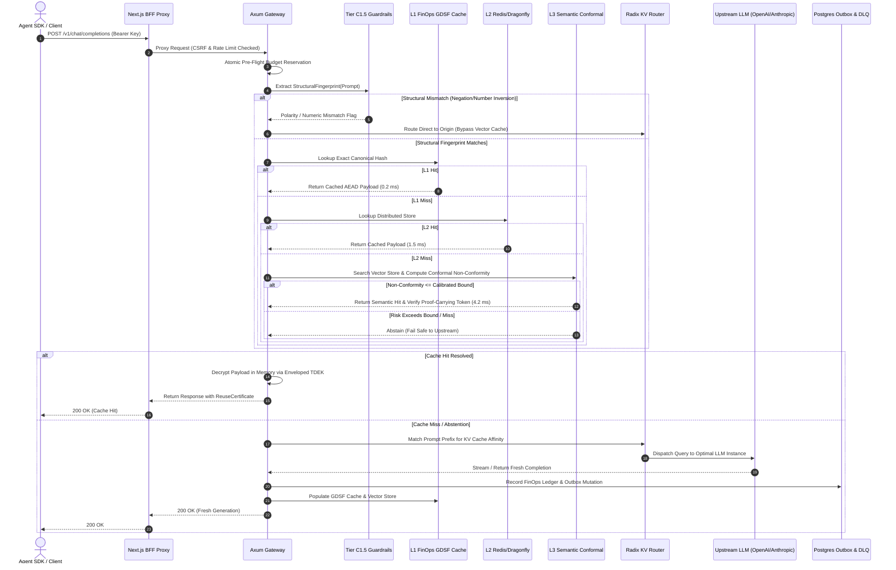
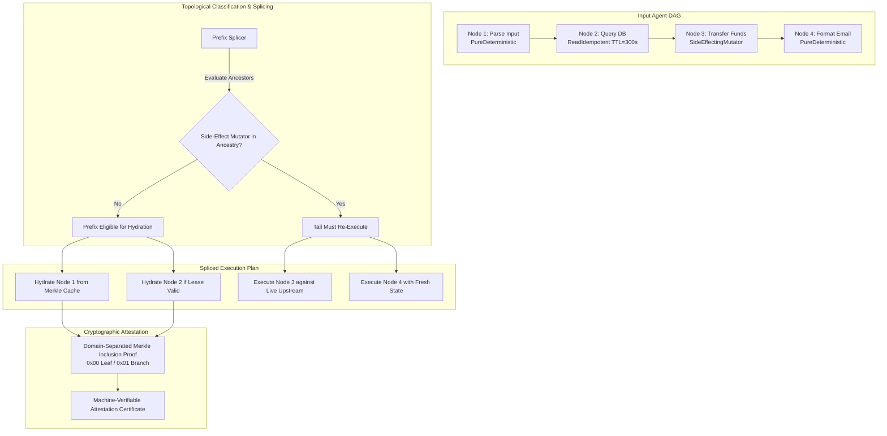
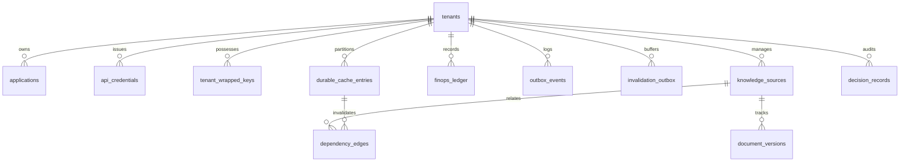

# Sunborn System Architecture & Subsystem Topologies

This document provides definitive Mermaid architectural diagrams depicting Sunborn's end-to-end data pipelines, cryptographic trust boundaries, and execution topologies.

---

## 1. End-to-End Ingress & Multi-Tier Resolution Topology



---

## 2. Merkle-DAG Spliced Execution Engine



---

## 3. Data Sovereignty & Cryptographic Shredding State Machine

```mermaid
stateDiagram-v2
    [*] --> Provisioned: POST /v1/governance/provision
    Provisioned --> Active: Generate AES-256-GCM TDEK wrapped under Master KEK (AWS KMS / Vault)
    
    state Active {
        [*] --> Ingesting
        Ingesting --> EncryptingAtRest: Envelope Encrypt Payloads with TDEK
        EncryptingAtRest --> ServingHits: Memory Decrypt on Read Path
        ServingHits --> Ingesting
    }

    Active --> RevokedCredentials: POST /v1/auth/credentials/revoke
    RevokedCredentials --> Active: Rotate Credentials (Historical Data Preserved)

    Active --> CryptoShredding: POST /v1/governance/shred (GDPR Article 17)
    
    state CryptoShredding {
        ZeroizeMemory: Memory Zeroization (zeroize::Zeroize on in-flight keys)
        DeleteTDEK: DELETE FROM tenant_wrapped_keys in PostgreSQL
        PurgeL1L2: Prefix Purge L1 memory and L2 Redis
        DropVectors: Delete tenant vector namespace
        
        ZeroizeMemory --> DeleteTDEK
        DeleteTDEK --> PurgeL1L2
        PurgeL1L2 --> DropVectors
    }

    CryptoShredding --> IrreversiblyShredded: O(1) Ciphertext Cryptographically Inaccessible
    IrreversiblyShredded --> [*]
```

---

## 4. Transitive Invalidation Topology with Outbox & DLQ

```mermaid
flowchart LR
    subgraph Knowledge Mutation
        DocUpdate[Document / Chunk Mutation] --> OutboxEvent[Postgres outbox_events Record]
    end

    subgraph Invalidation Pipeline
        OutboxEvent --> Engine[InvalidationEngine]
        Engine --> Channel{Bounded Channel<br/>Capacity=1024}
        Channel -- Normal --> Worker[Outbox Worker]
        Channel -- Saturated --> Backpressure[10ms Backpressure Wait / Reserve]
        Backpressure -- Timeout --> Reject[Fail Closed / Log Alarm]
    end

    subgraph Dependency Resolution
        Worker --> Lineage[CompressedLineageGraph<br/>Roaring Treemaps]
        Lineage --> SIMD[SIMD Bitwise OR Union<br/>O(k) AVX2 Operation]
        SIMD --> EvictList[100,000+ Affected Cache Keys]
    end

    subgraph Multi-Store Eviction
        EvictList --> PurgeCache[Purge L1 GDSF & L2 Redis]
        EvictList --> PurgeVector[Delete Vector Embeddings]
        Worker -- Persistent Failure --> DLQ[Dead Letter Queue<br/>DeadLetterItem]
        DLQ --> Replay[POST /v1/lifecycle/sweep Replay]
        Replay --> Channel
    end
```

---

## 5. PostgreSQL 12-Table Relational Schema ERD


