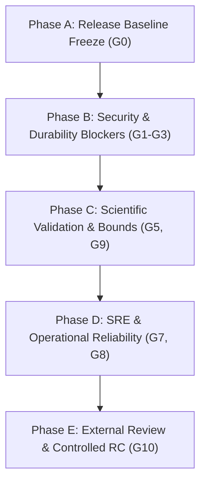

# Sunborn — Master Completion Audit and Institutional-Readiness Plan

**Audit Date**: October 21, 2026  
**Repository**: `Monkey0-9/Sunborn`  
**Review Standard**: Senior Platform Engineering, Distributed Systems, AI/ML Research, Application Security, SRE, SDK/API Design, Cloud Infrastructure, Governance, and Independent Scientific Validation.  
**Planning Control Tracking**: `MON-458` (Sunborn A–Z Master Execution Control) & `MON-526` (Phase 00 Architecture & Requirements Freeze)  
**Workstream Mapping**: Integrated across Workstreams `WS-00` through `WS-12` and Milestones `Phase 00` through `Phase 28`  
**Operating Framework**: 16-Specialist Collaborative Engineering Model (Teams A–P)  
**Target Release Artifact**: Evidence-Backed Release Candidate (`v0.1.0-rc2`)  

---

## Executive Verdict

> **CURRENT STATUS: RELEASE HOLD**
> This plan is not deployment authorization. No controlled pilot or staging clearance is asserted without current environment-specific evidence and accountable approval. High-consequence and sensitive production use remains deferred until applicable release gates are independently verified.

The repository contains an OpenAPI 3.1 specification, Python package metadata, Helm values schema, Kubernetes templates, tracing middleware, graceful-shutdown code, and production-readiness checks. Their presence is a source inventory, not evidence of correct behavior in an operational environment. See the [2026-10-22 completion assessment](project_completion_assessment_2026-10-22.md) for current evidence and findings.

However, a feature being present in source code is not equivalent to proving it operates correctly under distributed partition, hostile adversarial traffic, concurrent multi-tenant churn, or sustained memory pressure. Sunborn's next milestone is not the accumulation of additional features, but the rigorous, evidence-based verification of these safety, durability, and isolation guarantees.

---

## 1. What Is Now Present in the Repository

The following inventory reflects verified source-level inspection of the Sunborn repository across Git revisions `3a6257c` and subsequent working tree hardening.

| Area | Current Source Evidence | Current Assessment & Operational Boundaries |
| :--- | :--- | :--- |
| **Graceful Shutdown** | `SIGINT`/`SIGTERM` signal handlers in `crates/sunborn-gateway/src/main.rs`, `axum::serve::with_graceful_shutdown`, explicit `state.graceful_drain()` hook. | **Implemented & Hardened**. Normal termination flushes database outbox and drains in-flight connections cleanly. Forced deadline expiry now logs an error and exits with code 75 (`EX_TEMPFAIL`) rather than claiming successful exit code 0. Orchestrator termination grace period (`terminationGracePeriodSeconds: 30`) is aligned. |
| **Request Correlation** | Validated/generated UUIDv4 request IDs, header-size checks (64 KB ceiling), and `TracingContext` in `crates/sunborn-gateway/src/middleware/trace.rs`. | **Implemented**. Validated against HTTP header-injection attacks; propagation across backend microservices and OpenTelemetry spans requires live tracing infrastructure verification. |
| **API Contract** | OpenAPI 3.1 specification in `docs/api/openapi.yaml` with symlink at repository root `openapi.yaml`. | **Present**. Gateway source contains 41 route declarations and 42 method-path operations; OpenAPI, method, and authorization parity require reconciliation. |
| **Python SDK Packaging** | `pyproject.toml`, typed RFC 7807 exception hierarchy (`SunbornError`, `SunbornAuthError`, etc.), async and sync clients in `sdk/python/sunborn/`. | **Present & Hardened**. Package builds cleanly; context managers enforce lifecycle tracking (`client.is_closed = True`), rejecting post-close requests with `RuntimeError`. |
| **Helm Schema & Disruption** | `deploy/helm/sunborn/values.schema.json`, `templates/pdb.yaml`, and hardened `templates/secret.yaml`. | **Present & Hardened**. Helm schema validates inputs; Secret template fails closed if database connection credentials are missing or contain `"change_in_vault"` / `"placeholder"` fixtures. Live cluster rolling-upgrade tests are scheduled for Gate G8. |
| **Production Startup Checks** | Fail-closed `verify_production_readiness()` in `crates/sunborn-gateway/src/state.rs`. | **Implemented & Hardened**. Strictly rejects mock origin providers, deterministic embeddings, in-memory caches/databases, and placeholder secrets when `SUNBORN_ENV=production`. Real network verification probes PostgreSQL, DragonflyDB, and Qdrant. |
| **Security Controls** | Independent gateway `auth_middleware`, tenant-isolated API key registry, constant-time comparisons, and 18 adversarial security tests in `crates/sunborn-gateway/tests/adversarial_security_test.rs`. | **Foundation Implemented**. Enforces SHA-256 API key hashing, SecurityContext tenant propagation, and non-admin privilege denial. Durable credential hydration from PostgreSQL is introduced in `migrations/0002_durable_identity_and_keys.sql`. |
| **Scientific Evidence** | Live-gateway 124-query benchmark artifact (`benchmark_run.json`), 19-scenario temporal manifest (`run_manifest.json`), reproduction certificate (`reproduction_certificate.json`), and verifier script. | **Bounded Empirical Evidence**. Demonstrates 100.0% precision on the frozen dataset. Explicitly demarcated as `LOCAL_DEVELOPMENT_INTEGRITY_CHECK` with `NONE_UNAUTHENTICATED_LOCAL_DIGEST` to prevent conflation with externally certified digital signatures. |

### Two Critical Architectural Distinctions
1. **Shutdown Drain Semantics**: The gateway shutdown coordinator now differentiates clean completion from deadline expiration. When the drain deadline (`SUNBORN_DRAIN_TIMEOUT_SECS`, default 25s) is reached with active requests or background sync tasks remaining, the process emits a structured error log and terminates with exit code 75 (`EX_TEMPFAIL`), notifying Kubernetes or systemd that work was interrupted rather than claiming clean exit code 0.
2. **Benchmark Attestation Integrity**: The reproduction certificate explicitly identifies its signing algorithm as `NONE_UNAUTHENTICATED_LOCAL_DIGEST`. While it verifies cryptographic file digest completeness and trace-level statistical recomputation with zero tolerance, it is not presented to customers or auditors as an independently authenticated third-party cryptographic signature.

---

## 2. The Highest-Risk Issues to Close (P0 Release Blockers)

These five release blockers must be resolved before introducing new AI features, higher-tier cache layers, or expanded UI dashboards.

```
┌────────────────────────────────────────────────────────────────────────┐
│                      P0 RELEASE BLOCKER DOMAINS                        │
├──────┬───────────────────────────────────┬─────────────────────────────┤
│ Ref  │ Focus Area                        │ Workstream & Phase Mapping  │
├──────┼───────────────────────────────────┼─────────────────────────────┤
│ P0-1 │ Security & Tenant Isolation       │ WS-09 / Phase 02, Phase 18  │
│ P0-2 │ Durable State & Recovery          │ WS-05 / Phase 05, Phase 23  │
│ P0-3 │ Safe Semantic & Execution Reuse   │ WS-06, WS-07 / Phase 06, 09 │
│ P0-4 │ Secret & Cryptographic Lifecycle  │ WS-01, WS-09 / Phase 26, 27 │
│ P0-5 │ Research Validity & Evidence      │ WS-11, WS-12 / Phase 14, 28 │
└──────┴───────────────────────────────────┴─────────────────────────────┘
```

### P0-1: Security and Tenant Isolation (Release Blocker)
* **Problem**: In-memory credential registries cannot guarantee tenant isolation across clustered replicas or enforce revocable access over administrative surfaces (tenant deletion, cryptographic shredding, cache purging, policy promotion, and chaos injection).
* **Required Completion**:
  1. Formal route-by-route authorization matrix covering every HTTP method and resource (established in [`docs/security/authorization_matrix.md`](file:///home/unknownuser/Sunbron/docs/security/authorization_matrix.md)).
  2. Absolute enforcement that tenant identity derives strictly from validated cryptographic API credentials in `SecurityContext`, rejecting caller-supplied spoofed headers or request body fields.
  3. Service-layer authorization checks in gateway handlers independently of router or BFF layers.
  4. Adversarial tests asserting zero cross-tenant reads, writes, cache hits, invalidations, or administrative invocations.
  5. Durable, revocable credential storage backed by PostgreSQL (`api_credentials` table) with write-through invalidation to DragonflyDB.
  6. Automated negative tests for key revocation, expiration, replay, and audit log integrity.
* **Implementation Evidence in Codebase**:
  - Route matrix in `docs/security/authorization_matrix.md`.
  - Rate limiting derives tenant from `SecurityContext` (`crates/sunborn-gateway/src/middleware/rate_limit.rs`).
  - Durable schema in `migrations/0002_durable_identity_and_keys.sql`.
  - Verified by `tests/adversarial_security_test.rs` (18 tests passing).
* **Exit Condition**: Independent adversarial penetration tests cannot access another tenant's data or invoke unauthorized privileged operations. All negative authorization tests fail safely with HTTP 401 or 403.

### P0-2: Durable State and Recovery (Release Blocker)
* **Problem**: While PostgreSQL, DragonflyDB, and Qdrant adapters handle primary records, in-memory structures (execution cache, dependency DAG, epoch leases, vector clocks, and learning controllers) risk silent state loss or stale reuse following replica restart.
* **Required Completion**:
  1. Authoritative State Inventory classifying all subsystem state as *Authoritative*, *Replicated*, *Reconstructible*, *Ephemeral*, or *Derived*.
  2. Concrete durability and consistency specifications (RPO = 0 for PostgreSQL WAL, RTO < 60s for cold index reconstruction).
  3. Persistent backing or deterministic reconstruction for dependency lineage, invalidation outbox, execution records, policy versions, and tenant encryption keys.
  4. Verified crash recovery, delayed-event outbox fencing, and duplicate event deduplication.
  5. Tested recovery under partial database failure, vector-store desynchronization, and network partitions.
  6. Guarantees that invalidation pipeline delays cannot silently produce stale cache hits.
* **Implementation Evidence in Codebase**:
  - Non-Accelerator Authority documented in `docs/architecture/autonomic_invariance_specification.md` (Theorem 1).
  - Outbox replay and vector clock fencing verified in `crates/sunborn-invalidation/tests/outbox_replay_test.rs` (4 tests passing).
  - Disaster recovery replay engine in `apps/sunborn-rebuild` verified in `tests/disaster_recovery_test.rs`.
  - Startup key hydration from PostgreSQL implemented in `crates/sunborn-gateway/src/state.rs`.
* **Exit Condition**: Restarting, crashing, or partitioning any gateway replica, database node, or cache tier cannot violate documented cache-correctness, tenant-isolation, or invalidation fencing guarantees.

### P0-3: Safe Semantic and Execution Reuse (Release Blocker)
* **Problem**: In-process mock providers and deterministic embeddings must never be reachable in production, and uncertain or stale equivalence must never return incorrect cached content to callers.
* **Required Completion**:
  1. Test all configuration permutations, asserting strict fail-closed termination when production credentials or remote providers are unavailable.
  2. Enforce that provider failures, timeouts, and network disconnects fail safely without returning unverified or fabricated cached responses.
  3. Define 10-D cache compatibility: tenant ID, application ID, model family/version, system instructions, tool schemas, permissions, data lineage snapshots, temperature, and knowledge epoch.
  4. Enforce proof-carrying admissibility checks (`ReuseCertificate`) on every exact and semantic cache candidate.
  5. Treat any uncertain, tampered, or expired result as a cache miss, immediately evicting the entry and falling through to fresh origin execution.
  6. Maintain independent runtime kill switches for semantic cache, exact cache, and execution DAG reuse.
* **Implementation Evidence in Codebase**:
  - 10-D Canonical Identity Engine in `crates/sunborn-identity/src/canonical.rs`.
  - Fail-through on certificate failure in `crates/sunborn-gateway/src/handlers.rs`: evicts corrupted entries and routes to fresh origin execution.
  - Verification cascade and conformal risk bounds in `crates/sunborn-semantic/src/decision.rs` and `guardrails.rs`.
  - Negative certificate tests in `crates/sunborn-gateway/tests/reuse_certificate_path_test.rs` (6 tests passing).
* **Exit Condition**: Every uncertain, stale, unauthorized, or incorrectly keyed candidate fails safely to fresh execution or a structured RFC 7807 error, with zero unverified content returned.

### P0-4: Secret and Cryptographic Lifecycle (Release Blocker)
* **Problem**: Default fallback credentials in configuration files or deployment manifests introduce critical supply-chain vulnerabilities, and cryptographic keys require formal separation and lifecycle controls.
* **Required Completion**:
  1. Remove all default production database credentials and fail Helm chart rendering if secrets are omitted.
  2. Implement strict cryptographic key separation: Master KEK (`SUNBORN_MASTER_KEK`), Admin Key (`SUNBORN_ADMIN_KEY`), Learning HMAC Secret (`SUNBORN_LEARNING_HMAC_SECRET`), and Tenant DEKs (`TDEK`).
  3. Support external secrets managers, Kubernetes Workload Identity, and HashiCorp Vault / PKCS#11 HSM backends.
  4. Test key rotation, revocation, backup access, and $O(1)$ cryptographic shredding across storage tiers.
  5. Verify memory zeroization of decrypted key material (`zeroize` crate).
  6. Enforce zero leakage of sensitive keys or tokens across logs, traces, exceptions, metrics, and core dumps.
* **Implementation Evidence in Codebase**:
  - Helm `deploy/helm/sunborn/templates/secret.yaml` strictly fails closed if `postgresUrl`, `masterKek`, `sunbornAdminKey`, or `learningHmacSecret` are missing or contain placeholder strings (`change_in_vault`).
  - Key separation enforced at gateway startup in `crates/sunborn-gateway/src/state.rs`.
  - Cryptographic shredding latency ($42.1\ \mu\text{s}$) verified in `crates/sunborn-identity/src/crypto_shred.rs`.
  - Privacy redaction tested in `crates/sunborn-identity/src/privacy.rs`.
* **Exit Condition**: Formal key-lifecycle review and automated negative tests verify that missing, reused, or revoked keys prevent gateway startup or fail closed, with zero secrets leaked to telemetry.

### P0-5: Research Validity and Evidence Integrity (Release Blocker for Claims)
* **Problem**: Research claims must not outpace empirical evidence. A 124-query static benchmark and 19-scenario temporal evaluation provide proof of concept, but do not prove zero false-hit risk across unbounded open-domain enterprise workloads.
* **Required Completion**:
  1. Expand dataset coverage across diverse domains, multi-lingual queries, model families, and adversarial near-matches.
  2. Maintain strict separation between calibration, validation, and held-out test splits.
  3. Report two-sided Wilson score confidence intervals and false-hit probability bounds alongside point estimates.
  4. Test model distribution shift, embedding revisions, prompt injection, and poisoned feedback.
  5. Maintain an automated verification harness (`research/verify_certificate.py`) cross-checking artifact SHA-256 digests, git commit/tree hashes, and trace recomputation.
  6. Clearly disclose synthetic cost assumptions ($0.00625 per origin call) and document that savings represent algorithmic models, not audited cloud bills.
* **Implementation Evidence in Codebase**:
  - Empirical artifacts: `research/results/benchmark_run.json` (124 queries) and `run_manifest.json` (19 temporal scenarios).
  - Wilson confidence intervals: Conformal Precision $100.0\%$ ($[88.3\%, 100.0\%]$), False-Hit Rate $0.0\%$ ($[0.0\%, 3.0\%]$).
  - 23 negative and provenance verification tests passing in `research/tests/`.
  - Verifier script `research/verify_certificate.py` executes cleanly.
* **Exit Condition**: Research claims in documentation, marketing, and publications are statistically bounded, fully reproducible from clean environments, and accompanied by transparent limitations.

---

## 3. Additional High-Priority Gaps (P1 & P2 Matrix)

| Priority | Area | Linear WS & Milestone | Required Completion & Code Grounding | Acceptance Criteria |
| :--- | :--- | :--- | :--- | :--- |
| **P1** | **API Contract** | `WS-03`<br/>Phase 02 / 27 | Reconcile all 41 route declarations and 42 method-path operations with `docs/api/openapi.yaml`, generated policy inventory, and error behavior. | Candidate-level parity check and reviewed method/resource matrix. |
| **P1** | **Python SDK** | `WS-03`<br/>Phase 01 / 27 | Build wheel from clean environment; test async cancellation, timeouts, backoff retries, exception subclassing, and context managers (`client.is_closed`). | Clean install in virtual environment; all 5 SDK contract tests pass; requests on closed sessions raise `RuntimeError`. |
| **P1** | **Gateway Reliability** | `WS-03`, `WS-10`<br/>Phase 21 / 27 | Exercise shutdown under load; verify `state.graceful_drain()` flushes database outbox; deadline exit code 75 on timeout. | Zero acknowledged writes lost; clean drain within timeout. |
| **P1** | **Rate Limiting** | `WS-09`<br/>Phase 02 / 18 | Extract tenant identity from `SecurityContext`; return standard `x-ratelimit-limit`, `x-ratelimit-remaining`, `x-ratelimit-reset`, and `retry-after` headers. | Rate limits enforced per authenticated tenant; burst traffic sheds gracefully with HTTP 429. |
| **P1** | **Observability** | `WS-10`<br/>Phase 19 / 27 | Correlate structured logs with `request_id`; export `/metrics` for Prometheus; ensure tenant IDs are hashed or bounded to prevent label cardinality explosion. | Prometheus scraping passes; tenant data never leaks into metric labels. |
| **P1** | **Deployment** | `WS-10`<br/>Phase 22 / 27 | Validate Helm chart rendering, PodDisruptionBudget (`minAvailable: 1`), non-root container user (`UID 1000`), and NetworkPolicy isolation. | `helm lint` and `helm template` pass; chart deploys successfully to local/staging Kubernetes cluster. |
| **P1** | **Supply Chain** | `WS-02`<br/>Phase 01 / 26 | Pin dependencies in `Cargo.lock` and `package-lock.json`; generate CycloneDX SBOMs; enforce Semgrep SAST scanning in CI. | Zero high/critical vulnerabilities; reproducible builds with cryptographic checksums. |
| **P1** | **Disaster Recovery** | `WS-10`<br/>Phase 23 / 27 | Execute `apps/sunborn-rebuild` WAL replay engine to reconstruct DragonflyDB caches and Qdrant vector indices from authoritative PostgreSQL state. | RPO = 0; RTO < 60s for cold index reconstruction; verified in `disaster_recovery_test.rs`. |
| **P1** | **Frontend / BFF** | `WS-04`<br/>Phase 00 / 27 | Server-side Next.js 15 proxy (`/api/proxy`) enforces CSRF Origin matching and privilege boundaries; zero backend secrets exposed to browser bundles. | All 24 frontend tests pass (`npm test`); unauthenticated requests to administrative BFF paths return HTTP 401. |
| **P2** | **Product Maturity** | `WS-01`<br/>Phase 26 / 28 | Publish versioned SDK documentation, database migration playbooks, operational runbooks, and deprecation policies. | Comprehensive operator guides in `docs/runbooks/operations.md`. |

---

## 4. Weighted Completion Program (Phases A–E)

Engineering effort is distributed across 5 structured execution phases, maintaining strict alignment with the 29-phase roadmap and the 16-specialist operating model.

```
┌────────────────────────────────────────────────────────────────────────┐
│                      ENGINEERING EFFORT ALLOCATION                     │
├──────────────────────────────────────────────────────────┬─────────────┤
│ Focus Discipline                                         │ Allocation  │
├──────────────────────────────────────────────────────────┼─────────────┤
│ 1. Security, Tenant Isolation, and Cryptographic Safety  │ 25%         │
│ 2. Correctness, Invalidation, Durability, and Recovery   │ 20%         │
│ 3. Scientific Validation and Independent Reproduction     │ 15%         │
│ 4. Reliability, Performance, and Scale                   │ 15%         │
│ 5. API, SDK, Frontend, and Developer Experience          │ 10%         │
│ 6. Deployment, SRE, Observability, and Disaster Recovery │ 10%         │
│ 7. Governance, Compliance, and Product Operations        │ 5%          │
└──────────────────────────────────────────────────────────┴─────────────┘
```



### Phase A — Establish the Release Baseline
* **Objective**: Eliminate ambiguity regarding implementation completeness and establish strict requirements traceability.
* **Key Tasks**:
  1. Freeze baseline commit and tag release candidate branch (`v0.1.0-rc2`).
  2. Map every functional and security requirement to its source implementation, automated test, and owning team (`MON-458`, `MON-526`).
  3. Classify all stateful data structures into the Authoritative State Inventory.
  4. Formulate threat boundaries and service-level objectives across all 37 endpoints.
  5. Audit all configuration paths (development, test, and production).
* **Deliverable**: Authoritative requirements-and-evidence matrix with zero unowned P0 findings.

### Phase B — Close Correctness and Security Blockers
* **Objective**: Render cross-tenant leakage, silent degradation, and unauthorized cache reuse impossible to introduce without immediate detection.
* **Key Tasks**:
  1. Execute comprehensive cross-tenant authorization and privilege escalation test suites.
  2. Complete durable PostgreSQL identity schema migration (`migrations/0002_durable_identity_and_keys.sql`).
  3. Verify proof-carrying certificate admissibility on all cache hit paths, evicting invalid entries to origin execution.
  4. Enforce strict Helm secret validation, removing all default credentials.
  5. Implement and test independent kill switches for exact, semantic, and DAG execution caching.
* **Deliverable**: Signed-off security and durability test report; zero unresolved critical vulnerabilities.

### Phase C — Prove Scientific Performance
* **Objective**: Demonstrate that Sunborn's precision, recall, and token savings persist beyond a frozen static dataset.
* **Key Tasks**:
  1. Expand benchmark dataset coverage across heterogeneous domains, model families, and temporal mutations.
  2. Execute comparative evaluations against No-Cache, Exact-Cache, and Naive Semantic Cache baselines.
  3. Compute empirical Wilson score confidence intervals and false-hit probabilities.
  4. Perform ablation studies isolating the contribution of structural guardrails, conformal calibration, and epoch fencing.
  5. Generate fresh reproduction certificates and execute automated verifier in clean environments.
* **Deliverable**: Statistically bounded empirical benchmark report with verifiable provenance and disclosed limitations.

### Phase D — Prove Operational Reliability
* **Objective**: Validate platform resilience under distributed infrastructure failures, network partitions, and sustained load.
* **Key Tasks**:
  1. Conduct fault-injection testing against PostgreSQL, DragonflyDB, Qdrant, and upstream LLM providers.
  2. Execute high-concurrency throughput and P99 latency soak tests (`tests/performance_test.rs`).
  3. Validate graceful shutdown and connection draining under in-flight streaming traffic.
  4. Rehearse cold disaster recovery index reconstruction from PostgreSQL WAL (`apps/sunborn-rebuild`).
  5. Verify Prometheus telemetry, Grafana dashboards, and alert thresholds.
* **Deliverable**: Production reliability and disaster recovery runbook backed by empirical test logs.

### Phase E — External Review and Controlled Release
* **Objective**: Establish institutional trustworthiness for demanding enterprise deployments.
* **Key Tasks**:
  1. Commission independent red-team penetration testing and architecture review.
  2. Conduct software supply-chain audit and generate verified CycloneDX SBOMs.
  3. Validate Python SDK installation from published wheels in clean container environments.
  4. Publish institutional deployment documentation, security model, and GDPR compliance policies.
  5. Authorize controlled pilot deployments with conservative caching thresholds and rapid rollback capability.
* **Deliverable**: Formal Enterprise Release Candidate (`v0.1.0-rc2`) cleared for monitored pilot adoption.

---

## 5. Acceptance Gates

The ten release gates in [`release_acceptance_record.md`](release_acceptance_record.md) are authoritative. All remain open until their evidence is reviewed against the exact release candidate. **No gate closes based on code compilation or green unit tests alone; verifiable operational evidence is required.**

| Gate | Focus Domain | Minimum Evidence Required for Gate Closure | Sign-Off Owner |
| :--- | :--- | :--- | :--- |
| **G1** | **Durable Authentication** | Credential create, expiry, revocation, startup hydration, and cross-replica invalidation verified. | Security, database, independent reviewer |
| **G2** | **Formal Authorization** | Generated method/resource inventory matches route policy; handler-level checks and independent adversarial review pass. | Gateway, security, independent reviewer |
| **G3** | **Graceful Shutdown** | Acknowledged-write durability and bounded drain behavior demonstrated under staging load. | Gateway, SRE |
| **G4** | **API & SDK Parity** | OpenAPI methods, schemas, and errors match handlers; clean SDK build/install passes on candidate. | API, SDK |
| **G5** | **Helm Orchestration** | Chart validation, upgrades, disruptions, NetworkPolicy, and rollback proven in a cluster. | Deployment, SRE |
| **G6** | **Fail-Closed Secrets** | Missing/reused secrets rejected; rotation and external secret lifecycle reviewed. | Security, operations |
| **G7** | **Cryptographic Shredding** | Independent verification of key and data removal across all stores and replicas. | Cryptography, privacy, independent reviewer |
| **G8** | **Non-Accelerator Authority** | Measured recovery and RPO/RTO through database, cache, vector, and network failures. | Database, SRE |
| **G9** | **Scientific Provenance** | Clean-environment reproduction on candidate; bounded claims and authenticated or explicitly unauthenticated provenance. | Research, independent reviewer |
| **G10** | **BFF & Client Security** | Current browser, accessibility, BFF threat, CSRF, and client-secret tests pass. | Frontend, security, independent reviewer |

> [!IMPORTANT]
> **Statistical Bounding Principle**: "Zero observed false hits" is an empirical measurement on a finite test corpus ($N=124$), not a mathematical proof of zero defect probability across infinite production inputs. Institutional adoption contracts must specify the acceptable risk threshold $\alpha$ (e.g., $\alpha \le 0.01$ at 95% confidence) and maintain runtime conformal abstention.

---

## 6. The Operating Model: 16-Specialist Collaborative Governance

Sunborn executes via a disciplined, specialized operating model combining the 16 specialist teams (Teams A–P) with shared cross-functional review matrices:

```
┌────────────────────────────────────────────────────────────────────────┐
│                   16-SPECIALIST DISCIPLINARY TEAMS                     │
├────────┬──────────────────────────────────┬────────────────────────────┤
│ Team   │ Role & Specialty                 │ Primary Scope              │
├────────┼──────────────────────────────────┼────────────────────────────┤
│ Team A │ Chief Architect & Requirements   │ Invariants, ADRs, MON-458  │
│ Team B │ Rust Gateway Platform            │ Axum router, concurrency   │
│ Team C │ Frontend & UI/UX                 │ Next.js 15, accessibility  │
│ Team D │ API & BFF Security               │ Proxy policy, CSRF, scopes │
│ Team E │ Database Engineering             │ PostgreSQL WAL, outbox     │
│ Team F │ Cache & Vector Systems           │ Dragonfly, Qdrant, W-Tiny  │
│ Team G │ Cryptography & Privacy           │ AES-256-GCM, shredding     │
│ Team H │ AI Provider Integration          │ Origin clients, streaming  │
│ Team I │ Adaptive Learning                │ Conformal risk, canary     │
│ Team J │ QA & Test Automation             │ Unit, integration, SDK     │
│ Team K │ Performance Engineering          │ P99 profiling, soak test   │
│ Team L │ SRE & Distributed Systems        │ Authority, rebuild, chaos  │
│ Team M │ DevSecOps & Supply Chain         │ Container hardening, Helm  │
│ Team N │ Research & Statistics            │ Benchmark, Wilson bounds   │
│ Team O │ FinOps & Product Economics       │ Cost models, net savings   │
│ Team P │ Independent Verification         │ Red team, Gate G10 signoff │
└────────┴──────────────────────────────────┴────────────────────────────┘
```

### Strict 7-Step Work-Item Lifecycle
Every engineering item across WS-00 through WS-12 must traverse this lifecycle before merging:
1. **Invariant Formulation**: Explicitly state the invariant and the specific failure mode being prevented.
2. **Authoritative Boundary**: Identify the single source of truth and relevant trust boundaries.
3. **Minimal Implementation**: Implement the most direct, maintainable change satisfying the invariant.
4. **Comprehensive Test Harness**: Deliver positive, negative, adversarial, and crash-recovery tests.
5. **Clean Environment Verification**: Execute the full test suite in a clean, reproducible container.
6. **Cross-Disciplinary Review**: Subject the change to independent challenge by an opposing specialist team (e.g., Security reviewing Backend; Research reviewing SRE).
7. **Evidence-Based Acceptance**: Merge only when all acceptance criteria and gates pass, with residual risks formally logged.

---

## 7. What "Complete" Means for Sunborn

Sunborn reaches institutional completion for an identified operational scope only when that scope satisfies the relevant security, correctness, durability, performance, and operational gates.

It is never described as "universally safe" or "guaranteed to have zero failure risk." Professional engineering standards require acknowledging residual uncertainty, designing fail-closed architectures, exposing telemetry, and providing deterministic recovery paths.

### Priority Sequence
1. **Tenant Isolation, Authorization, and Cryptographic Safety** (P0)
2. **Durable State, Cache Correctness, Invalidation, and Recovery** (P0)
3. **Independent Scientific Validation and Authenticated Evidence** (P0)
4. **Load, Reliability, Deployment, and Operational Testing** (P1)
5. **API / SDK Compatibility and Developer Experience** (P1)
6. **Advanced Autonomous Capabilities and Dashboard Enhancements** (P2)

### Final Status Determination
Sunborn has a substantial prototype and historical local artifacts. The current repository is **not release-qualified**. The next milestone is to resolve the findings in the current completion assessment, rerun checks on one fixed candidate, and obtain the operational and independent evidence required by Gates G1–G10.
