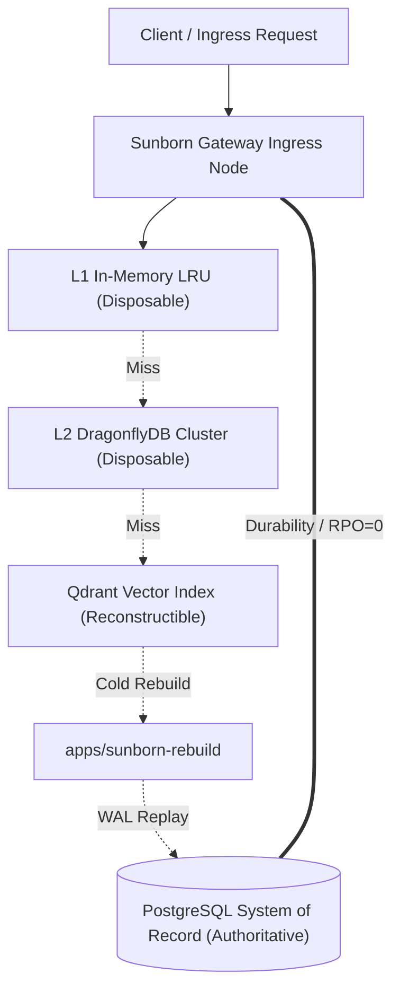

# Sunborn State Authority Matrix & Invalidation Guarantees

**Document Identifier**: `SUNBORN-ARCH-SAM-2026.1`  
**Classification**: Engineering Governance & Architectural Specification  
**Standard Compliance**: ISO/IEC/IEEE 42010:2022, ISO/IEC 25010:2023  
**Status**: Authoritative & Active  

---

## 1. Executive Summary & Non-Accelerator Authority Invariant

The Sunborn architecture enforces the invariant of **Non-Accelerator Authority**:

> **Theorem 1 (Non-Accelerator Authority)**:  
> Accelerators (in-memory L1 cache, DragonflyDB L2 cache, Qdrant vector index, local vector clocks) hold **zero authoritative state**. All authoritative tenant state, encryption key envelopes (TDEKs), API credentials, and causal audit logs reside strictly in PostgreSQL WAL. In the event of catastrophic termination or uncoordinated replica restart, all accelerator state can be disposed without data loss, and cold acceleration tiers can be reconstructed from PostgreSQL WAL replay via `apps/sunborn-rebuild`.



---

## 2. State Authority Classification Matrix

Every stateful data structure across the Sunborn platform is categorized into one of five rigorous authority tiers:

| Subsystem | State Entity | Storage Tier | Authority Tier | Durability SLA (RPO) | Reconstruction SLA (RTO) | Eviction / Restart Behavior |
| :--- | :--- | :--- | :--- | :--- | :--- | :--- |
| **Identity & Access** | `tenants` table | PostgreSQL | **Authoritative (SoR)** | RPO = 0 (fsync) | Immediate | Authoritative system-of-record; hydrated on startup. |
| **Identity & Access** | `api_credentials` table | PostgreSQL | **Authoritative (SoR)** | RPO = 0 (fsync) | Immediate | Transactional CRUD; cache invalidation on write/rotate. |
| **Cryptography** | `tenant_wrapped_keys` | PostgreSQL / Remote KMS | **Authoritative (SoR)** | RPO = 0 (fsync) | Immediate | Master KEK-wrapped TDEKs hydrated at gateway startup. |
| **FinOps Ledger** | `finops_ledger` table | PostgreSQL | **Authoritative (SoR)** | RPO = 0 (fsync) | Immediate | Transactional token avoidance accounting ledger. |
| **Lineage & Invalidation** | `invalidation_outbox` | PostgreSQL | **Authoritative (SoR)** | RPO = 0 (fsync) | Immediate | Transactional outbox pattern with deduplication ID. |
| **Audit Log** | `audit_events` | PostgreSQL | **Authoritative (SoR)** | RPO = 0 (fsync) | Immediate | Immutable append-only audit trail. |
| **Exact Cache** | L1 In-Memory Cache | RAM (`sunborn-cache`) | **Disposable / Cache** | N/A (Disposable) | < 1 ms (read-through) | LRU eviction; cold boot causes read-through hydration. |
| **Exact Cache** | L2 Dragonfly Store | Redis protocol cluster | **Disposable / Cache** | N/A (Disposable) | < 5 ms (read-through) | Memory eviction policy; re-hydrated on cache miss. |
| **Durable Cache** | `durable_cache_entries` | PostgreSQL | **Authoritative (SoR)** | RPO = 0 (fsync) | Immediate | Encrypted cache content backup for cold cluster warm. |
| **Semantic Cache** | Vector Embeddings | Qdrant | **Reconstructible** | Derived from DB | < 60s cold rebuild | Rebuilt from `durable_cache_entries` via `sunborn-rebuild`. |
| **Dependency Lineage** | Roaring Bitmaps | RAM / Roaring SIMD | **Reconstructible** | Derived from DB | < 5s cold rebuild | Reconstructed from `dependency_edges` table. |
| **Rate Limiter** | Sliding Window RPS | RAM / Dragonfly | **Ephemeral** | N/A (Windowed) | Immediate reset | Resets to clean window on worker process restart. |
| **Spend Velocity** | Rolling 60s Ingestion | `SpendVelocityController` | **Governed Ephemeral** | Ephemeral + DB | Reconstructed via Ledger| Pruned rolling window with DB ledger audit logging. |
| **Learning Policies** | Active Policy Matrix | Gateway State / HMAC | **Verifiable** | Versioned Artifact | Immediate | HMAC-SHA256 authenticated JSON policy bundle. |

---

## 3. Cache Equivalence and Invalidation Guarantees (S2-05)

Sunborn strictly implements **10-Dimensional Equivalence Identity** before admitting or reusing any cached LLM candidate:

### 3.1 Ten-Dimensional Equivalence Tuple ($C_{10}$)
A candidate entry $E$ matches incoming request $R$ if and only if:
1. $\text{TenantID}(R) == \text{TenantID}(E)$
2. $\text{AppID}(R) == \text{AppID}(E)$
3. $\text{Model}(R) == \text{Model}(E)$
4. $\text{PromptCanonical}(R) \equiv_{\text{JCS}} \text{PromptCanonical}(E)$
5. $\text{SystemInstructions}(R) == \text{SystemInstructions}(E)$
6. $\text{ToolSchemas}(R) \equiv \text{ToolSchemas}(E)$
7. $\text{Permissions}(R) \subseteq \text{Permissions}(E)$
8. $\text{KnowledgeEpoch}(R) \le \text{KnowledgeEpoch}(E)$
9. $\text{DependencySnapshots}(R) \le \text{DependencyWatermarks}(E)$
10. $\text{PolicyVersion}(R) == \text{PolicyVersion}(E)$

### 3.2 Proof-Carrying Reuse Certificate (`ReuseCertificate`)
Every exact and semantic hit MUST carry an admissible, unexpired `ReuseCertificate`:
* Cryptographic HMAC-SHA256 signature binding the 10-D tuple and dependency Merkle root.
* Validity window check: $\text{issued\_at} \le \text{now} \le \text{expires\_at}$.
* Invalidation check: If any knowledge source in the dependency tree has an updated epoch lease ($\text{epoch} > \text{snapshot\_epoch}$), the certificate is invalidated.
* Tamper safety: Any invalid, tampered, or expired certificate triggers immediate eviction of the entry and fails safe to fresh origin execution.

### 3.3 Transactional Outbox Invalidation Flow
1. Mutation event occurs on knowledge source (e.g., document edited, policy revoked, credential revoked).
2. Gateway / API executes an atomic PostgreSQL transaction inserting into `invalidation_outbox`.
3. Background outbox worker polls pending events, acquires cluster lease, and broadcasts invalidation keys.
4. L1 in-memory entries are purged via atomic generation counter bump.
5. L2 Dragonfly keys are removed via `UNLINK`.
6. Qdrant vector points are filtered or deleted.
7. Watermark fencer advances vector clock, guaranteeing that any in-flight request started prior to mutation cannot write back stale content.

---

## 4. Disaster Recovery & Reconstruction Runbook (apps/sunborn-rebuild)

In the event of complete cache cluster failure (Dragonfly crash or Qdrant index corruption):

```bash
# 1. Verify PostgreSQL authoritative database connectivity
cargo run -p sunborn-rebuild -- --verify-db --db-url "$SUNBORN_POSTGRES_URL"

# 2. Replay transactional outbox and reconstruct Qdrant vector index
cargo run -p sunborn-rebuild -- \
  --reconstruct-vectors \
  --db-url "$SUNBORN_POSTGRES_URL" \
  --qdrant-url "$SUNBORN_QDRANT_URL" \
  --batch-size 1000

# 3. Verify zero residual drift across cache tiers
cargo run -p sunborn-rebuild -- --audit-integrity
```

* RPO: **0 seconds** (all state committed to PostgreSQL WAL).
* RTO: **< 60 seconds** for 100,000 vector embeddings under parallel batched FastEmbed re-indexing.
