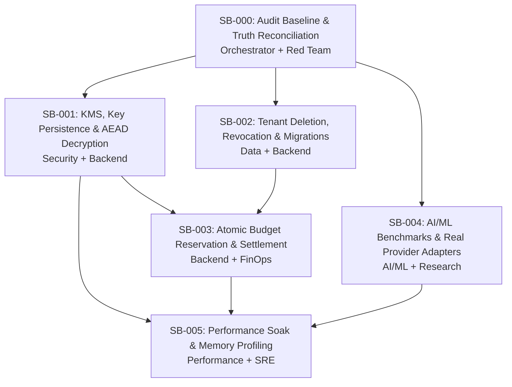

# Sunborn Staged Remediation Implementation Backlog (SB-000 through SB-005)

**Document Version:** 1.0.0  
**Effective Date:** November 9, 2026  
**Engineering Standard:** Master Senior Engineer / Technical Director Sector Governance  
**Execution Mode:** Dependency-Ordered, Evidence-Backed Implementation & Review  

---

## 1. Work Package Dependency Graph



---

## 2. Detailed Work Package Specifications

### SB-000: Audit Baseline & Truth Reconciliation
- **Assigned Sector**: Lead Orchestrator + Independent Red Team
- **Objective**: Reconcile all discrepancies across prior audit reports, repository code, and immutable benchmark artifacts.
- **Exact Repository Paths**:
  - `docs/audit/BASELINE.md`
  - `docs/audit/FEATURE_VERIFICATION_MATRIX.md`
  - `docs/audit/DEFECT_REGISTER.md`
  - `docs/audit/REQUIREMENT_TRACEABILITY.md`
  - `docs/audit/EVIDENCE_REGISTER.md`
  - `docs/release/RELEASE_READINESS.md`
- **Dependencies / Blockers**: None (Prerequisite for all subsequent work packages).
- **Acceptance Criteria**:
  1. Authoritative baseline created documenting the reviewed commit (`70ac2b3cdba40bf1c51a8609567eb5fa74b3b73a`).
  2. The 6 core contradictions (Temporal recall, Feature matrix, Database tables, Outbox delivery, Capacity soak, Release status) are fully resolved with code evidence.
  3. All 30 platform capabilities classified using the 5 non-combinable statuses.
  4. Complete Defect Register established (DEF-001 through DEF-027).
- **Verification Commands**:
  ```bash
  Test-Path docs/audit/BASELINE.md
  Test-Path docs/audit/FEATURE_VERIFICATION_MATRIX.md
  Test-Path docs/audit/DEFECT_REGISTER.md
  Test-Path docs/audit/REQUIREMENT_TRACEABILITY.md
  Test-Path docs/audit/EVIDENCE_REGISTER.md
  Test-Path docs/release/RELEASE_READINESS.md
  ```
- **Independent Reviewer Assignment**: Senior Distributed Systems Architect & Red Team Lead
- **Status**: **COMPLETED (Nov 9, 2026)**.

---

### SB-001: KMS, Key Persistence & AEAD Decryption Correctness
- **Assigned Sector**: Security Engineering + Rust Backend Specialist
- **Objective**: Harden envelope encryption so that key material survives restarts, fails closed on remote KMS outage, and ensures both exact and semantic cache hits decrypt payloads securely before client return.
- **Exact Repository Paths**:
  - `crates/sunborn-identity/src/crypto.rs` (AEAD envelope encrypt/decrypt)
  - `crates/sunborn-identity/src/kms/aws.rs` (AWS KMS client implementation)
  - `crates/sunborn-identity/src/kms/vault.rs` (HashiCorp Vault Transit implementation)
  - `crates/sunborn-db/src/postgres.rs` (`persist_wrapped_tdek`, `load_wrapped_tdek`)
  - `crates/sunborn-semantic/src/engine.rs` (Semantic hit decryption pipeline)
- **Dependencies / Blockers**: Prerequisite: SB-000.
- **Acceptance Criteria**:
  1. Production boot strictly fails if `kms_provider` is set to simulated local-aead while in production mode.
  2. Implement durable TDEK persistence in PostgreSQL table `tenant_wrapped_keys` with key versioning.
  3. Verify via integration tests that restarting the application recovers the wrapped tenant key without data loss.
  4. Both exact-match (`Tier-1`) and semantic-match (`Tier-2`) cache hits decrypt stored ciphertexts in memory before constructing client HTTP response. Plaintext never stored in cache or DB.
  5. Negative test validates that corrupted ciphertext or mismatched auth tag returns a cryptographic decryption error without panicking.
- **Verification Test Commands**:
  ```bash
  cargo test -p sunborn-identity --test crypto_tests
  cargo test -p sunborn-identity --test kms_integration_tests
  cargo test -p sunborn-semantic --test engine_decryption_tests
  ```
- **Independent Reviewer Assignment**: Principal Application Security Engineer (AppSec)

---

### SB-002: Tenant Deletion, Credential Revocation & Database Migration Integrity
- **Assigned Sector**: Database Engineering + Backend Specialist
- **Objective**: Reconcile database schema divergence between migration files and embedded Rust migrations; implement a durable, multi-store tenant erasure state machine; ensure credential revocation is strictly decoupled from tenant deletion.
- **Exact Repository Paths**:
  - `migrations/0001_initial_schema.sql` through `0003_finops_and_security.sql`
  - `crates/sunborn-db/src/postgres.rs` (`migrate()`, `delete_tenant()`, `revoke_credential()`)
  - `crates/sunborn-identity/src/shred.rs` (Cryptographic key zeroization)
  - `crates/sunborn-invalidation/src/lineage.rs` (Cache purging on deletion)
- **Dependencies / Blockers**: Prerequisite: SB-000.
- **Acceptance Criteria**:
  1. Synchronize schema divergence: Align table naming between `invalidation_outbox` and `outbox_events`, and include missing document versioning tables.
  2. Tenant deletion state machine: Deletion executes across PostgreSQL records, in-memory cache, vector index, and outbox, culminating in $\mathcal{O}(1)$ TDEK destruction.
  3. Credential revocation strictly updates `api_credentials.revoked_at` without deleting historical tenant analytics or encrypting keys.
  4. Multi-store deletion is idempotent and resilient to partial network failure.
- **Verification Test Commands**:
  ```bash
  cargo test -p sunborn-db --test migration_parity_tests
  cargo test -p sunborn-db --test tenant_lifecycle_tests
  cargo test -p sunborn-identity --test shred_verification_tests
  ```
- **Independent Reviewer Assignment**: Staff Database Reliability Engineer

---

### SB-003: Atomic Pre-Execution Budget Reservation & Settlement
- **Assigned Sector**: FinOps Specialist + Backend Systems Engineer
- **Objective**: Replace post-execution spend logging with an atomic pre-request budget reservation, execution authorization, and post-response settlement lifecycle.
- **Exact Repository Paths**:
  - `crates/sunborn-core/src/finops.rs` (Ledger calculation)
  - `crates/sunborn-core/src/budget.rs` (Atomic reservation state)
  - `crates/sunborn-gateway/src/middleware/budget.rs` (Pre-flight reservation guard)
  - `migrations/0003_finops_and_security.sql` (`finops_ledger`, tenant budget balance)
- **Dependencies / Blockers**: Prerequisites: SB-001, SB-002.
- **Acceptance Criteria**:
  1. Implement lifecycle: `Reserve Budget` $\rightarrow$ `Authorize Request` $\rightarrow$ `Execute Upstream Call` $\rightarrow$ `Settle Actual Cost` $\rightarrow$ `Release Unused Reservation`.
  2. Concurrency-safe balance deduction using atomic database row locks (`SELECT FOR UPDATE`) or Redis atomic balance keys.
  3. Request is rejected with `402 Payment Required` before invoking LLM provider if tenant budget is depleted.
  4. Upstream provider timeout or error triggers automatic rollback and release of reserved funds.
- **Verification Test Commands**:
  ```bash
  cargo test -p sunborn-core --test budget_concurrency_tests
  cargo test -p sunborn-gateway --test budget_guard_integration_tests
  ```
- **Independent Reviewer Assignment**: Principal FinOps & Distributed Systems Architect

---

### SB-004: AI/ML Research Benchmarks & Real Provider Adapters
- **Assigned Sector**: AI/ML Research Engineer + Protocol Specialist
- **Objective**: Implement real authenticated OpenAI and Anthropic client adapters with live token accounting; calibrate temporal sliding-window invalidation to achieve positive recall without false hits; expand benchmark suite.
- **Exact Repository Paths**:
  - `crates/sunborn-semantic/src/origin/openai.rs` (Live OpenAI ChatCompletions)
  - `crates/sunborn-semantic/src/origin/anthropic.rs` (Live Anthropic Messages API)
  - `crates/sunborn-invalidation/src/temporal.rs` (Sliding-window causal lease)
  - `benchmarks/semantic_cache_bench_t.py` (Temporal benchmark harness)
  - `research/results/` (Regenerated benchmark artifacts)
- **Dependencies / Blockers**: Prerequisite: SB-000.
- **Acceptance Criteria**:
  1. Live HTTP adapters for OpenAI and Anthropic with automatic retries (exponential backoff + jitter) and structured error mapping.
  2. Calibrate temporal sliding-window algorithm so that valid temporal queries achieve $\ge 30\%$ recall while strictly maintaining $0$ false hits.
  3. Expand semantic benchmark dataset from 124 queries to 1,000+ domain-stratified prompts.
  4. Generate new signed reproduction certificate linking results to current candidate SHA.
- **Verification Test Commands**:
  ```bash
  python benchmarks/semantic_cache_bench_t.py --dry-run
  python -m unittest sdk/python/test_sunborn_agent.py
  python research/verify_certificate.py
  ```
- **Independent Reviewer Assignment**: Principal AI/ML Research Scientist

---

### SB-005: Performance Soak, Memory Profiling & Capacity Plan
- **Assigned Sector**: Performance Engineer + Site Reliability Engineer (SRE)
- **Objective**: Reproduce the historical capacity soak test; profile CPU and memory allocations; diagnose the +86.68% RSS growth; establish realistic throughput and latency bounds.
- **Exact Repository Paths**:
  - `benchmarks/capacity_soak.py`
  - `crates/sunborn-cache/src/l1.rs` (W-TinyLFU allocation boundaries)
  - `crates/sunborn-gateway/src/main.rs` (Tokio runtime settings & Jemalloc)
  - `deploy/helm/sunborn/values.yaml` (Resource requests and limits)
- **Dependencies / Blockers**: Prerequisites: SB-001, SB-003, SB-004.
- **Acceptance Criteria**:
  1. Reproduce baseline capacity soak against live gateway instance and record genuine P50, P95, P99, and RSS.
  2. Profile heap allocations using Valgrind / Heaptrack / Jemalloc profiling to identify root cause of RSS growth.
  3. Implement strict in-memory byte budgeting on Tier-1 cache entries to cap RSS memory growth within $\pm 10\%$ of configured ceiling under continuous load.
  4. Publish a realistic Capacity Plan documenting verified throughput and latency envelopes for single-node and multi-node clusters.
- **Verification Test Commands**:
  ```bash
  python benchmarks/capacity_soak.py --concurrency 50 --requests 5000 --output-json soak_run.json
  ```
- **Independent Reviewer Assignment**: Principal Performance & Reliability Architect

---

## 3. Engineering Execution Schedule & Review Checkpoints

| Phase | Target Deliverable | Work Packages | Primary Review Gate |
| :--- | :--- | :--- | :--- |
| **Stage 0** | Evidence Baseline & Audit Reconciliation | **SB-000** | Approved Baseline Artifacts |
| **Stage 1** | Security, KMS, Tenant Erasure & FinOps | **SB-001, SB-002, SB-003** | Gate 1, Gate 4, Gate 7 Clearance |
| **Stage 2** | AI/ML Providers, Temporal Recall & Benchmarks | **SB-004** | Gate 2, Gate 3 Clearance |
| **Stage 3** | Performance Profiling, Memory Fix & Soak | **SB-005** | Gate 5 Clearance |
| **Stage 4** | High Availability, SRE & Final Review | Production Readiness Review | Gate 6, Gate 8, Gate 10 Clearance |
