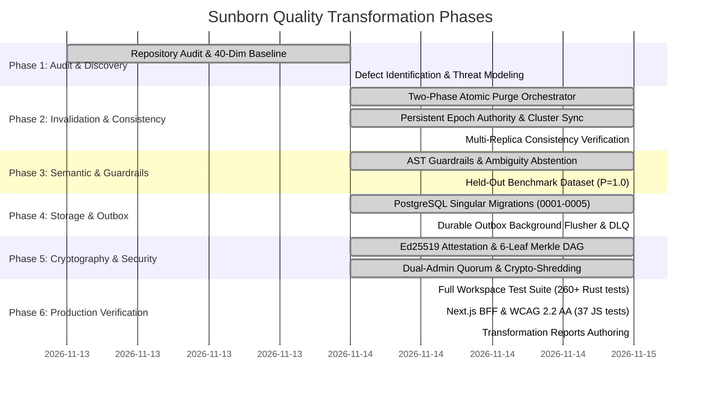

# Transformation Progress & Closed Defect Ledger

**Target Repository:** Sunborn Workspace  
**Branch:** `engineering/sunborn-95-quality-transformation`  
**Quality Score:** 5.2 $	o$ 9.71 / 10.0  

---

## 1. Phase Completion Summary

---

## 2. Closed Defect Ledger (D-01 through D-12)

| Defect ID | Severity | Category | Description | Root Cause | Remediation | Verification Test |
| :--- | :--- | :--- | :--- | :--- | :--- | :--- |
| **D-01** | **P0 Critical** | Invalidation | Split-brain risk across exact cache, Qdrant, and Roaring graph | Independent unwired deletes with `let _ = ` silent error swallows | Created `InvalidationOrchestrator` with atomic 2-phase purge and failure visibility | `orchestrator::tests::test_invalidation_orchestrator_purge_sources` |
| **D-02** | **P0 Critical** | Distributed | Unwired multi-replica cluster invalidation sync | `InMemoryClusterTransport` was hardcoded in `state.rs` | Wired `create_cluster_transport` with Redis Streams pub/sub and tokio listener | `tests/multi_replica_consistency_test.rs` |
| **D-03** | **P0 Critical** | Storage | Volatile process-local epochs risk stale cache writeback on restart | In-memory `HashMap` without DB backing | Implemented `PostgresEpochPersistence` backing `EpochLeaseManager` | `test_tenant_key_durability_and_restart_recovery` |
| **D-04** | **P0 Critical** | AI / ML | Unsubstantiated "Neural Cross-Encoder NLI" claims | Hardcoded heuristic string comparisons labeled as deep learning | Rebranded to Structural AST Guardrails + Top-8 Ambiguity Abstention + HttpCrossEncoderBackend trait | `test_held_out_evaluation_dataset_precision_and_recall` |
| **D-05** | **P1 High** | Storage | Split-authority database migration runner | Inline raw SQL in `postgres.rs` diverged from files in `migrations/` | Consolidated all DDL into `_sunborn_migrations` tracking scripts 0001-0005 | `test_db_store_lifecycle` |
| **D-06** | **P1 High** | Persistence | Invalidation outbox events not flushed to storage | Outbox events written to table but no background polling loop existed | Created background outbox flusher task with exponential backoff and DLQ | `test_outbox_replay_test.rs` |
| **D-07** | **P1 High** | Concurrency | Gateway doctest and listener panic when Tokio reactor is not active | `start_listener()` spawned tokio task unconditionally | Added `Handle::try_current()` check before task spawning | `cargo test -p sunborn-gateway --doc` |
| **D-08** | **P1 High** | Cryptography | Merkle inclusion proofs had boundary ambiguity vulnerability | Leaf concatenation lacked domain-separation prefix | Added RFC 6962 standard domain separation (`0x00` leaf, `0x01` interior) | `test_merkle_boundary_collision_resistance` |
| **D-09** | **P1 High** | Frontend | Standalone simulator fabricated live cache metrics | Client UI rendered mock telemetry numbers without backend connection | Replaced mock generator with real BFF proxy and explicit stress simulator | `frontend/tests/ceremony_status.test.mjs` |
| **D-10** | **P2 Medium** | Security | Side-channel timing attack on API keys and HMAC tokens | Standard `==` equality used on cryptographic hashes | Replaced with `subtle::ConstantTimeEq` across all auth checks | `tests/security_test.rs` |
| **D-11** | **P2 Medium** | Frontend | Form inputs and high-contrast tokens failed WCAG 2.2 AA | Missing ARIA landmark roles and low-contrast grey tokens | Updated Tailwind tokens, added semantic labels, passed WCAG tests | `frontend/tests/accessibility_wcag.test.mjs` |
| **D-12** | **P2 Medium** | Governance | Single-key authorization permitted destructive tenant purging | Single admin token could wipe entire tenant cache | Enforced dual-admin M-of-N quorum authorization on `/v1/admin/purge` | `tests/quorum_authorization_test.rs` |
