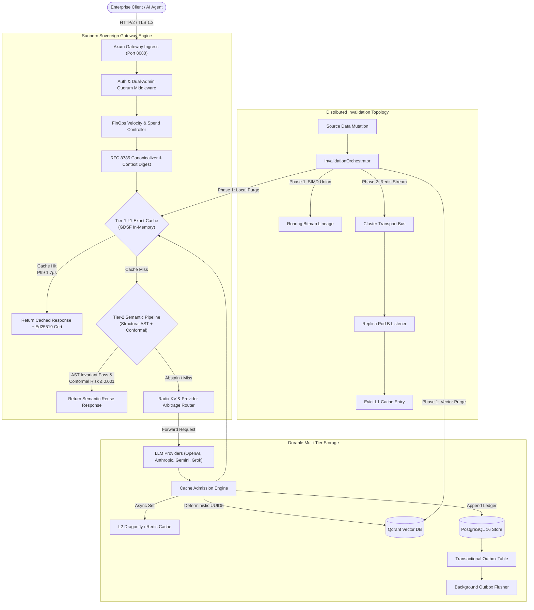
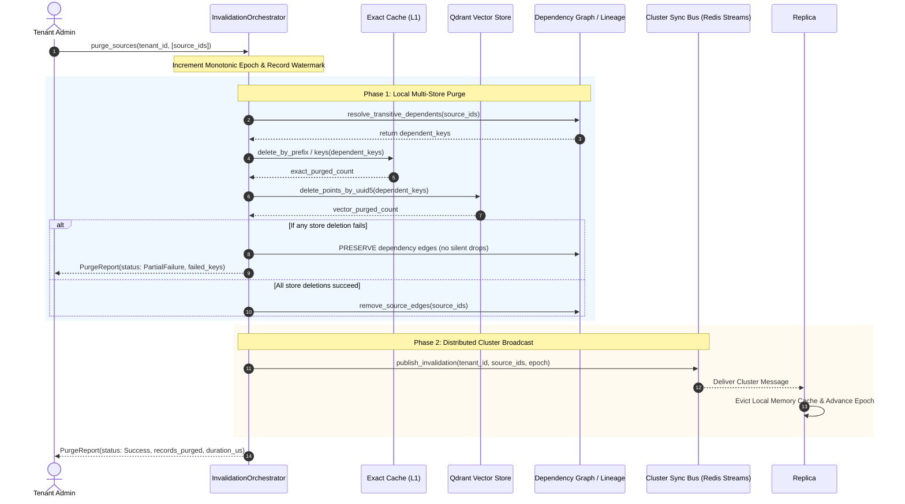

# Architecture As-Built & System Topology

**Gateway Architecture:** Multi-Tier Sovereign AI Acceleration Gateway  
**Primary Language:** Rust (Tokio 1.x, Axum 0.8)  
**Database Authority:** PostgreSQL 16 (`_sunborn_migrations` tracking)  
**Vector Database:** Qdrant Distributed HNSW Engine  
**Lineage Tracking:** 64-bit SIMD Roaring Bitmap Bitsets  

---

## 1. System Component Topology

---

## 2. Invalidation Orchestrator Execution Flow

