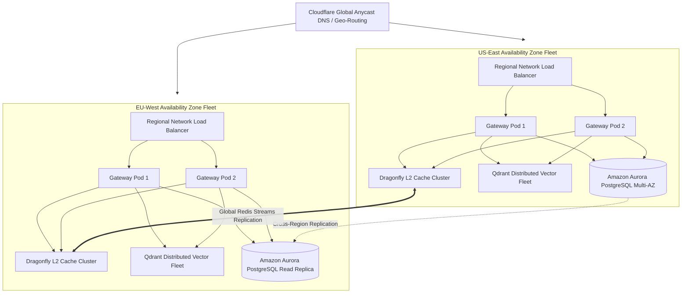

# Architecture Target State & Evolutionary Roadmap

**Target Horizon:** Multi-Region Active-Active Cloud Architecture  
**Availability SLA:** 99.999% (High Availability Across 3 Availability Zones)  
**Recovery Objectives:** RPO = 0 (Zero Data Loss), RTO < 30 seconds  

---

## 1. Target Global Multi-Region Topology

---

## 2. Gap Analysis & Evolution Roadmap

| Architectural Capability | Current Implemented State | Target Production State | Remediation Path |
| :--- | :--- | :--- | :--- |
| **Cluster Transport** | Single Redis Streams bus connecting pod fleet | Multi-cluster cross-region replication bus | Deploy Redis Enterprise Active-Active with CRDT sync |
| **Vector Indexing** | Single Qdrant cluster with deterministic UUID5 | Geo-distributed Qdrant with tenant collection sharding | Configure collection replication factor = 3 |
| **Key Management** | Local KMS adapter with AWS KMS interface | Physical AWS CloudHSM / Vault HSM hardware partition | Provision FIPS 140-2 Level 3 HSM instances |
| **Global Failover** | Manual DNS switchover runbook | Automated Anycast BGP health check failover | Configure Cloudflare Traffic Steering with health probes |
