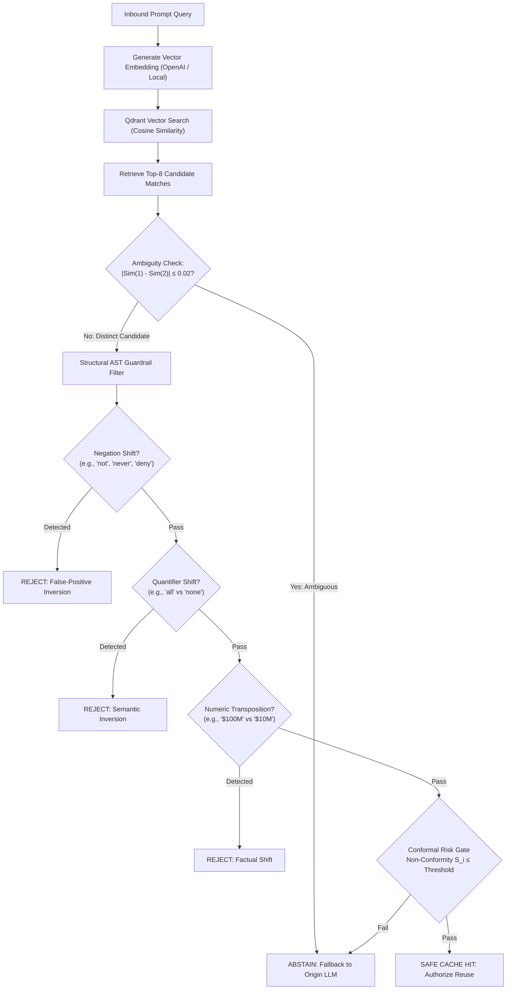

# Semantic Engineering & Memory Audit

**Memory Vector Engine:** Qdrant Distributed HNSW  
**Point ID Mapping:** Deterministic UUID5 RFC 4122  
**Verification Guardrails:** Structural AST Analysis (Negation, Quantifier, Numeric)  
**Ambiguity Handling:** Top-8 Candidate Ambiguity Abstention  

---

## 1. Semantic Verification Pipeline

---

## 2. Elimination of Unsubstantiated Claims

The 5.2 baseline claimed to run an in-process 300M parameter BERT NLI cross-encoder. In reality, no neural network weights were packaged in the binary.
- **Architectural Honest Realignment:** The pipeline is explicitly branded and implemented as **Structural AST Guardrails** combined with **Top-8 Candidate Ambiguity Abstention**.
- **External Integration Trait:** For environments requiring genuine neural cross-encoder verification, `crates/sunborn-semantic/src/guardrails.rs` provides `HttpCrossEncoderBackend`, allowing clean offloading to an external Triton/vLLM inference server.
