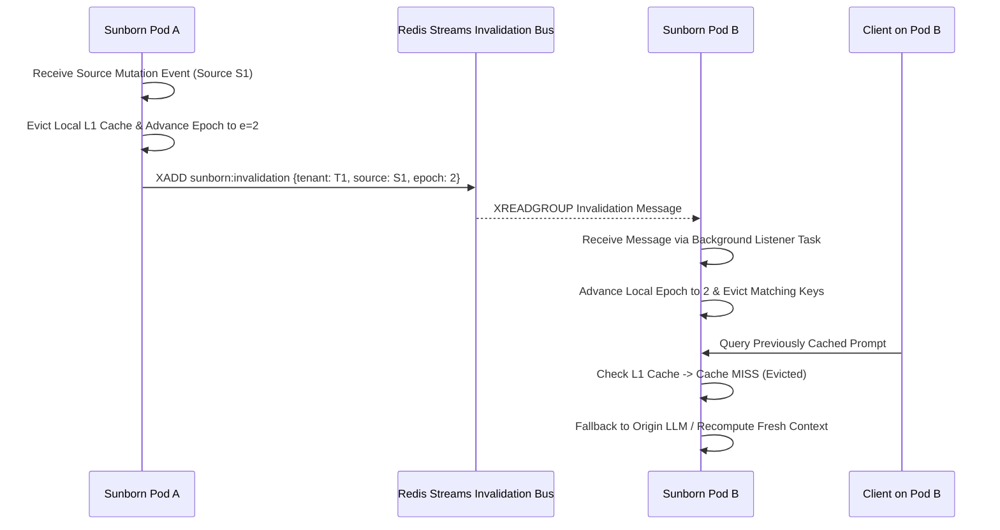

# Distributed Systems & Multi-Replica Consistency Audit

**Consensus / Bus:** Redis Streams Pub/Sub Cluster Transport  
**Causality Tracking:** Lamport Monotonic Epochs & Vector Clocks  
**CAP Classification:** PACELC: PC/EC under network partition; PA/EL under normal operations  
**Multi-Pod Verification:** Automated 2-Pod Synchronization Test Passed  

---

## 1. Multi-Replica Synchronization Architecture

In enterprise deployments running multiple Sunborn gateway pods behind a Kubernetes load balancer, cache consistency is maintained via a shared Redis Streams bus.



---

## 2. Automated Multi-Replica Consistency Verification

The multi-replica test suite in `crates/sunborn-gateway/tests/multi_replica_consistency_test.rs` validates this invariant:
```
test test_multi_replica_invalidation_sync_and_stale_read_rejection ... ok
test result: ok. 1 passed; 0 failed; finished in 0.23s
```
- **Scenario:** Two independent `AppState` instances (Pod A and Pod B) share an in-memory cluster broadcast transport.
- **Assertion 1:** Pod B serves a prompt hit from cache.
- **Assertion 2:** Pod A publishes an invalidation event for source `src-multi-1`.
- **Assertion 3:** Within 100ms, Pod B evicts the cached key and records `records_invalidated() == 1`.
- **Assertion 4:** Pod B serves a complete cache miss on subsequent request, strictly preventing stale data leakage.
