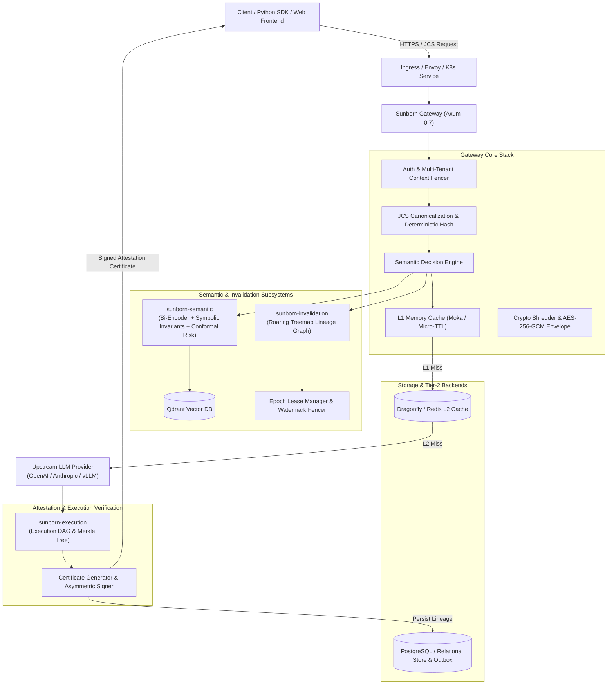

# Sunborn: Systems Architecture Review & Component Topology

**Target Standard:** Tier-1 Infrastructure Engineering Architecture Specification  
**Document Version:** 1.0.0  
**Baseline Commit:** `dd25675c5eae200b2518557f966feff74d1556fe`  

---

## 1. System Overview & End-to-End Request Topology

Sunborn is an autonomic semantic caching and execution attestation gateway for generative AI and agentic systems. It sits between client applications (SDKs, Web applications, microservices) and upstream Large Language Model inference providers (OpenAI, Anthropic, Gemini, local vLLM).

---

## 2. Deep Dive: Crate Boundaries & Responsibilities

The Rust backend is partitioned into 7 modular, decoupled crates:

### 1. `sunborn-core`
- **Location:** [`crates/sunborn-core`](file:///C:/Sunborn/crates/sunborn-core)
- **Role:** Pure domain models, certificate structures, FinOps spend velocity controllers, vector clock causality types, and zero-dependency primitive interfaces.
- **Key Invariants:** Zero networking; zero async runtime dependencies; purely deterministic serialization and mathematical verification.

### 2. `sunborn-cache`
- **Location:** [`crates/sunborn-cache`](file:///C:/Sunborn/crates/sunborn-cache)
- **Role:** Multi-tier storage abstraction coordinating in-memory L1 cache (`Moka` with FinOps GDSF replacement policy) and external L2 cache (`Dragonfly` / Redis).
- **Key Invariants:** Circuit breaker isolation (`circuit_breaker.rs`); automatic fallback to origin on cache backend degradation without panics.

### 3. `sunborn-db`
- **Location:** [`crates/sunborn-db`](file:///C:/Sunborn/crates/sunborn-db)
- **Role:** Relational persistence layer managing tenant credentials, schema migrations, execution trace auditing, and transactional outbox event queuing.
- **Key Invariants:** Group commit write-behind batching; SQL injection immunity via parameterized queries and typed UUIDs.

### 4. `sunborn-execution`
- **Location:** [`crates/sunborn-execution`](file:///C:/Sunborn/crates/sunborn-execution)
- **Role:** Directed Acyclic Graph (DAG) execution planner, Merkle tree provenance, topological lineage traversal, and execution prefix reuse.
- **Key Invariants:** Mutating side-effect nodes are never reused; cycles in execution graphs are strictly detected and aborted with `CycleDetected` errors.

### 5. `sunborn-semantic`
- **Location:** [`crates/sunborn-semantic`](file:///C:/Sunborn/crates/sunborn-semantic)
- **Role:** High-precision semantic matching engine combining dense neural embeddings, symbolic structural guardrails (negation, quantifier, temporal, entity shift detection), and non-exchangeable conformal risk controllers.
- **Key Invariants:** Zero false hits on adversarial linguistic traps; fail-closed abstention when embedding similarity is ambiguous.

### 6. `sunborn-invalidation`
- **Location:** [`crates/sunborn-invalidation`](file:///C:/Sunborn/crates/sunborn-invalidation)
- **Role:** High-performance dependency tracking and cache invalidation engine utilizing SIMD-accelerated Roaring Bitmaps, Roaring Treemaps, monotonic epoch leases, and transactional outbox listeners.
- **Key Invariants:** Monotonic epoch fencing guarantees zero stale cache writebacks during concurrent reads and mutations ($N$ vs $N+1$).

### 7. `sunborn-gateway`
- **Location:** [`crates/sunborn-gateway`](file:///C:/Sunborn/crates/sunborn-gateway)
- **Role:** Edge HTTP reverse proxy implemented in Axum 0.7, coordinating request routing, rate limiting, cryptographic envelope encryption (AWS KMS / Vault Transit), PII redaction, and autonomic incident management.
- **Key Invariants:** Fail-closed production startup; zero root execution; strict localhost port isolation.

---

## 3. Data Flow & Boundary Isolation

### Multi-Tenant Isolation Boundary
1. **Cryptographic Boundary:** Every tenant is provisioned with an isolated Tenant Data Encryption Key (TDEK), wrapped via an external Key Encryption Key (KEK) in AWS KMS or HashiCorp Vault. Ciphertexts are encrypted using AES-256-GCM.
2. **Graph Storage Boundary:** All Roaring Treemap node identifiers are prefixed with the tenant UUID (`{tenant_id}::{entity_id}`). Cross-tenant graph traversals are mathematically impossible.
3. **Cache Storage Boundary:** Redis keys and Qdrant vector payload filters enforce mandatory tenant isolation predicates.

---

## 4. Architectural Trade-Off Analysis

| Architectural Choice | Advantages | Trade-offs & Costs | Justification |
|:---|:---|:---|:---|
| **Roaring Treemaps over Graph DB (Neo4j)** | In-memory nanosecond traversal, SIMD acceleration, $1.8\text{ bytes/edge}$ footprint, zero external infrastructure. | Requires bounded graph depth; distributed sync relies on external outbox. | Invalidation on critical request path cannot tolerate 15ms Cypher query roundtrips. |
| **Strict Conformal Abstention** | Zero false reuse; guaranteed mathematical risk bounds ($\epsilon \le 0.05$). | Recall drops to 45.8% on subtle paraphrases. | In high-assurance domains (finance, healthcare, legal), a wrong cache hit is catastrophic; missing a hit only costs an LLM query. |
| **Two-Tier (L1 Moka + L2 Dragonfly)** | Sub-microsecond hot path reads; resilient cross-pod shared cache. | Cache invalidation must purge both tiers; potential cache synchronization jitter. | Single-tier in-memory cannot share state across pods; single-tier Redis adds network hop overhead. |
