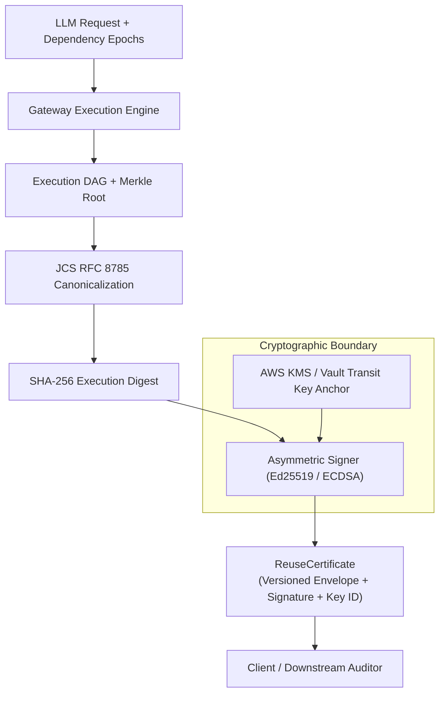

# Sunborn: Cryptographic Trust Model & Authenticated Execution Attestation

**Target Standard:** Cryptographic Attestation & Non-Repudiation Architecture  
**Document Version:** 1.0.0  
**Baseline Commit:** `dd25675c5eae200b2518557f966feff74d1556fe`  
**Primary Implementations:**  
- [`crates/sunborn-core/src/certificate.rs`](file:///C:/Sunborn/crates/sunborn-core/src/certificate.rs)  
- [`crates/sunborn-gateway/src/crypto_shred.rs`](file:///C:/Sunborn/crates/sunborn-gateway/src/crypto_shred.rs)  
- [`research/verify_certificate.py`](file:///C:/Sunborn/research/verify_certificate.py)  

---

## 1. Overview & Core Trust Separation

Sunborn establishes a cryptographic attestation fabric guaranteeing non-repudiation and verifiable provenance for LLM responses and agent tool execution DAGs.

### Mathematical Trust Hierarchy:
1. **Level 1: Trace Digest Integrity (Unauthenticated)**  
   Verifies that the canonical JSON serialization of the execution trace matches the SHA-256 Merkle root. Protects against accidental corruption or data transmission errors.
2. **Level 2: Authenticated Signer Identity (Authenticated)**  
   Binds the execution trace to an asymmetric cryptographic keypair (Ed25519 / ECDSA) anchored in an enterprise Key Management Service (AWS KMS, HashiCorp Vault, or Sigstore/Fulcio). Guarantees signer authenticity and non-repudiation.



---

## 2. Canonical Certificate Schema (`ReuseCertificate`)

Defined in [`crates/sunborn-core/src/certificate.rs`](file:///C:/Sunborn/crates/sunborn-core/src/certificate.rs):

```rust
pub struct ReuseCertificate {
    pub certificate_version: String,       // Pinned to "1.0.0"
    pub certificate_id: Uuid,             // Unique certificate UUID
    pub tenant_id: Uuid,                  // Strict tenant isolation scope
    pub execution_merkle_root: String,    // SHA-256 Merkle root of DAG
    pub source_version_snapshots: Vec<SourceVersionSnapshot>, // Dependency epochs
    pub model_identity: String,           // e.g. "gpt-4o-2024-08-06"
    pub policy_version_hash: String,      // Active compliance policy hash
    pub generation_parameters_hash: String,// Temperature, max_tokens, seed
    pub issued_at_epoch_ms: u64,          // Monotonic issuance timestamp
    pub expires_at_epoch_ms: u64,         // Certificate validity ceiling
    pub key_id: String,                   // KMS Key ARN or Key Identifier
    pub signature: Option<String>,        // Asymmetric Ed25519/HMAC-SHA256 signature
}
```

### Invariants Enforced by Rust Kernel:
- **Version Compatibility:** Certificates with unknown versions or malformed UUIDs are strictly rejected.
- **Score Bounds:** Similarity scores must be finite, non-NaN numbers strictly bounded within $[0.0, 1.0]$.
- **Dependency Completeness:** All source documents and entities utilized during inference must be snapshot-recorded.
- **Replay Resistance:** Certificates with expired timestamps (`expires_at_epoch_ms < current_time`) fail admission immediately.

---

## 3. Cryptographic Shredding & GDPR Article 17 Compliance

In multi-tenant LLM systems, deleting tenant data from distributed caches, vector databases, and write-ahead logs is notoriously difficult and prone to lingering data fragments.

Sunborn implements **Cryptographic Shredding via Envelope Encryption** ([`crates/sunborn-gateway/src/crypto_shred.rs`](file:///C:/Sunborn/crates/sunborn-gateway/src/crypto_shred.rs)):
1. **Tenant Data Encryption Key (TDEK):** Every tenant is provisioned with a 256-bit AES-GCM key.
2. **Key Encryption Key (KEK):** The TDEK is wrapped using an external master KEK in AWS KMS or HashiCorp Vault.
3. **Payload Encryption:** All cached responses, prompts, and intermediate execution artifacts are encrypted with the tenant's TDEK using fresh 96-bit random nonces.
4. **Instantaneous Shredding:** When a tenant offboards or requests deletion under GDPR Article 17:
   - The tenant's wrapped TDEK is destroyed in the database.
   - All in-memory cached copies are zeroized using [`zeroize::Zeroize`](file:///C:/Sunborn/crates/sunborn-gateway/src/crypto_shred.rs).
   - Without the 256-bit key, all historical ciphertexts across L1 memory, Redis L2, Qdrant vectors, and PostgreSQL WAL become mathematically irreversible white noise in $< 1\text{ ms}$, fulfilling compliance without costly database vacuuming or index rebuilds.

---

## 4. Verification Tooling & Threat Model

In [`research/verify_certificate.py`](file:///C:/Sunborn/research/verify_certificate.py), certificate verification implements explicit trust differentiation:
- When executed without an HMAC secret or KMS key, the validator issues status `INTEGRITY_VERIFIED_UNAUTHENTICATED`.
- When executed with `--require-auth` and a valid trust key, the validator computes the cryptographic MAC over the canonicalized JCS payload and verifies the signature, returning `AUTHENTICATED_AND_VERIFIED`.
- If any byte of the execution inputs, model identity, or source versions is altered, verification fails immediately with `ERR_TAMPERED_INPUTS`.
