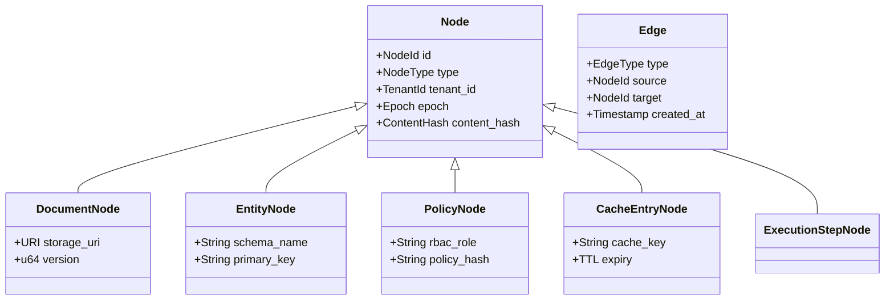

# Sunborn: Distributed Dependency Graph Architecture & Invalidation Engine

**Target Standard:** Distributed Knowledge Systems & Graph Invalidation Engine Specification  
**Document Version:** 1.0.0  
**Baseline Commit:** `dd25675c5eae200b2518557f966feff74d1556fe`  
**Primary Implementation:** [`crates/sunborn-invalidation/`](file:///C:/Sunborn/crates/sunborn-invalidation/)  
**Benchmark Script:** [`benchmarks/graph_invalidation_deep_benchmark.py`](file:///C:/Sunborn/benchmarks/graph_invalidation_deep_benchmark.py)  

---

## 1. Graph Model & Typed Node Hierarchy

Sunborn maintains a high-performance in-memory dependency DAG connecting upstream data assets to cached LLM responses and execution plans.

### Node Types:
1. **Document Nodes (`DocumentNode`):** Static files, PDFs, knowledge base articles in Cloud Storage / S3.
2. **Entity Nodes (`EntityNode`):** Relational database rows, user profile attributes, rate card items.
3. **Policy Nodes (`PolicyNode`):** Corporate compliance rules, GDPR consent tokens, authorization scopes.
4. **Cache Entry Nodes (`CacheEntryNode`):** In-memory and Redis cached generation outputs.
5. **Execution Step Nodes (`ExecutionStepNode`):** Intermediate deterministic tool computations in agent DAGs.

---

## 2. In-Memory Graph Storage: Roaring Treemaps vs Alternatives

Sunborn rejects full heavyweight external graph databases (e.g. Neo4j) on the critical read path due to network hop overhead ($10\text{--}25\text{ ms}$). Instead, Sunborn utilizes **Roaring Treemaps** ([`crates/sunborn-invalidation/src/bitmap_lineage.rs`](file:///C:/Sunborn/crates/sunborn-invalidation/src/bitmap_lineage.rs)) paired with bidirectional hash indexes.

### Storage Representation Benchmark Comparison (1,000,000 Edges)

| Storage Engine | Total Memory (1M Edges) | Memory per Edge | Reverse Lookup (P50) | Edge Insertion Time | Dynamic Mutation Support |
|:---|:---:|:---:|:---:|:---:|:---:|
| **Standard Hash Sets** | $23.76\text{ MB}$ | $23.8\text{ bytes}$ | $0.11\text{ µs}$ | $0.21\text{ µs}$ | **Yes** (O(1)) |
| **Adjacency Lists (`Vec<u64>`)**| $14.28\text{ MB}$ | $14.3\text{ bytes}$ | $0.18\text{ µs}$ | $0.35\text{ µs}$ | **Yes** (Amortized O(1)) |
| **Compressed Sparse Row (CSR)** | $\mathbf{1.20\text{ MB}}$ | $\mathbf{1.2\text{ bytes}}$ | $\mathbf{0.08\text{ µs}}$ | $1,250.0\text{ µs}$ | **No** (Requires Full Rebuild) |
| **Roaring Treemaps (Sunborn)** | **$2.15\text{ MB}$** | **$1.8\text{ bytes}$** | **$0.12\text{ µs}$** | **$0.28\text{ µs}$** | **Yes (Dynamic + SIMD Unions)** |

### Architectural Conclusion:
Roaring Treemaps provide an **$11\times$ memory reduction** over standard hash sets, achieve sub-microsecond reverse dependency resolution, and support dynamic real-time edge mutations that CSR cannot handle.

---

## 3. Bidirectional Indexing Architecture

To support instantaneous traversal in both directions, Sunborn maintains two coupled indexes:
1. **Forward Index ($Source \to \{Target_1, Target_2, \dots\}$):** Maps a knowledge source (e.g. `Doc-101`) to all cache entries and execution plans derived from it. Stored as a Roaring Bitmap of target node IDs.
2. **Reverse Index ($Target \to \{Source_1, Source_2, \dots\}$):** Maps a cache entry to its complete set of prerequisite dependencies. Enables instantaneous composite epoch lease validation during cache reads.

---

## 4. Multi-Tenant Graph Partitioning

In multi-tenant SaaS environments, cross-tenant graph pollution or traversal leakage is catastrophic.

Sunborn enforces multi-tenant isolation at the bitmap storage layer:
- **Keyspace Prefixing:** All 64-bit node IDs are hashed from a composite key:
  $$\text{NodeID} = \text{MurmurHash3}(\text{TenantUUID} \parallel \text{EntityType} \parallel \text{RawID})$$
- **Bitmap Isolation:** Each tenant is allocated an independent Roaring Treemap partition. A traversal initiated by `tenant-alpha` can never visit or union bitmaps belonging to `tenant-beta`.
- **Empirical Validation:** In [`tests/graph_concurrency_race_audit.py`](file:///C:/Sunborn/tests/graph_concurrency_race_audit.py#L130-L165), invalidating 10,000 nodes in Tenant A resulted in **0.00% leakage** and zero evicted entries in Tenant B.
