# Sunborn: Master Engineering Maturity Plan (Stages 0–8)

**Target Standard:** Tier-1 Infrastructure Engineering (Google / Apple / Meta / OpenAI / Microsoft / NVIDIA)  
**Document Status:** Approved for Phased Execution  
**Baseline Commit:** `dd25675c5eae200b2518557f966feff74d1556fe`  

---

## 1. Executive Program Architecture

This program systematically transforms Sunborn from an advanced research prototype into a battle-tested, mathematically defended, and operationally observable enterprise infrastructure gateway.

### Maturity Roadmap Overview

```mermaid
flowchart LR
    S0["Stage 0: Baseline & Reconciliation"] --> S1["Stage 1: Semantic Safety & Re-ranking"]
    S1 --> S2["Stage 2: Distributed Graph Invalidation"]
    S2 --> S3["Stage 3: Authenticated Attestation (PKI/Sigstore)"]
    S3 --> S4["Stage 4: Live Distributed Deployment"]
    S4 --> S5["Stage 5: Full-Stack OpenTelemetry Observability"]
    S5 --> S6["Stage 6: Security Threat Modeling & Fuzzing"]
    S6 --> S7["Stage 7: Production Performance Engineering"]
    S7 --> S8["Stage 8: Engineering Quality & Ergonomics"]
```

---

## 2. Phased Implementation Specifications

### Stage 1: Semantic Safety & Calibrated Re-Ranking
- **Severity / Priority:** High (Core Safety Thesis)
- **Impact:** Eliminates false cache hits while expanding recall from 45.8% to 65%+ on legitimate paraphrases.
- **Root Cause:** Conservative abstention thresholds discard subtle semantic equivalents without cross-encoder validation.
- **Dependencies:** `sunborn-semantic`, `sunborn-core`.
- **Files Affected:**
  - [`crates/sunborn-semantic/src/guardrails.rs`](file:///C:/Sunborn/crates/sunborn-semantic/src/guardrails.rs)
  - [`crates/sunborn-semantic/src/decision.rs`](file:///C:/Sunborn/crates/sunborn-semantic/src/decision.rs)
  - [`benchmarks/heldout_semantic_generalization.py`](file:///C:/Sunborn/benchmarks/heldout_semantic_generalization.py)
  - `docs/engineering/SEMANTIC_EVALUATION.md`
- **Proposed Solution:** Implement a two-tier retrieval cascade: Tier 1 bi-encoder candidate retrieval + symbolic invariant checks $\to$ Tier 2 cross-encoder calibrated re-ranking for borderline cases ($s \in [0.80, 0.88]$).
- **Test Strategy:** Evaluate against the 70-scenario held-out benchmark with Wilson 95% confidence intervals.
- **Measurable Acceptance Criteria:**
  - False-Hit Rate: Strictly $0.00\%$ on adversarial traps.
  - Semantic Precision: $100.0\%$.
  - Semantic Recall: $\ge 60.0\%$ on paraphrases.
- **Risks & Rollback:** Overfitting to benchmark phrasing; rollback via feature flag `SUNBORN_SEMANTIC_CROSS_ENCODER=false`.

---

### Stage 2: Distributed Graph Invalidation Engine
- **Severity / Priority:** Critical (Data Integrity)
- **Impact:** Prevents cache stale-reads across multi-pod gateway deployments when underlying knowledge updates.
- **Root Cause:** In-memory Roaring Treemaps operate per gateway instance; multi-pod clusters require durable outbox broadcast.
- **Dependencies:** `sunborn-invalidation`, `sunborn-cache`.
- **Files Affected:**
  - [`crates/sunborn-invalidation/src/graph.rs`](file:///C:/Sunborn/crates/sunborn-invalidation/src/graph.rs)
  - [`crates/sunborn-invalidation/src/outbox.rs`](file:///C:/Sunborn/crates/sunborn-invalidation/src/outbox.rs)
  - [`crates/sunborn-invalidation/src/epoch.rs`](file:///C:/Sunborn/crates/sunborn-invalidation/src/epoch.rs)
  - `docs/engineering/DISTRIBUTED_GRAPH_DESIGN.md`
  - `docs/engineering/GRAPH_CONSISTENCY_AND_FAILURES.md`
- **Proposed Solution:** Deploy transactional outbox pattern with Kafka/Dragonfly Pub/Sub replication, monotonic watermark advance, and dead-letter queues (DLQ).
- **Test Strategy:** Concurrency race stress harness (100 parallel workers), out-of-order message injection, circular dependency injection.
- **Measurable Acceptance Criteria:**
  - 0 stale writebacks admitted during $N$ vs $N+1$ mutation races.
  - Multi-source atomic lease validation: 100% fail-closed on partial mutation.
  - Transitive invalidation P99 latency $< 5.0\text{ ms}$ at 352,578 edges.
- **Risks & Rollback:** Network partitioning causing invalidation backlog; fallback to immediate time-based TTL cache bypass.

---

### Stage 3: Authenticated Cryptographic Attestation
- **Severity / Priority:** High (Non-Repudiation & Trust)
- **Impact:** Elevates certificate verification from mathematical digest integrity to legally binding signer authenticity.
- **Root Cause:** Development certificates emitted null HMAC signatures (`INTEGRITY_VERIFIED_UNAUTHENTICATED`).
- **Dependencies:** `sunborn-core`, `sunborn-gateway`.
- **Files Affected:**
  - [`crates/sunborn-core/src/certificate.rs`](file:///C:/Sunborn/crates/sunborn-core/src/certificate.rs)
  - [`research/verify_certificate.py`](file:///C:/Sunborn/research/verify_certificate.py)
  - `docs/engineering/CRYPTOGRAPHIC_TRUST_MODEL.md`
- **Proposed Solution:** Integrate asymmetric Ed25519 / ECDSA signing, Sigstore/Cosign-compatible certificate envelopes, and AWS KMS / Vault Transit key identity binding.
- **Test Strategy:** Negative signature tampering tests, expired key tests, revoked trust anchor tests.
- **Measurable Acceptance Criteria:**
  - Certificate verification returns `AUTHENTICATED_AND_VERIFIED`.
  - Signature tampering strictly caught and rejected.
  - Key rotation supported without breaking historical certificate validation.
- **Risks & Rollback:** KMS network latency on signing path; mitigate via async signing worker queue.

---

### Stage 4: Live Distributed Deployment & SRE Hardening
- **Severity / Priority:** High (Operational Viability)
- **Impact:** Demonstrates live cluster resilience under pod eviction, database failover, and rolling upgrades.
- **Dependencies:** Kubernetes, Helm, Docker, Kustomize.
- **Files Affected:**
  - [`deploy/helm/sunborn/`](file:///C:/Sunborn/deploy/helm/sunborn/)
  - [`deploy/k8s/`](file:///C:/Sunborn/deploy/k8s/)
  - [`deploy/verify_live_stack.sh`](file:///C:/Sunborn/deploy/verify_live_stack.sh)
  - `docs/engineering/PRODUCTION_DEPLOYMENT_EVIDENCE.md`
- **Proposed Solution:** Provide automated Kubernetes verification scripts, Chaos Mesh testing scenarios, and strict container security profiles (non-root `65532`, dropped capabilities `ALL`).
- **Test Strategy:** Automated Helm linting, Kustomize dry-runs, and local Docker Compose end-to-end integration.
- **Measurable Acceptance Criteria:**
  - Zero root processes across all containers.
  - Automated PodDisruptionBudget ensures 99.99% availability during rolling restart.
  - Fail-closed startup on missing KMS keys or insecure DB configurations.
- **Risks & Rollback:** Kubernetes version incompatibilities; pinned to Helm 3.16+ and K8s v1.28+.

---

### Stage 5: Full-Stack OpenTelemetry Observability
- **Severity / Priority:** Medium (Production Observability)
- **Impact:** Provides distributed tracing across Axum routing, semantic scoring, Roaring Treemap traversal, and origin LLM execution.
- **Dependencies:** `tracing-opentelemetry`, `opentelemetry-otlp`, `metrics-exporter-prometheus`.
- **Files Affected:**
  - [`crates/sunborn-gateway/src/main.rs`](file:///C:/Sunborn/crates/sunborn-gateway/src/main.rs)
  - [`crates/sunborn-gateway/src/autonomic.rs`](file:///C:/Sunborn/crates/sunborn-gateway/src/autonomic.rs)
  - `docs/engineering/OBSERVABILITY_SPECIFICATION.md`
- **Proposed Solution:** Standardize OpenTelemetry spans with strict PII/secret scrubbing, Grafana dashboards, and Prometheus alert rules for outbox backlog, DLQ spikes, and stale-write rejections.
- **Test Strategy:** Trace emission tests verifying span parentage and zero sensitive prompt leakage.
- **Measurable Acceptance Criteria:**
  - 100% of gateway requests emit valid trace IDs.
  - Zero PII or raw prompts in span attributes.
- **Risks & Rollback:** Telemetry overhead; configurable sampling rate (default 10% in high-load prod).

---

### Stage 6: Security Threat Modeling & Fuzzing
- **Severity / Priority:** Critical (Security Assurance)
- **Impact:** Hardens gateway against prompt injection, SQLi, CRLF, denial-of-service, and cross-tenant leakage.
- **Dependencies:** `cargo-fuzz` / `libfuzzer`, `semgrep`, `trufflehog`.
- **Files Affected:**
  - [`crates/sunborn-gateway/src/middleware/`](file:///C:/Sunborn/crates/sunborn-gateway/src/middleware/)
  - [`crates/sunborn-gateway/src/crypto_shred.rs`](file:///C:/Sunborn/crates/sunborn-gateway/src/crypto_shred.rs)
  - `docs/engineering/SECURITY_THREAT_MODEL.md`
- **Proposed Solution:** STRIDE threat model, libfuzzer harnesses on JCS canonicalization and certificate parsing, automated Semgrep CI rules.
- **Test Strategy:** 14-test adversarial security suite, memory sanitizers, dependency audit.
- **Measurable Acceptance Criteria:**
  - Zero high or critical vulnerabilities in `cargo audit` and `npm audit`.
  - Zero unauthorized cross-tenant data accesses.
- **Risks & Rollback:** False positive security blocks; whitelist overrides for authenticated tenant administrators.

---

### Stage 7: Production Performance Engineering
- **Severity / Priority:** Medium (Latency & Cost)
- **Impact:** Measures exact P50/P95/P99 latencies, CPU profile, allocation rates, and lock contention under 10k+ QPS load.
- **Dependencies:** `benchmarks/capacity_soak.py`, Criterion benchmarks.
- **Files Affected:**
  - [`crates/sunborn-gateway/tests/throughput_test.rs`](file:///C:/Sunborn/crates/sunborn-gateway/tests/throughput_test.rs)
  - [`benchmarks/capacity_soak.py`](file:///C:/Sunborn/benchmarks/capacity_soak.py)
  - `docs/engineering/PERFORMANCE_ENGINEERING_REPORT.md`
- **Proposed Solution:** Zero-allocation hot path optimization, SIMD-accelerated Roaring Treemap unions, lock-free read paths (`ArcSwap`).
- **Test Strategy:** Multi-threaded throughput soak tests under sustained load.
- **Measurable Acceptance Criteria:**
  - Gateway stack throughput: $> 3,000\text{ req/sec}$.
  - In-process L1 cache P99 latency: $< 50\text{ µs}$.
  - Memory envelope: $< 256\text{ MB}$ under 1M graph edges.
- **Risks & Rollback:** Over-optimization reducing code readability; keep abstractions standard unless proven on flamegraph.

---

### Stage 8: Engineering Quality, Ergonomics & Clean Developer Setup
- **Severity / Priority:** High (Maintainability)
- **Impact:** Allows a new distributed systems engineer to clone the repository, run one setup command, and pass all 334 tests in $< 3\text{ minutes}$.
- **Dependencies:** Makefile, devcontainer, Python UV.
- **Files Affected:**
  - `Makefile` / `scripts/dev_setup.sh`
  - [`README.md`](file:///C:/Sunborn/README.md)
  - `docs/engineering/KNOWN_LIMITATIONS.md`
- **Proposed Solution:** Unified `cargo test` and `npm test` runners, strict clean build guarantees, and comprehensive architectural documentation.
- **Test Strategy:** Clean checkout test on isolated runner.
- **Measurable Acceptance Criteria:**
  - Single command `make verify-all` completes all tests and linters cleanly.
- **Risks & Rollback:** None.
