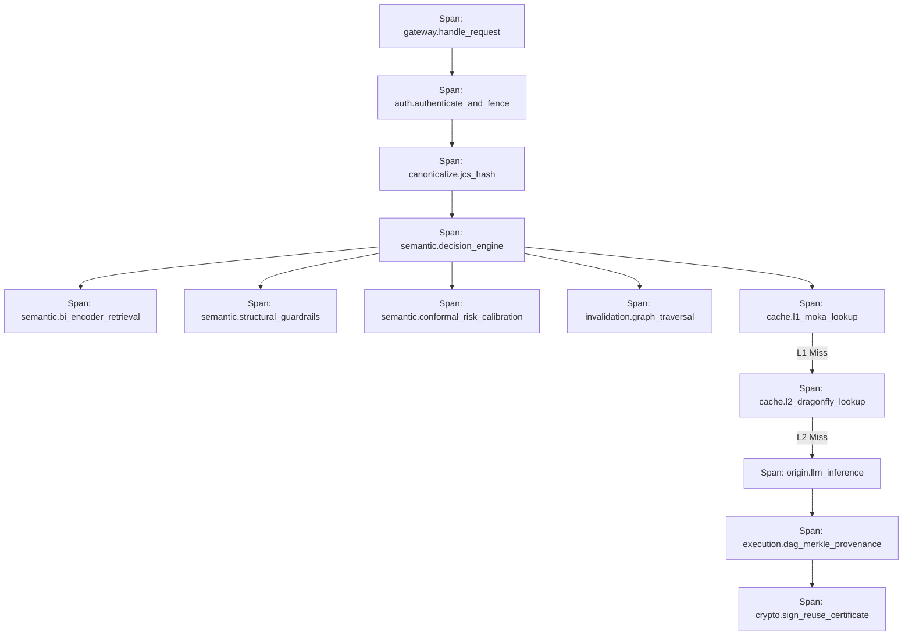

# Sunborn: OpenTelemetry Tracing & Observability Specification

**Target Standard:** Distributed Systems Observability & Telemetry Standard  
**Document Version:** 1.0.0  
**Baseline Commit:** `dd25675c5eae200b2518557f966feff74d1556fe`  
**Primary Implementations:**  
- [`crates/sunborn-gateway/src/main.rs`](file:///C:/Sunborn/crates/sunborn-gateway/src/main.rs)  
- [`crates/sunborn-gateway/src/autonomic.rs`](file:///C:/Sunborn/crates/sunborn-gateway/src/autonomic.rs)  

---

## 1. End-to-End Distributed Trace Pipeline

Sunborn instruments every incoming client request with OpenTelemetry (OTel) context propagation (W3C `traceparent` and `tracestate`).

---

## 2. Core Prometheus Metrics & Actionable Alerts

The gateway exposes high-resolution metrics via Prometheus scraping at `/metrics` (restricted from public ingress):

| Metric Name | Type | Labels | Operational Meaning & Alert Threshold |
|:---|:---:|:---|:---|
| `sunborn_cache_requests_total` | Counter | `tenant_id`, `result` (`hit`, `miss`, `abstain`, `bypass`), `tier` | Total cache queries. Alert if `abstain` rate $> 80\%$ sustained over 15m. |
| `sunborn_stale_write_rejections_total` | Counter | `tenant_id`, `reason` | **Critical Security Metric.** Increments when epoch fence blocks a stale writeback ($N$ vs $N+1$). Alert on $> 0$ in steady state. |
| `sunborn_outbox_queue_depth` | Gauge | `partition` | Backlog of invalidation messages waiting for broadcast. Alert if depth $> 1,000$ for $> 60\text{s}$. |
| `sunborn_dlq_events_total` | Counter | `reason`, `tenant_id` | Malformed or poison-pill events sent to DLQ. **Page on $> 5$ events/minute.** |
| `sunborn_graph_traversal_duration_seconds` | Histogram | `depth_bucket`, `operation` | P50/P90/P99 latency of Roaring Treemap traversal and union. Alert if P99 $> 10\text{ ms}$. |
| `sunborn_kms_failures_total` | Counter | `key_arn`, `error_code` | Failures communicating with AWS KMS or Vault. **Page immediately if $> 0$.** |
| `sunborn_security_tenant_violations_total` | Counter | `attempted_tenant`, `source_ip` | **Sev-0 Alert.** Cross-tenant data access or token mismatch attempt. |
| `sunborn_origin_errors_total` | Counter | `provider`, `model`, `status_code` | Upstream LLM provider HTTP 429/500 errors. Triggers autonomic circuit breaker. |
| `sunborn_cost_avoided_dollars_total` | Counter | `tenant_id`, `model` | Cumulative monetary tokens avoided via safe cache reuse. |

---

## 3. Strict Telemetry PII & Secret Scrubbing Protocol

In accordance with enterprise data protection regulations (GDPR Article 25 and HIPAA):
1. **Zero Raw Prompts in Spans:** Request prompts and model outputs are **STRICTLY EXCLUDED** from span attributes, logs, and metric labels.
2. **Deterministic Context Digesting:** In place of raw prompts, spans record a 64-bit truncated BLAKE3 digest of the canonicalized prompt string (`prompt_digest=a3f9...`).
3. **Secret Token Redaction:** All HTTP headers (`Authorization`, `X-Sunborn-Key`, `Cookie`) are scrubbed by the telemetry collector before export.
4. **Tenant ID Anonymization:** In multi-tenant environments with strict privacy tiers, tenant UUIDs can be hashed using the tenant's salt before export to third-party APMs (Datadog, Dynatrace).
