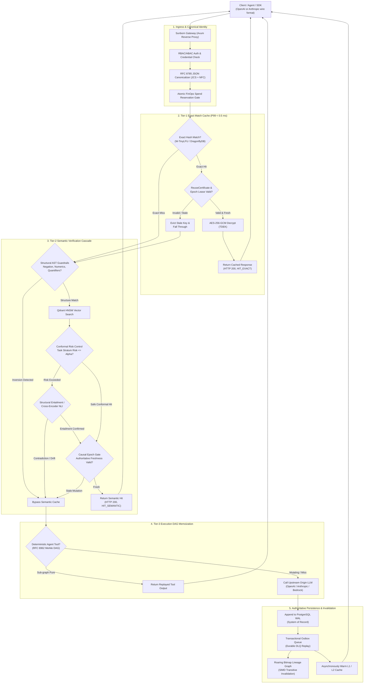
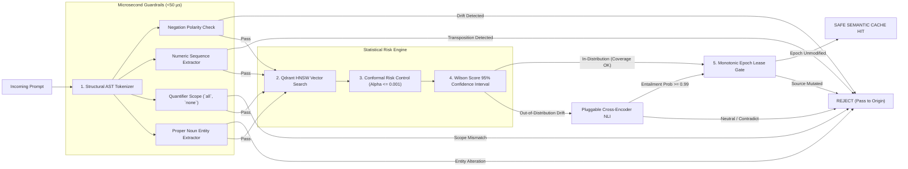
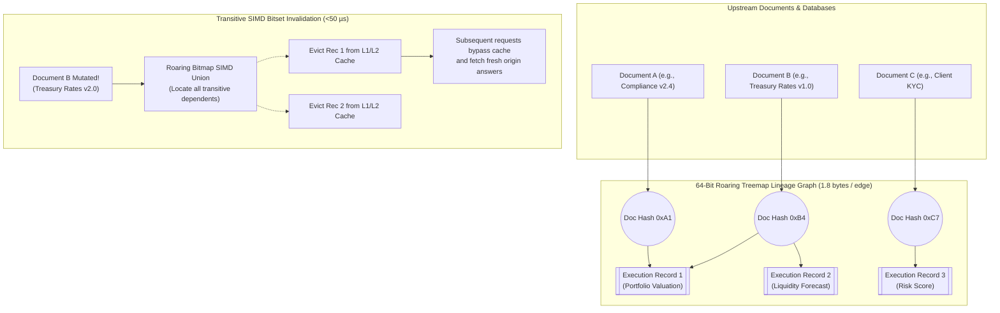

# FORMAL ARCHITECTURE & EXECUTION DIAGRAMS

**Audit Standard**: IEEE 42010-2011 / ISO/IEC 42010  
**Target Architecture**: Sunborn Systems Engineering Architecture  

---

## 1. Master Request Execution Lifecycle



---

## 2. Multi-Stage Semantic Verification Cascade



---

## 3. Real-Time Causal (RTC) Lineage Graph & Transitive Invalidation



---

## 4. Non-Accelerator Authority (NAA) & Disaster Recovery Flow

```mermaid
sequenceDiagram
    autonumber
    actor Admin as System Administrator / SRE
    participant Rebuild as apps/sunborn-rebuild (CLI Utility)
    participant PG as PostgreSQL (Authoritative WAL)
    participant Redis as DragonflyDB / Redis (Ephemeral Accelerator)
    participant Qdrant as Qdrant HNSW (Ephemeral Accelerator)

    Note over Redis,Qdrant: Disaster Scenario: Complete Memory/Disk Loss
    Admin->>Rebuild: Execute sunborn-rebuild --from-wal
    Rebuild->>PG: Acquire snapshot isolation read lock
    PG-->>Rebuild: Stream authoritative execution_records & knowledge_documents
    loop Stream Execution Records
        Rebuild->>Rebuild: Verify cryptographic ReuseCertificate HMAC
        Rebuild->>Redis: Re-populate L1/L2 exact hash entries
        Rebuild->>Qdrant: Re-index dense vector embeddings + ContextDigest
    end
    Rebuild->>Admin: Rebuild complete (100% state restored from PG WAL)
    Note over PG,Qdrant: Zero data drift; accelerators fully reconstructed
```
