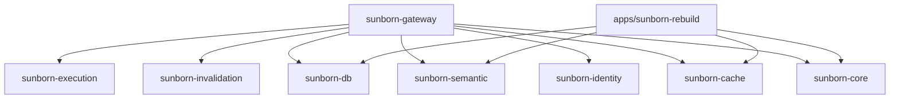
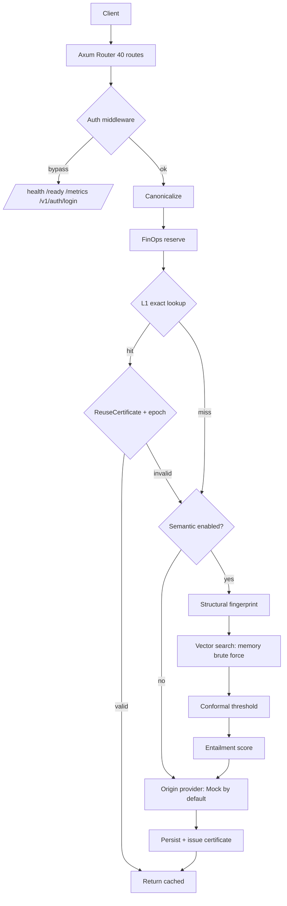
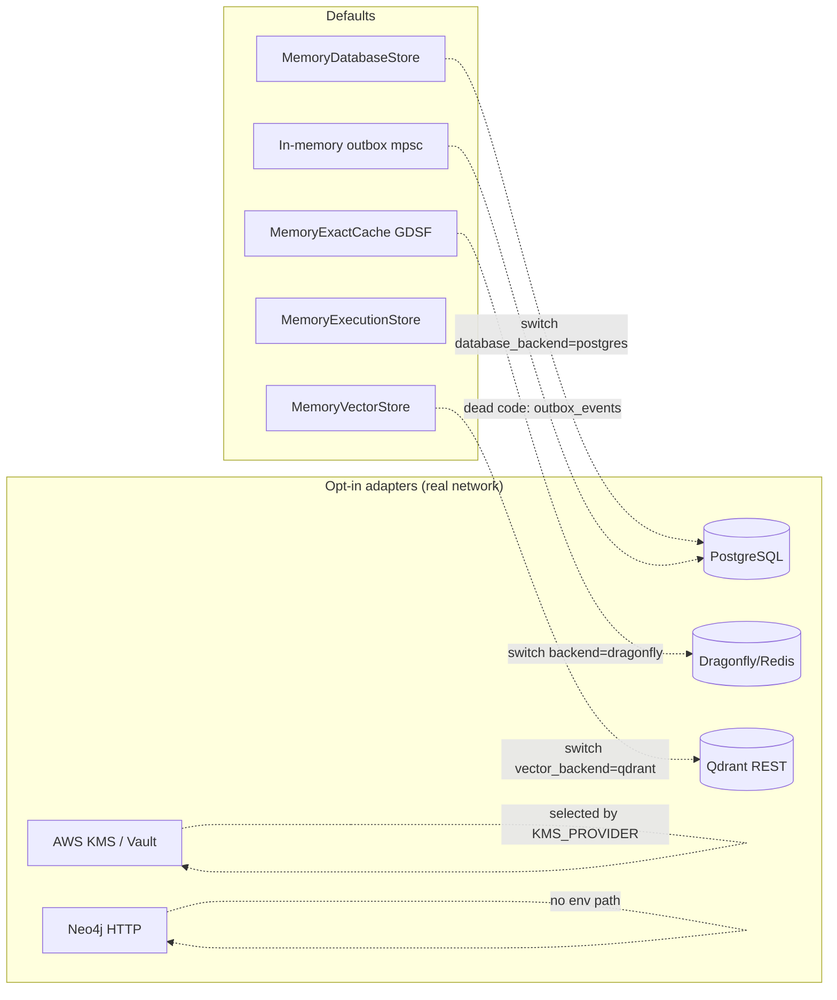
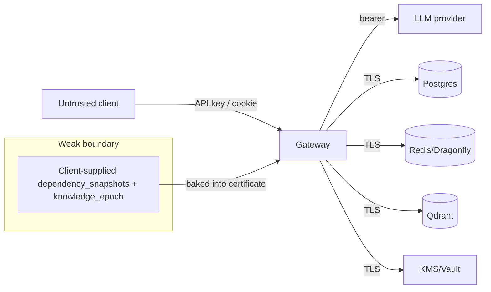
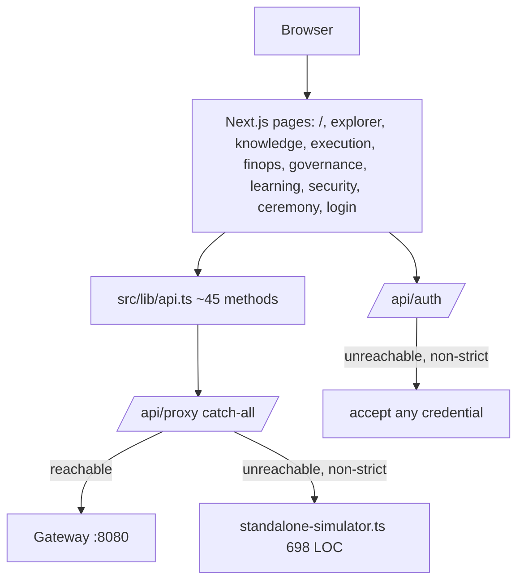

# 07 — Architecture Diagrams (as built)

These reflect the code, not the README.

## 1. Crate dependency graph (workspace)

## 2. Request path (default composition)

## 3. Storage / durability reality

## 4. Trust boundaries

## 5. Frontend topology

