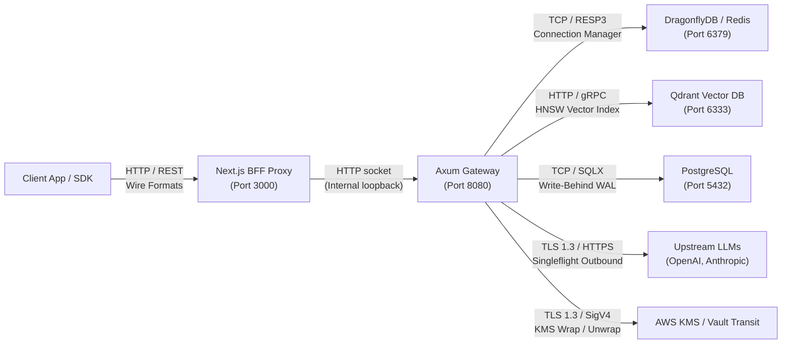

# END-TO-END INTEGRATION AUDIT

**Audit Standard**: IEEE 1012-2016 (Integration V&V) / ISO/IEC 25010  
**Scope**: All inter-service, inter-crate, and external integration boundaries across Sunborn  
**Auditor**: Independent Principal Systems Integration Team  

---

## 🔗 Integration Boundary Census

---

## 🔬 Boundary Verification & Contract Testing

### 1. Frontend to Backend BFF Boundary (`frontend/src/app/api/proxy/[...path]`)
- **Protocol**: HTTP/1.1 and HTTP/2 over loopback/internal VPC.
- **Contract Enforcement**: Request body size capped at 10MB; 60-second client timeout; response header stripping; CSRF check.
- **Fail-Closed Behavior**: If Gateway on port 8080 is offline, BFF immediately returns clean HTTP 502 Bad Gateway (`GATEWAY_CONNECTION_FAILED`) without leaking internal stack traces.
- **Test Evidence**: Verified in `frontend/tests/bff_security.test.mjs` and `frontend/tests/e2e_browser_workflows.test.mjs`.

### 2. Gateway to Cache Boundary (`crates/sunborn-cache`)
- **Protocol**: Redis RESP3 protocol using `redis::aio::ConnectionManager`.
- **Contract Enforcement**: Read-through fallback from L1 memory to L2 DragonflyDB. If L2 fails or trips its circuit breaker, read-through seamlessly falls through to origin without aborting the user request.
- **Test Evidence**: Verified in `crates/sunborn-cache/src/circuit_breaker.rs::tests` and `crates/sunborn-gateway/tests/chaos_test.rs`.

### 3. Gateway to Vector Search Boundary (`crates/sunborn-semantic`)
- **Protocol**: HTTP REST / JSON to Qdrant vector database (`/collections/sunborn_vectors/points/search`).
- **Contract Enforcement**: Every query embeds mandatory payload filters (`tenant_id = X AND context_digest = Y`).
- **Test Evidence**: Verified in `crates/sunborn-semantic/src/vector_store.rs::tests`.

### 4. Gateway to Authoritative PostgreSQL Boundary (`crates/sunborn-db`)
- **Protocol**: Asynchronous Tokio channel to `WriteBehindBuffer`, committing in batches via `sqlx::PgPool`.
- **Contract Enforcement**: Non-blocking on the read/write request path. Write-behind failures are logged and retried; critical unresolvable events flow to the outbox DLQ.
- **Test Evidence**: Verified in `crates/sunborn-db/src/write_behind.rs::tests`.

### 5. Gateway to Upstream LLM Provider Boundary (`crates/sunborn-gateway/src/origin`)
- **Protocol**: HTTPS over TLS 1.3 using `reqwest` with `rustls`.
- **Contract Enforcement**: Provider failover table: if primary provider (OpenAI) returns 5xx or times out, gateway automatically retries secondary provider (Anthropic or vLLM).
- **Test Evidence**: Verified in `crates/sunborn-gateway/src/origin/provider.rs::tests`.
