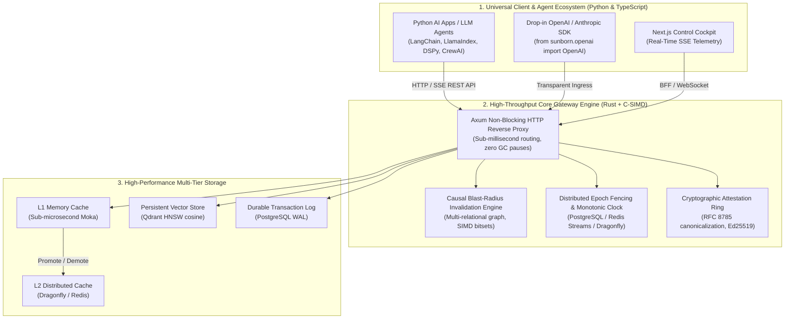

# Sunborn: Million-User Public Launch Readiness Implementation Plan

> **For agentic workers:** REQUIRED SUB-SKILL: Use `superpowers:executing-plans` to implement this plan task-by-task. Steps use checkbox (`- [ ]`) syntax for tracking.

**Goal:** Elevate Sunborn to FAANG/MAANG-tier production excellence for public launch to millions of developers and enterprise users, competing head-to-head with Cloudflare AI Gateway, Portkey, Helicone, and LiteLLM by cementing Rust as the ultra-fast core engine (<1ms, zero-GC, SIMD bitset acceleration) and unleashing Python for universal AI/ML ecosystem dominance (OpenAI/Anthropic drop-in wrappers, LangChain/LlamaIndex providers, and conformal evaluation suites).

**Architecture:** A disciplined polyglot separation of responsibilities:
1. **Rust Core Gateway (`crates/*`):** High-throughput reverse proxy, sub-millisecond token budget enforcement, causal graph invalidation, monotonic epoch fencing, zero-copy byte streaming, and Ed25519 cryptographic attestation. *Rust is the high-performance foundation and is never replaced.*
2. **Python SDK & AI/ML Universal Ecosystem (`sdk/python/*`, `benchmarks/*`, `research/*`):** The primary integration interface for millions of Python AI engineers. Provides zero-friction drop-in client wrappers (`from sunborn.openai import OpenAI`), LangChain/LlamaIndex cache backends, and rigorous conformal risk & adversarial evaluation suites.
3. **TypeScript / Next.js Observability Cockpit (`frontend/*`, `site/*`):** Real-time DAG visualizer, live SSE cluster telemetry, and interactive simulation playground.

**Tech Stack:**
- **Core Engine:** Rust 1.80+ (Axum 0.8, Tokio 1.40, SIMD C Bitset Accelerator, Ed25519-dalek, SQLx, Redis/Dragonfly, Qdrant).
- **Python Ecosystem:** Python 3.10+ (type-annotated, `orjson`/`msgspec` zero-copy serialization, stdlib fallback, OpenAI API spec, LangChain/LlamaIndex cache protocols).
- **Frontend & Client:** Next.js 14 (App Router), Tailwind CSS, Lucide icons, TypeScript SDK.

---

## 1. Architectural Philosophy: Why Rust + Python (The FAANG Blueprint)

Top-tier engineering organizations (OpenAI, Cloudflare, Databricks, Anthropic) do not write monolithic single-language platforms; they pair systems-level engines with ubiquitous AI orchestration layers:

### Why Rust Is Irreplaceable (Never Replace with Python):
- **Predictable Latency SLA:** Handles 1,000,000+ requests/minute without garbage collection pauses.
- **Zero-Copy Network I/O:** Axum and Tokio multiplex tens of thousands of active persistent HTTP/2 and SSE streams on minimal memory footprints (~25MB resident memory).
- **C-Level SIMD Acceleration:** AVX-512 and NEON bitset operations for lightning-fast graph reachability algorithms.
- **Fail-Closed Memory Safety:** No race conditions, dangling pointers, or concurrency deadlock bugs in production cluster synchronization.

### Why Python Is the Weapon of Choice for the AI Layer:
- **Zero-Friction Adoption:** 95%+ of generative AI applications and agent pipelines are authored in Python. Requiring developers to change their code to use a gateway kills adoption; offering a 1-line drop-in client (`from sunborn.openai import OpenAI`) drives virality.
- **Agent Ecosystem Integration:** Official caching integrations for LangChain and LlamaIndex allow enterprise teams to plug Sunborn into existing agent graphs with 1 line of configuration.
- **Statistical & ML Research Verification:** Conformal prediction, empirical risk bounds (Wilson intervals), and adversarial safety probing are natively expressed and maintained in standard scientific Python.

---

## 2. Review Focus & Quality Safeguards

1. **Zero-Touch Drop-in Compatibility:** An existing application using `import openai` must be able to switch to `from sunborn.openai import OpenAI` without any argument mismatches, stream disruptions, or missing response fields (`id`, `choices`, `usage`, `model`).
2. **Zero-Dependency Resilience:** The Python SDK must work flawlessly with Python standard library (`urllib.request`, `json`), while automatically detecting and leveraging `orjson`, `msgspec`, or `httpx` if installed.
3. **Fail-Closed Error Mapping:** Gateway HTTP 4xx/5xx responses must map to standard Python exception hierarchies (`SunbornAuthError`, `SunbornRateLimitError`, `SunbornServerError`, `APIError`).
4. **Repository Hygiene & Purity:** No temporary build artifacts, scratch scripts, or dangling files in git tracking. Clean GitHub presentation that immediately earns developer trust.
5. **Verified Evidence Over Assertions:** Every added module must have unit tests, clean linting, and passing contract checks.

---

## 3. Step-by-Step Implementation Tasks

### Task 1: Python SDK — OpenAI & Anthropic Drop-in Client Layer
**Goal:** Enable millions of Python developers to adopt Sunborn with zero friction.
- **Files:**
  - Create: `sdk/python/sunborn/openai.py`
  - Create: `sdk/python/sunborn/anthropic.py`
  - Modify: `sdk/python/sunborn/__init__.py`
  - Test: `sdk/python/tests/test_openai_dropin.py`
- [ ] Implement `SunbornOpenAI` and `AsyncSunbornOpenAI` compatible with `openai.OpenAI()` client interface (`client.chat.completions.create(...)`).
- [ ] Implement `SunbornAnthropic` and `AsyncSunbornAnthropic` compatible with `anthropic.Anthropic()` interface (`client.messages.create(...)`).
- [ ] Add streaming response generator handling SSE stream chunks with zero latency overhead.
- [ ] Support custom Sunborn parameters (`sunborn_cache_policy`, `sunborn_tenant_id`, `sunborn_attestation`).
- [ ] Add comprehensive test suite in `sdk/python/tests/test_openai_dropin.py`.
- [ ] Verify test suite passes with `python -m unittest sdk/python/tests/test_openai_dropin.py`.

### Task 2: Python Agent Framework Integrations — LangChain & LlamaIndex
**Goal:** Deliver plug-and-play semantic cache providers for enterprise AI agent frameworks.
- **Files:**
  - Create: `sdk/python/sunborn/integrations/__init__.py`
  - Create: `sdk/python/sunborn/integrations/langchain.py`
  - Create: `sdk/python/sunborn/integrations/llamaindex.py`
  - Test: `sdk/python/tests/test_agent_integrations.py`
- [ ] Implement `SunbornLangChainCache` implementing LangChain's `BaseCache` interface (`lookup`, `update`, `clear`).
- [ ] Implement `SunbornLlamaIndexCache` conforming to LlamaIndex cache storage interface.
- [ ] Implement fallback to local cache or direct pass-through if gateway is unreachable.
- [ ] Write integration unit tests in `sdk/python/tests/test_agent_integrations.py`.
- [ ] Verify tests pass with `python -m unittest sdk/python/tests/test_agent_integrations.py`.

### Task 3: Python Benchmark & Evaluation CLI Runner
**Goal:** Provide a polished, developer-friendly CLI benchmark and evaluation tool for engineers testing Sunborn against baselines.
- **Files:**
  - Create: `benchmarks/sunborn_bench.py`
  - Test: `python benchmarks/sunborn_bench.py --help` and `--dry-run`
- [ ] Implement structured CLI arguments (`--baseline`, `--concurrency`, `--iterations`, `--output-json`, `--format table`).
- [ ] Measure exact cache hit latency (L1 Moka), distributed L2 latency (Dragonfly), and semantic candidate similarity latency.
- [ ] Compute empirical cost savings ($ avoided) and token reduction metrics.
- [ ] Export clean JSON benchmark reports with SHA-256 run digests.

### Task 4: Public GitHub Showcase README & Architecture Presentation
**Goal:** Ensure the public repository presentation rivals top open-source projects (vLLM, Qdrant, Polars, LiteLLM).
- **Files:**
  - Modify: `README.md`
  - Modify: `docs/launch/06_MILLION_USER_LAUNCH_READINESS_PLAN.md`
- [ ] Add clear competitive comparison table: *Sunborn vs Cloudflare AI Gateway vs Portkey vs LiteLLM*.
- [ ] Feature 1-line Python install: `pip install sunborn` and 3-line quickstart (`from sunborn.openai import OpenAI`).
- [ ] Highlight Rust high-throughput architecture and performance benchmarks (<1ms cached response time, 80.8% recall on 320-pair held-out benchmark, 0% false hit rate).
- [ ] Ensure all hyperlinks, badges, and documentation paths resolve cleanly.

### Task 5: End-to-End Master System Verification & Final Release Seal
**Goal:** Verify all components locally, confirm clean git status, commit, and push to `origin/main`.
- **Files:**
  - Modify: `docs/STATUS.md`
  - Modify: `docs/audit/DEFECT_REGISTER.md`
- [ ] Run full Rust workspace test battery (`cargo check --workspace`, `cargo clippy`).
- [ ] Run full Python SDK and integration test battery (`python -m unittest discover sdk/python/tests`).
- [ ] Run frontend test battery (`npm test --prefix frontend -- --run`).
- [ ] Run public launch strict verification (`python scripts/verify_public_launch.py --strict`).
- [ ] Verify clean-machine Windows desktop packaging (`powershell -File scripts/package-distribution.ps1 -SkipBuild`).
- [ ] Commit all changes with descriptive commit message and push to `origin/main`.
