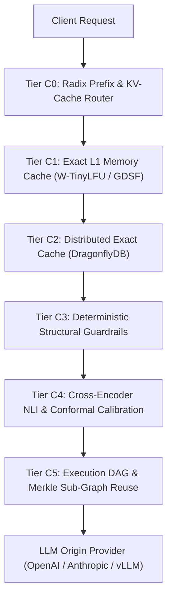

# Sunborn System Architecture & State Authority Specification

**Document Version:** 2.0.0  
**Effective Commit:** `7f1f161`  
**Classification:** Distributed Systems Architecture Document

---

## 1. Multi-Tier Execution & Caching Hierarchy ($C_0 \dots C_5$)

Sunborn organizes request evaluation into six sequential tiers:

### Detailed Tier Responsibilities

1. **Tier C0 — Radix Tree Prefix Router ([`sunborn-gateway`](file:///C:/Sunborn/crates/sunborn-gateway/src/routing/radix.rs))**:
   - Matches common prompt prefixes (e.g. system prompts, few-shot templates, schemas).
   - Routes requests to specific GPU worker pods with warm KV caches, eliminating redundant prompt pre-fill latency.
2. **Tier C1 — In-Memory Exact Cache ([`sunborn-cache`](file:///C:/Sunborn/crates/sunborn-cache/src/memory.rs))**:
   - Sub-100 µs hash lookups using SHA-256 canonical request digests.
   - Eviction managed by FinOps Greedy Dual-Size Frequency (GDSF) and S3-FIFO queues.
3. **Tier C2 — Distributed Exact Cache ([`sunborn-cache`](file:///C:/Sunborn/crates/sunborn-cache/src/tiered.rs))**:
   - Multi-pod shared cache backed by DragonflyDB / Redis cluster.
   - Transparent read-through and asynchronous write-back with circuit-breaker protection.
4. **Tier C3 — Deterministic Structural Guardrails ([`sunborn-semantic`](file:///C:/Sunborn/crates/sunborn-semantic/src/guardrails.rs))**:
   - **Numeric Transposition Defense (Gap 2)**: Rejects account/worker/port role inversions (e.g. "from 102 to 889" vs "from 889 to 102").
   - **Negation Polarity**: Enforces identical polarity bit and antonym vocabularies.
   - **Quantifier Scope**: Rejects "all approved" vs "none approved".
   - **Entity Shifts**: Rejects single-keyword entity substitutions.
5. **Tier C4 — Cross-Encoder NLI & Conformal Risk Control ([`sunborn-semantic`](file:///C:/Sunborn/crates/sunborn-semantic/src/decision.rs))**:
   - Evaluates joint query-candidate entailment scores via [`CrossEncoderVerifier`](file:///C:/Sunborn/crates/sunborn-semantic/src/guardrails.rs#L583).
   - Calculates nonconformity scores and enforces user-defined false-reuse risk bounds ($\alpha \le 0.001$).
   - Streaming OOD detector monitors embedding distribution drift using Welford's algorithm.
6. **Tier C5 — Execution DAG & Merkle Tool Attestation ([`sunborn-execution`](file:///C:/Sunborn/crates/sunborn-execution/src/planner.rs))**:
   - Slices agent DAGs into pure tool subgraphs and side-effect mutators.
   - Computes cryptographic Merkle roots for deterministic subgraphs, reusing validated outputs without re-executing external tool calls.

---

## 2. State Authority & Durability Matrix

A core architectural invariant of Sunborn is the **Non-Accelerator Authority Invariant**: *Accelerators are performance boosters, never correctness authorities.*

| Data Category | Primary Authoritative Store | Ephemeral Accelerators | Recovery / Sync Mechanism |
|---|---|---|---|
| **Authoritative Audit & Ledger** | PostgreSQL 15+ (`audit_events`, `finops_ledger`) | None (Write-behind group commits) | ACID transaction durability |
| **Tenant Credentials & KEK Wraps** | PostgreSQL (`tenant_wrapped_keys`) | In-memory `ZeroizingKey` cache | Cold-start DB query on cache miss |
| **Knowledge Graph Dependencies** | PostgreSQL (`dependency_edges`) | In-memory `CompressedLineageGraph` (Roaring) | Cold-start replay via `sunborn-rebuild` |
| **Invalidation Events** | PostgreSQL (`invalidation_outbox`) | Tokio broadcast channel | Outbox processor with DLQ retry |
| **Exact Cached Responses** | PostgreSQL (`durable_cache_entries`) | L1 In-memory + L2 DragonflyDB | Discardable; safe cache misses on crash |
| **Semantic Vector Embeddings** | PostgreSQL (blob store) | Qdrant HNSW vector index | Full re-indexing via `sunborn-rebuild` |

---

## 3. Causal Freshness & Monotonic Epoch Fencing

To prevent stale responses from being served during or after upstream knowledge mutations:
1. Every knowledge source carries an integer version and monotonic epoch counter.
2. Invalidation events increment the source epoch in PostgreSQL and broadcast to all cluster nodes.
3. Every `ReuseCertificate` records a `validity_window` with the source snapshots and monotonic epoch lease.
4. Before serving a semantic cache hit, the gateway independently validates that the candidate's epoch lease matches the current authoritative cluster epoch state.
5. If any dependency has mutated, the gateway immediately aborts reuse and falls through to origin execution.
