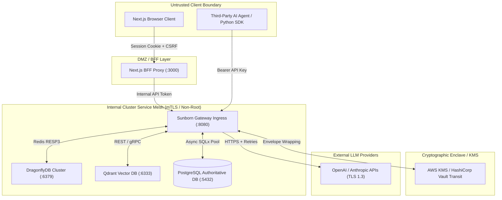
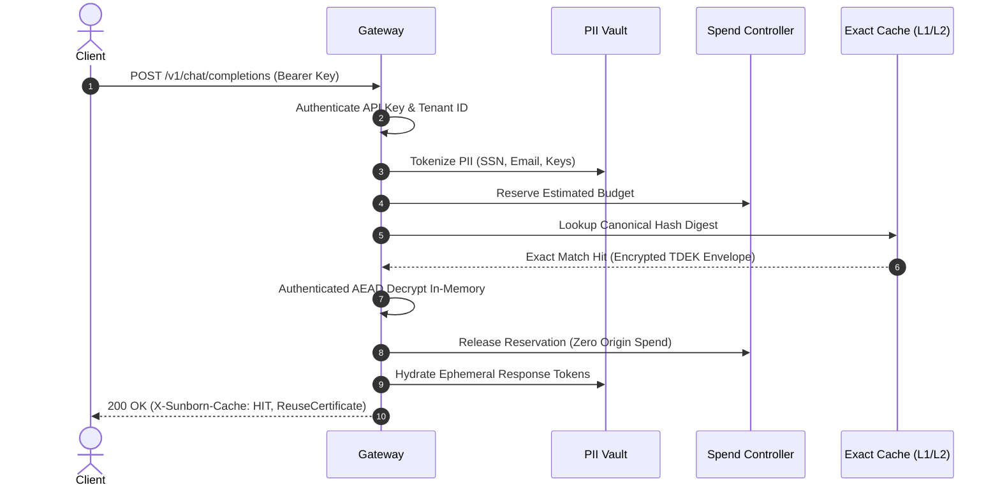
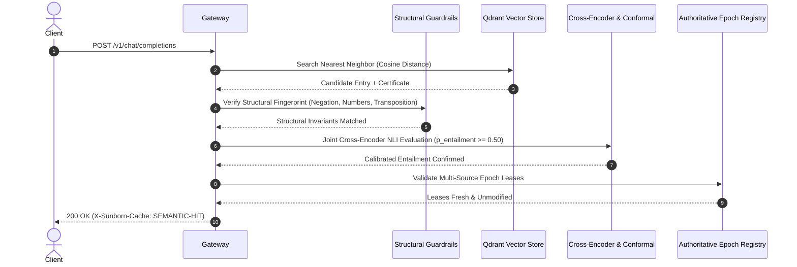
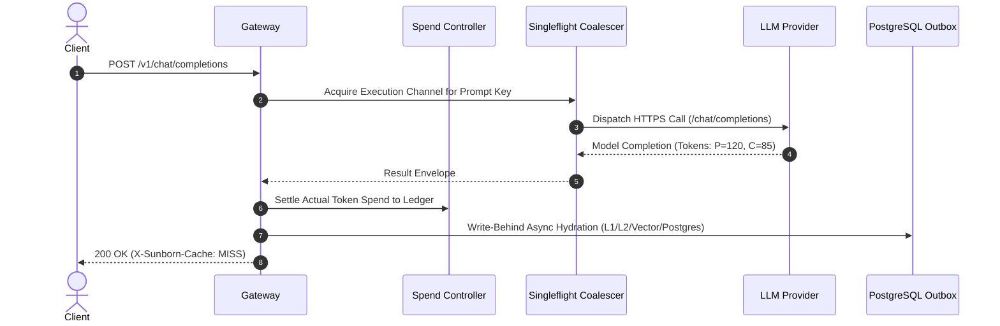
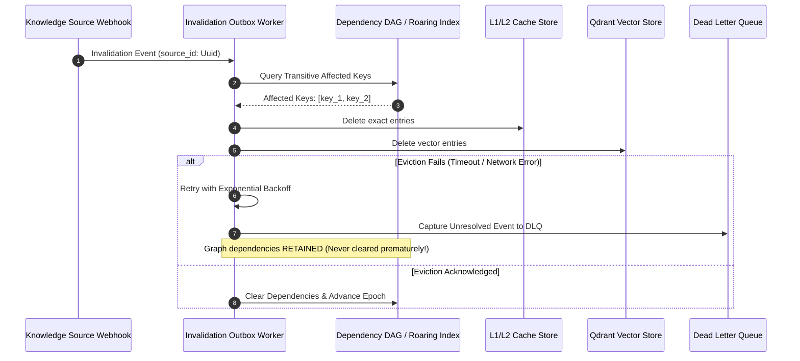

# Sunborn Data Flow & Trust Boundary Specification

**Document Version:** 2.0.0  
**Effective Commit:** `7f1f161`  
**Classification:** Security Architecture & Network Boundaries

---

## 1. Network Topologies & Trust Perimeters

---

## 2. Request Lifecycle & Sequence Flows

### Flow 1: Exact Cache Hit ($C_1 / C_2$)

### Flow 2: Semantic Cache Hit ($C_4$) with Authoritative Lease Verification

### Flow 3: Cache Miss & Upstream Execution

### Flow 4: Upstream Invalidation Cascade & DLQ Capture

