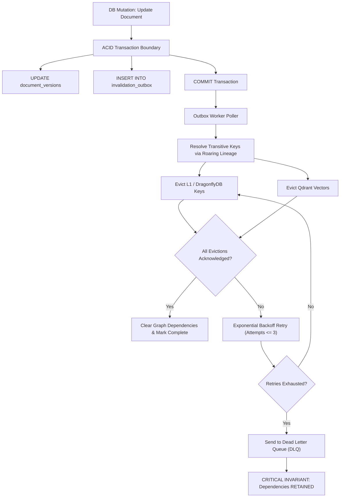

# Sunborn Distributed Systems & Invalidation Consistency Review

**Document Version:** 2.0.0  
**Effective Commit:** `7f1f161`  
**Classification:** Distributed Systems Engineering Report

---

## 1. Consistency Model & Causal Freshness

Sunborn implements a **Causal Consistency with Monotonic Read Leases** model for cached data:

```
+-----------------------------------------------------------------------------+
|                          CAUSAL CONSISTENCY MODEL                           |
+-----------------------------------------------------------------------------+
| System of Record: PostgreSQL (Linearizable writes, Read Committed reads)   |
| Exact Accelerator (L1/L2): Read-through with Monotonic Invalidation Fencing |
| Semantic Accelerator (Qdrant): Monotonic Epoch Leases with Origin Fallback  |
| Event Transport: PostgreSQL Transactional Outbox + Multi-Node Channel Sync  |
+-----------------------------------------------------------------------------+
```

### Causality & Multi-Source Vector Clocks
1. Each knowledge source update increments a per-source monotonic epoch counter.
2. In-flight requests capture a snapshot of the vector clocks for all referenced sources:
   $$V_{\text{req}} = \langle s_1: e_1, s_2: e_2, \dots, s_k: e_k \rangle$$
3. When evaluating a candidate cache hit, Sunborn compares the candidate's vector clock against current authoritative cluster epochs:
   - If $\forall i, e_{\text{candidate}}[i] == e_{\text{cluster}}[i]$, the cache hit is fresh and authorized for reuse.
   - If $\exists i, e_{\text{cluster}}[i] > e_{\text{candidate}}[i]$, the knowledge source has mutated; the candidate is stale and reuse is aborted.

---

## 2. Invalidation Outbox Architecture & Failure Recovery



### Outbox Failure-Mode Guarantees
- **At-Least-Once Eviction**: Outbox events remain in `pending` status until all targets acknowledge deletion.
- **Dependency Retention**: Graph dependencies are **never** cleared if any key eviction fails. Subsequent requests touching affected keys will continue to detect the dependency and fall through to origin.
- **Idempotent Replay**: Deletion commands are idempotent. Replaying duplicate outbox messages causes zero side effects.
- **Dead-Letter Queue (DLQ)**: Failed events are captured with exact error diagnostics for operator inspection.

---

## 3. High-Concurrency Watermark Fencing

Under high write concurrency, a race condition could occur if an upstream query starts *before* a mutation, but attempts to write its result back into the cache *after* the invalidation completed (stale writeback).

Sunborn resolves this with **Watermark Invalidation Fencing**:
1. At request start, a read view watermark $W_{\text{start}}$ is recorded.
2. If an invalidation occurs for a referenced source while the request is in-flight, the source watermark advances: $W_{\text{source}} > W_{\text{start}}$.
3. Upon completion, the write-behind committer verifies $W_{\text{source}} \le W_{\text{start}}$.
4. If the source watermark advanced, the writeback is safely discarded, preventing stale entry hydration.
