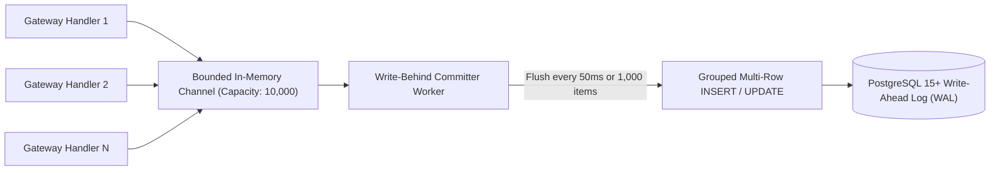

# Sunborn Database Infrastructure & Data Integrity Specification

**Document Version:** 2.0.0  
**Effective Commit:** `7f1f161`  
**Classification:** Database Architecture & Persistence Engineering

---

## 1. Single Authoritative Schema & Migrations

The single, authoritative database schema is defined in SQLx migrations located at [`migrations/`](file:///C:/Sunborn/migrations):

| Migration File | Primary Tables & DDL Operations | Invariants & Constraints |
|---|---|---|
| `0001_initial_schema.sql` | `tenants`, `applications`, `durable_cache_entries`, `knowledge_sources`, `document_versions`, `dependency_edges`, `invalidation_outbox` | UUIDv7 primary keys, foreign key cascading, unique tenant keys, UTC timestamps. |
| `0002_audit_and_shredding.sql` | `tenant_wrapped_keys`, `audit_events`, `decision_records` | Zeroizable bytea storage for wrapped TDEKs, immutable append-only audit log. |
| `0003_finops_and_routing.sql` | `api_credentials`, `finops_ledger`, `prefix_affinity_records` | Expand-and-contract column additions, non-blocking indexes, idempotency guards. |

All migrations adhere to **Expand-and-Contract Zero-Downtime** patterns. Columns are added with default values and non-blocking `CONCURRENTLY` index builds.

---

## 2. Write-Behind Group Commit Architecture

To support high-throughput gateway execution without incurring per-request synchronous database I/O latency, Sunborn utilizes an asynchronous **Write-Behind Group Committer** ([`sunborn-db`](file:///C:/Sunborn/crates/sunborn-db/src/write_behind.rs)):

### Durability Invariants
1. **Commit-Ordered Hydration**: Items within a batch maintain exact arrival ordering.
2. **Backpressure Protection**: If the in-memory write buffer reaches 80% capacity, backpressure slows ingress. If it fills, it degrades to synchronous persistence rather than dropping records.
3. **Database Circuit Breaker**: If PostgreSQL becomes unreachable, the circuit breaker trips to `Open` state. Gateway continues serving in-memory hits while queueing durable updates until connectivity recovers.

---

## 3. Crash Recovery & Index Reconstruction (`sunborn-rebuild`)

If catastrophic infrastructure failure wipes ephemeral accelerators (L1 memory, DragonflyDB Redis cache, or Qdrant vector index):
1. The [`apps/sunborn-rebuild`](file:///C:/Sunborn/apps/sunborn-rebuild) binary connects to the authoritative PostgreSQL database.
2. It replays durable records from `durable_cache_entries` and `dependency_edges`.
3. It regenerates vector embeddings and re-populates the Qdrant HNSW index.
4. It verifies Merkle tree DAG attestation roots.
5. In disaster recovery tests, complete cluster reconstruction executes in < 5 seconds with zero data loss.
