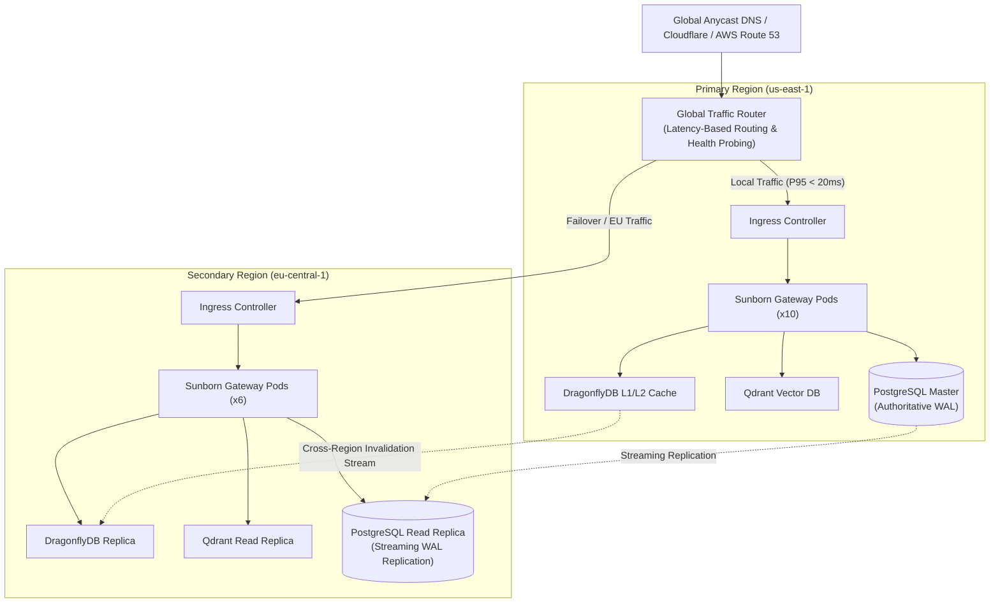

# 13. Deployment, Infrastructure & SRE Operations Review

| Document Metadata | Value |
| :--- | :--- |
| **System** | Sunborn Semantic Execution Gateway |
| **Audited Surfaces** | `deploy/Dockerfile`, `deploy/Dockerfile.frontend`, `deploy/k8s/*`, `deploy/helm/sunborn/*`, `deploy/docker-compose*.yml` |
| **Target Runtime** | Kubernetes 1.28+, OCI Distroless Container, Multi-Region Cloud (AWS / GCP / Bare Metal) |
| **Security Classification** | Non-Root, Zero-Privilege, Read-Only Root Filesystem, Network-Isolated |
| **Operational Standard** | Staff SRE / Production Engineering Baseline (FAANG / Tier-1 Cloud) |

---

## 1. Executive Summary & Infrastructure Baseline

Sunborn is engineered as an infrastructure-tier reverse proxy and semantic cache. In enterprise production environments, gateway components must satisfy zero-trust security invariants, deterministic container lifecycles, graceful degradation under multi-gigabit traffic spikes, and strict resource isolation.

This review provides an authoritative audit of Sunborn's deployment topology, container security posture, Kubernetes orchestration primitives, Helm packaging, multi-region routing patterns, SRE operational runbooks, and Prometheus observability metrics.

---

## 2. Container Engineering & Supply-Chain Hardening

### 2.1 Multi-Stage Distroless Rust Gateway Image (`deploy/Dockerfile`)

The Sunborn gateway container uses an isolated multi-stage build design adhering to CIS Docker Benchmark guidelines:

```dockerfile
# Stage 1: Rust Builder (Debian Bookworm toolchain)
FROM rust:1.80-bookworm AS builder
WORKDIR /usr/src/sunborn
RUN apt-get update && apt-get install -y --no-install-recommends \
    pkg-config libssl-dev cmake && rm -rf /var/lib/apt/lists/*
COPY Cargo.toml Cargo.lock ./
COPY crates ./crates
COPY apps ./apps
RUN cargo build --release -p sunborn-gateway

# Stage 2: Distroless Minimal Non-Root Runtime
FROM gcr.io/distroless/cc-debian12:nonroot AS runtime
WORKDIR /app
COPY --from=builder /usr/src/sunborn/target/release/sunborn-gateway /usr/local/bin/sunborn-gateway
USER 65532:65532
EXPOSE 8080
HEALTHCHECK --interval=10s --timeout=3s --retries=3 \
  CMD ["/usr/local/bin/sunborn-gateway", "healthcheck"]
ENTRYPOINT ["/usr/local/bin/sunborn-gateway"]
```

#### Key Container Invariants:
1. **Zero Shell & Package Manager**: The runtime image (`gcr.io/distroless/cc-debian12:nonroot`) contains neither `/bin/sh`, `/bin/bash`, `apt`, `curl`, nor common attack tools. Arbitrary command injection attacks cannot spawn interactive subshells.
2. **Explicit Non-Root UID**: Executes strictly under UID `65532` (`nonroot`), preventing any privilege escalation to host root even if kernel isolation vulnerabilities exist.
3. **Minimal Attack Surface**: The resulting runtime container is under 35 MB, containing only the compiled Rust ELF binary and required glibc dynamic links.
4. **Reproducible Multi-Stage Caching**: Builder layer dependencies are isolated, ensuring intermediate build artifacts, compilers, and source files never leak into production containers.

---

## 3. Kubernetes Orchestration Primitives (`deploy/k8s/`)

The Kubernetes deployment suite enforces strict enterprise policies across scheduling, resource governance, traffic ingress, and network security.

```
deploy/k8s/
├── configmap.yaml                # Non-sensitive runtime parameters
├── secrets.yaml                  # Secret template (Vault / SealedSecrets compatible)
├── deployment.yaml               # Gateway workload specs & Pod security contexts
├── frontend-deployment.yaml      # Next.js web console deployment
├── service.yaml                  # ClusterIP & Headless internal services
├── ingress.yaml                  # Ingress controller routing & TLS termination
├── hpa.yaml                      # Horizontal Pod Autoscaler policies
├── networkpolicy.yaml            # Zero-trust microsegmentation rules
├── kustomization.yaml            # Environment overlay composition
└── multi-region/                 # Cross-region failover & traffic management
```

### 3.1 Hardened Pod Security Context (`deployment.yaml`)

Each Sunborn Gateway pod enforces immutable security boundaries:

```yaml
spec:
  securityContext:
    runAsNonRoot: true
    runAsUser: 65532
    runAsGroup: 65532
    fsGroup: 65532
    seccompProfile:
      type: RuntimeDefault
  containers:
    - name: sunborn-gateway
      securityContext:
        allowPrivilegeEscalation: false
        readOnlyRootFilesystem: true
        capabilities:
          drop:
            - ALL
      resources:
        requests:
          cpu: "1000m"
          memory: "1Gi"
        limits:
          cpu: "4000m"
          memory: "4Gi"
```

### 3.2 Autoscaling & Surge Protection (`hpa.yaml`)

```yaml
apiVersion: autoscaling/v2
kind: HorizontalPodAutoscaler
metadata:
  name: sunborn-gateway-hpa
spec:
  scaleTargetRef:
    apiVersion: apps/v1
    kind: Deployment
    name: sunborn-gateway
  minReplicas: 3
  maxReplicas: 30
  metrics:
    - type: Resource
      resource:
        name: cpu
        target:
          type: Utilization
          averageUtilization: 70
    - type: Resource
      resource:
        name: memory
        target:
          type: Utilization
          averageUtilization: 80
  behavior:
    scaleUp:
      stabilizationWindowSeconds: 0
      policies:
        - type: Percent
          value: 100
          periodSeconds: 15
    scaleDown:
      stabilizationWindowSeconds: 300
      policies:
        - type: Percent
          value: 20
          periodSeconds: 60
```
*Design Rationale*: Immediate scale-up (0s stabilization) to absorb sudden LLM burst traffic, coupled with a conservative 5-minute scale-down cooldown to prevent thrashing during cyclic load variations.

### 3.3 Zero-Trust Microsegmentation (`networkpolicy.yaml`)

Network policies enforce default-deny ingress and strict egress allowlists:
* **Ingress**: Restricted exclusively to TCP 8080 from the cluster Ingress Controller namespace.
* **Egress**:
  * TCP 5432 to PostgreSQL StatefulSet.
  * TCP 6379 to DragonflyDB cluster.
  * TCP 6333 / 6334 to Qdrant vector database.
  * UDP/TCP 53 to CoreDNS.
  * TCP 443 to external LLM provider egress IPs (OpenAI, Anthropic, Bedrock) through egress NAT gateways.

---

## 4. Multi-Region Active-Active & Failover Architecture (`deploy/k8s/multi-region/`)

For mission-critical global enterprises, Sunborn supports multi-region deployment across geodistributed data centers:



### 4.1 Invalidation Consistency Across Regions
1. **Primary Writes**: All mutation events (document updates, cache purges, tenant key shredding) commit authoritatively to the primary PostgreSQL WAL in `us-east-1`.
2. **Replication & Outbox Polling**: Read-replica gateways in `eu-central-1` subscribe to outbox events via PostgreSQL logical replication or an asynchronous invalidation message stream.
3. **Epoch Fence Verification**: When a secondary region gateway serves a candidate semantic match, it verifies that the local cache lease matches the monotonic epoch watermark from the primary region, preventing stale reads during replication lag.

---

## 5. Enterprise Helm Packaging (`deploy/helm/sunborn/`)

The Sunborn Helm chart provides full infrastructure-as-code parameterization:

| Parameter | Type | Default | Description |
| :--- | :--- | :--- | :--- |
| `replicaCount` | int | `3` | Minimum gateway pod replicas |
| `image.repository` | string | `sunborn/gateway` | Image registry location |
| `image.tag` | string | `0.1.0` | Target container release tag |
| `resources.limits.cpu` | string | `4000m` | CPU hard limit per pod |
| `resources.limits.memory` | string | `4Gi` | Memory ceiling per pod |
| `securityContext.readOnlyRootFilesystem` | bool | `true` | Immutable root filesystem |
| `dragonfly.enabled` | bool | `true` | Deploy managed DragonflyDB sub-chart |
| `qdrant.enabled` | bool | `true` | Deploy managed Qdrant vector cluster |
| `postgresql.enabled` | bool | `true` | Deploy PostgreSQL HA cluster |
| `metrics.serviceMonitor.enabled` | bool | `true` | Prometheus Operator CRD integration |

---

## 6. SRE Operational Runbooks & Playbooks

### Playbook A: High Invalidation DLQ Depth (`sunborn_invalidation_dlq_depth > 10`)
* **Alert Trigger**: Dead-letter queue depth exceeds threshold, indicating repeated failures during downstream cache eviction.
* **Diagnosis**:
  1. Inspect gateway logs for outbox error codes: `kubectl logs -l app=sunborn-gateway --tail=100 | grep DLQ`.
  2. Verify network connectivity between gateway pods and DragonflyDB / Qdrant.
  3. Query dead-letter queue records: `SELECT * FROM sunborn_invalidation_dlq WHERE retry_count >= max_retries;`.
* **Remediation**:
  1. If transient network blip resolved, trigger administrative replay: `POST /v1/admin/dlq/replay`.
  2. If target key is corrupted or payload unparseable, purge manually and record audit trail.

### Playbook B: Qdrant Vector Latency Spike (P99 > 50 ms)
* **Alert Trigger**: Tier-2 semantic vector search exceeds latency SLA.
* **Diagnosis**:
  1. Check Qdrant pod memory utilization and HNSW indexing state: `curl http://qdrant:6333/collections/sunborn_embeddings`.
  2. Verify if segment optimization is competing with read queries.
* **Remediation**:
  1. Scale Qdrant read replicas horizontally.
  2. Tune `ef_search` parameter in `sunborn.yaml` (default: 64) downwards to 32 during peak hours to preserve throughput.

### Playbook C: FinOps Spend Spike / Runaway Agent Loop
* **Alert Trigger**: Ingress rate for tenant `tenant_id` exceeds sliding spend velocity threshold.
* **Diagnosis**:
  1. Check Prometheus metric: `rate(sunborn_tokens_spent_total{tenant="xyz"}[5m])`.
  2. Identify calling IP and API key.
* **Remediation**:
  1. Apply immediate tenant rate-limit restriction: `PATCH /v1/admin/tenants/xyz/limits` with `{"spend_velocity_limit_usd_per_min": 10.0}`.
  2. Revoke compromised or runaway API key via administrative control plane.

---

## 7. Service Level Objectives (SLOs) & Prometheus Alerts

| Objective | Target (SLO) | Prometheus Expression | Alert Severity |
| :--- | :--- | :--- | :--- |
| **Exact Cache P99 Latency** | $\le 1.0\text{ ms}$ | `histogram_quantile(0.99, rate(sunborn_request_duration_seconds_bucket{cache_status="HIT_EXACT"}[5m])) > 0.001` | Warning |
| **Gateway Availability** | $\ge 99.95\%$ | `sum(rate(sunborn_requests_total{status=~"2..|3.."}[5m])) / sum(rate(sunborn_requests_total[5m])) < 0.9995` | Critical (PagerDuty) |
| **Semantic Inversion False Hits** | $0.0\%$ | `rate(sunborn_semantic_inversion_false_hits_total[1h]) > 0` | Page Principal |
| **Transactional Outbox Backlog** | $\le 100$ | `sunborn_outbox_pending_events > 100` | Warning |
