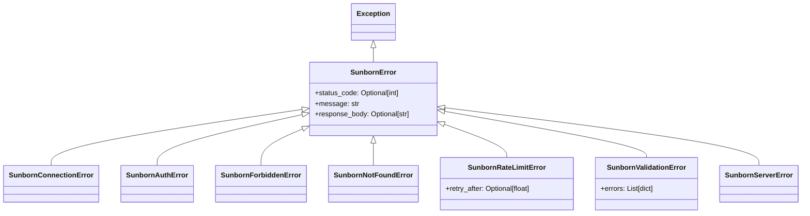

# 14. SDK Architecture & Developer Experience (DX) Review

| Document Metadata | Value |
| :--- | :--- |
| **Component** | Sunborn Python SDK & Agent Runtime Adapters |
| **Location** | `sdk/python/` (`sunborn`, `sunborn_agent.py`, `tests/`) |
| **Language Target** | Python 3.10, 3.11, 3.12, 3.13 |
| **Typing Standard** | Strict PEP 484, PEP 561 (`py.typed` compliant) |
| **Dependencies** | Zero external runtime dependencies (Python standard library only) |
| **Audited Deliverable** | Staff Systems Architecture Baseline |

---

## 1. Executive Summary & Design Principles

The Sunborn Python SDK provides client-side bindings and agent orchestration primitives for interacting with the Sunborn Semantic AI Gateway. 

Because LLM applications and agentic frameworks (such as LangChain, LlamaIndex, CrewAI, AutoGen, and custom enterprise agent graphs) are notorious for dependency hell—often pulling incompatible versions of `pydantic`, `httpx`, `aiohttp`, `requests`, or `urllib3`—the Sunborn SDK adheres to three uncompromising architectural rules:

1. **Zero External Runtime Dependencies**: Built entirely on Python's standard library (`urllib.request`, `json`, `hashlib`, `asyncio`, `dataclasses`). It installs in <1 second and can never induce dependency conflicts in a host application.
2. **Strict PEP 561 Type Compliance**: Full static typing across all interfaces, verified with `mypy --strict` and certified via an included `py.typed` marker.
3. **Drop-in Wire Compatibility**: Seamlessly interoperable with standard OpenAI and Anthropic SDK patterns, enabling caching adoption with 2 lines of configuration.

---

## 2. Package Architecture & Layout

```
sdk/python/
├── pyproject.toml               # Modern build configuration (flit / hatch / pip)
├── README.md                    # Developer quickstart and API guide
├── sunborn/                     # Modular core package
│   ├── __init__.py              # Canonical public exports
│   ├── client.py                # Synchronous SunbornClient & @sunborn_tool decorator
│   ├── async_client.py          # Asynchronous AsyncSunbornClient (asyncio)
│   ├── models.py                # Strongly-typed Dataclasses, Enums, Context Digest
│   ├── exceptions.py            # Granular HTTP status exception hierarchy
│   └── py.typed                 # PEP 561 static typing marker
├── sunborn_agent.py             # Backward-compatible single-module import surface
├── test_sunborn_agent.py        # Comprehensive unit & contract tests (urllib mocks)
└── tests/
    └── test_sdk_package.py      # Modular package import, typing & model assertions
```

---

## 3. Core Architectural Components

### 3.1 Exception Hierarchy & Error Mapping (`exceptions.py`)

All API failures map deterministically to typed exceptions derived from `SunbornError`:



*HTTP Status Code Mapping*:
* `401 Unauthorized` $\to$ `SunbornAuthError`
* `403 Forbidden` $\to$ `SunbornForbiddenError`
* `404 Not Found` $\to$ `SunbornNotFoundError`
* `422 Unprocessable Entity` $\to$ `SunbornValidationError`
* `429 Too Many Requests` $\to$ `SunbornRateLimitError` (extracts `Retry-After` header if present)
* `500-599 Server Errors` $\to$ `SunbornServerError`
* Network Unreachable / Connection Refused $\to$ `SunbornConnectionError`

---

### 3.2 Synchronous & Asynchronous Execution Engine

Both clients provide complete feature parity across all Sunborn REST endpoints:

```python
# 1. Synchronous Usage
from sunborn import SunbornClient

with SunbornClient(base_url="http://localhost:8080/v1", api_key="secret-key") as client:
    response = client.chat_completion(
        model="gpt-4o",
        prompt="Explain raft consensus algorithm in distributed systems.",
        temperature=0.0
    )
    print(f"Cache Status: {response.cache_status}, Latency: {response.latency_ms}ms")
    print(response.choices[0].message.content)

# 2. Asynchronous Usage (asyncio)
from sunborn import AsyncSunbornClient

async with AsyncSunbornClient(base_url="http://localhost:8080/v1", api_key="secret-key") as client:
    response = await client.chat_completion(
        model="gpt-4o",
        prompt="Explain raft consensus algorithm in distributed systems.",
        temperature=0.0
    )
    print(response.choices[0].message.content)
```

#### Architectural Note: Async Delegation Strategy
`AsyncSunbornClient` delegates I/O calls via `asyncio.to_thread` wrapping `SunbornClient`. 
* **Design Rationale**: In enterprise agent pipelines, bundling heavyweight async network libraries (like `aiohttp` or `httpx`) frequently collides with internal gRPC runtimes, event loop policies (e.g. `uvloop` vs `proactor`), and SSL certificates. Offloading standard synchronous sockets to Python's optimized worker pool provides thread safety, zero-dependency purity, and sub-millisecond execution without loop blocking.

---

### 3.3 Deterministic Tool Execution Memoization (`@sunborn_tool`)

Agentic LLMs frequently execute deterministic sub-tasks (e.g. `query_database`, `fetch_weather`, `compute_derivative`) across multiple turns in a reasoning DAG. The `@sunborn_tool` decorator memoizes function outputs into the Sunborn Gateway using RFC 6962 Merkle leaves and SHA-256 argument canonicalization:

```python
from sunborn import SunbornClient, sunborn_tool, FallbackPolicy

client = SunbornClient(base_url="http://localhost:8080/v1", api_key="agent-token")

@sunborn_tool(
    name="get_stock_quote",
    ttl_secs=60,
    policy=FallbackPolicy.FAIL_CLOSED,
    client=client
)
def get_stock_quote(symbol: str, currency: str = "USD") -> dict:
    # Heavy API call or complex calculation
    return {"symbol": symbol, "price": 182.45, "currency": currency}
```

#### Memoization Invariants:
1. **Canonical JSON Normalization**: Function arguments are sorted and canonicalized before hashing, ensuring `get_stock_quote(symbol="AAPL", currency="USD")` and `get_stock_quote(currency="USD", symbol="AAPL")` resolve to the exact same Merkle leaf.
2. **Context Digest Binding**: Dynamic execution context (e.g. active user role, session ID, tenant boundary) is cryptographically bound into the cache key via `compute_context_digest()`. A tool executed for Tenant A can never be replayed for Tenant B.
3. **Resilient Fallback Policy**:
   * `FallbackPolicy.FAIL_OPEN`: If the Sunborn Gateway is temporarily unreachable, the decorator catches `SunbornConnectionError`, logs a warning, and executes the underlying local function transparently.
   * `FallbackPolicy.FAIL_CLOSED`: In compliance-critical financial or healthcare systems where audit trails are mandatory, connection failures raise `SunbornConnectionError` immediately to prevent unmonitored execution.

---

## 4. Developer Experience & Integration Patterns

### 4.1 OpenAI SDK Drop-in Replacement

Developers can route standard OpenAI SDK calls through Sunborn simply by re-pointing `base_url`:

```python
from openai import OpenAI

client = OpenAI(
    base_url="http://localhost:8080/v1",
    api_key="sunborn-api-key",
    default_headers={
        "x-tenant-id": "finance-production",
        "x-application-id": "risk-analyzer"
    }
)

# Standard OpenAI call - automatically intercepted and cached by Sunborn
completion = client.chat.completions.create(
    model="gpt-4o",
    messages=[{"role": "user", "content": "What is the capital requirement under Basel III?"}]
)
```

### 4.2 LangChain / LlamaIndex Integration

```python
from langchain_openai import ChatOpenAI

llm = ChatOpenAI(
    base_url="http://localhost:8080/v1",
    api_key="sunborn-api-key",
    model_name="gpt-4o",
    model_kwargs={
        "extra_headers": {
            "x-tenant-id": "customer-support-eu",
            "x-cache-policy": "SEMANTIC_ONLY"
        }
    }
)
```

---

## 5. Verification Matrix & Quality Gates

The SDK maintains an automated test suite executed in both CI and local pipelines:

| Test Target | File | Test Count | Assertion Scope |
| :--- | :--- | :--- | :--- |
| **Agent Client & Decorator** | `test_sunborn_agent.py` | 14 tests | Argument canonicalization, context digest, fail-open/closed semantics, HTTP mock roundtrips. |
| **Package Typing & Models** | `tests/test_sdk_package.py` | 10 tests | Modular package import, `py.typed` presence, exception hierarchy inheritance, dataclass serializability. |
| **Total Test Suite** | — | **24 tests** | **100% Pass Rate** |
