# 17. Engineering Implementation Roadmap & Phased Delivery Milestones

| Document Metadata | Value |
| :--- | :--- |
| **System** | Sunborn Semantic Execution Gateway |
| **Methodology** | Wave-Based Phased Systems Engineering (Waves 1 through 8) |
| **Target Maturity** | Production GA (General Availability) for Enterprise Workloads |
| **Review Cadence** | Bi-Weekly Architecture Review Board & Continuous Verification |

---

## 1. Executive Summary & Delivery Philosophy

Transforming an experimental caching prototype into a production-grade enterprise execution gateway requires disciplined phased execution. Features must be implemented strictly according to their distributed dependencies: storage durability and identity must precede semantic caching; failure-safe invalidation must precede distributed cache scaling; and cryptographic privacy must be baked into storage primitives rather than patched on top.

This roadmap details the 8 sequential implementation waves that define Sunborn's engineering transformation, specifying deliverables, dependency graphs, and production promotion criteria.

---

## 2. Phased Implementation Waves

```mermaid
flowchart LR
    W1["Wave 1: Core Integrity & CVE Remediation"] --> W2["Wave 2: Storage Durability & Invalidation"]
    W2 --> W3["Wave 3: Semantic Safety & Conformal Bounds"]
    W3 --> W4["Wave 4: Identity & Cryptographic Shredding"]
    W4 --> W5["Wave 5: Gateway Routing & FinOps Gates"]
    W5 --> W6["Wave 6: Agent DAG Planning & Merkle Reuse"]
    W6 --> W7["Wave 7: Deployment, Kubernetes & SRE"]
    W7 --> W8["Wave 8: DX, SDK, Console & Verification"]
```

---

### Wave 1: Core Integrity, Cargo Workspace & CVE Remediation
* **Objective**: Establish a secure, compiler-verified, and vulnerability-free Rust workspace foundation.
* **Key Deliverables**:
  1. *Cargo Audit Cleanliness*: Eradicate `libsqlite3-sys 0.30.1` (`RUSTSEC-2026-0459`) from `sunborn-db` by disabling default sqlite features on sqlx. Ensure `cargo audit` reports 0 advisories across all 355 workspace dependencies.
  2. *Compiler Warning Policy*: Enforce `#![deny(warnings)]` and `#![forbid(unsafe_code)]` across all 9 workspace crates.
  3. *Clippy & Format Compliance*: 100% adherence to standard Rust style via `cargo clippy --all-targets -- -D warnings` and `cargo fmt --check`.
* **Exit Gate**: 100% clean automated compilation and zero security advisories.

---

### Wave 2: Storage Durability, Monotonic Epochs & Failure-Safe Invalidation
* **Objective**: Guarantee zero data loss, monotonic freshness, and resilient outbox event propagation.
* **Key Deliverables**:
  1. *PostgreSQL Authoritative WAL*: Implement transactional schema migrations (`V001__initial_schema.sql` through `V005`) for chat executions, certificates, budgets, and outbox events.
  2. *Failure-Safe Outbox Processing*: Overhaul `crates/sunborn-invalidation/src/outbox.rs` with per-target deletion acknowledgments, exponential retry backoff, Dead-Letter Queue (DLQ) routing, and strict dependency retention on failure.
  3. *Monotonic Epoch Watermarks*: Implement uint64 epoch leases to prevent stale writeback races when documents mutate during in-flight LLM calls.
  4. *Roaring Bitmap Invalidation Graph*: Deploy 64-bit Roaring Bitmaps for microsecond transitive closures across 1,000,000+ dependency edges.
  5. *Real-Time Causal (RTC) Graph Caching*: Wire `GraphMemoryCache` with `CompressedLineageGraph` and Axum gateway admission, exposing `/v1/cache/graph/stats`, `/v1/cache/graph/lineage/{key}`, and `/v1/cache/graph/invalidate` with full SDK and frontend bindings.
* **Exit Gate**: Integration tests verify that outbox network failures trigger retries and quarantine to DLQ without corrupting cache state, and real-time causal graph invalidation evicts dependent entries in sub-50µs.

---

### Wave 3: Semantic Safety Cascade & Conformal Risk Bounds
* **Objective**: Mathematically eliminate the Semantic Inversion Problem (false hits on negated/contradictory queries).
* **Key Deliverables**:
  1. *Structural AST Guardrails*: Sub-50 µs token filters verifying negation polarity bits, sorted numeric sequences, and quantifier scopes (`all`, `none`, `some`, `only`).
  2. *Split-Conformal Risk Control*: Calibrate distribution-free risk bounds ($\alpha \le 0.001$) across 4 task strata (Financial, Healthcare, Admin, Security-Sensitive).
  3. *Cross-Encoder NLI Verifier*: Author `CrossEncoderBackend` trait and wire `CrossEncoderVerifier` into Tier-2 evaluation, computing calibrated entailment, neutrality, and contradiction probabilities.
  4. *Adversarial Trap Suite*: Establish continuous testing against 46 held-out adversarial inversion traps.
* **Exit Gate**: `adversarial_evaluation_suite.py` achieves 0.0% false cache hits (100% precision).

---

### Wave 4: Identity, AEAD Envelope Encryption & Cryptographic Shredding
* **Objective**: Deliver zero-trust tenant isolation and instant GDPR Article 17 erasure.
* **Key Deliverables**:
  1. *10-D Identity Canonicalization*: Author RFC 8785 JSON Canonicalization Scheme (JCS) normalizer for whitespace, JSON key ordering, system prompts, temperature, and top-p.
  2. *AES-256-GCM Envelope Encryption*: Encrypt all cache payloads with 96-bit random nonces under tenant-specific Data Encryption Keys (TDEKs).
  3. *Cryptographic Key Erasure*: Implement instant $\mathcal{O}(1)$ cryptographic shredding by destroying wrapped TDEKs in KMS/Vault, rendering distributed exact-cache and vector payloads unrecoverable.
  4. *Dual-Admin Quorum*: Enforce multi-signature sign-off for destructive administrative operations.
* **Exit Gate**: Crypto-shredding integration test proves decrypted reads fail immediately following key deletion.

---

### Wave 5: High-Performance Gateway Ingress & FinOps Spend Gates
* **Objective**: Expose sub-millisecond HTTP reverse proxy endpoints with distributed budget protection.
* **Key Deliverables**:
  1. *Axum Ingress Pipeline*: Implement `/v1/chat/completions` reverse proxy supporting OpenAI and Anthropic wire formats.
  2. *Distributed FinOps Ledger*: Implement two-phase atomic spend pre-reservations and post-execution token reconciliations.
  3. *Sliding-Window Velocity Limiters*: Rate limit runaway agent loops to protect upstream cloud accounts.
  4. *Prometheus Telemetry*: Expose `/metrics` with latency histograms, hit counters, and DLQ depth gauges.
* **Exit Gate**: Full gateway socket benchmark achieves 3,257 req/s HTTP throughput with P99 < 500 µs.

---

### Wave 6: Agent DAG Planning & RFC 6962 Merkle Memoization
* **Objective**: Enable multi-step agent reasoning reuse without replaying side-effectful mutations.
* **Key Deliverables**:
  1. *Merkle DAG Engine*: Parse agent execution graphs into RFC 6962 compliant Merkle trees.
  2. *Idempotency Analysis*: Classify agent tools into deterministic queries vs state-mutating actions.
  3. *Cryptographic Inclusion Proofs*: Generate and verify Merkle audit paths for cached tool results.
  4. *Context Digest Binding*: Bind tenant and role context hashes into Merkle leaf digests.
* **Exit Gate**: Deterministic agent step reuse test verifies tool replay without re-executing underlying functions.

---

### Wave 7: Production SRE, Kubernetes Orchestration & Multi-Region Topology
* **Objective**: Package Sunborn for enterprise cloud deployment with zero-privilege security controls.
* **Key Deliverables**:
  1. *Distroless Container*: Package `sunborn-gateway` in `gcr.io/distroless/cc-debian12:nonroot` (<35 MB, zero shell, UID 65532).
  2. *Kubernetes Manifests*: Author production-ready Deployment, HPA, NetworkPolicy, Ingress, and Service specifications.
  3. *Enterprise Helm Chart*: Author parameter-validated Helm chart (`deploy/helm/sunborn`).
  4. *Multi-Region Spec*: Define active-active cross-region routing and epoch replication patterns.
* **Exit Gate**: `check_k8s_manifests.py` passes with zero plaintext secrets and valid pod security standards.

---

### Wave 8: Developer Experience, Verification & Open-Source Excellence
* **Objective**: Deliver a polished developer ecosystem, web console, and exhaustive verification pipeline.
* **Key Deliverables**:
  1. *Zero-Dependency Python SDK*: Synchronous `SunbornClient` and asynchronous `AsyncSunbornClient` with `@sunborn_tool` memoization.
  2. *Next.js 15 Control Plane*: Enterprise dashboard with secure BFF proxy and Distributed Systems Fleet Sizing Modeler.
  3. *Master Engineering Documentation*: Canonical 20-deliverable engineering excellence suite in `docs/master/`.
  4. *Automated 11-Gate Pipeline*: Unified verification script (`scripts/verify.sh` / `scripts/verify.ps1`).
* **Exit Gate**: All 11 verification gates pass cleanly; 338+ tests green.

---

## 3. Production Readiness & Promotion Criteria

| Promotion Gate | Target Metric | Verification Method | Status |
| :--- | :--- | :--- | :--- |
| **Cargo Workspace Compilation** | 0 errors, 0 warnings | `cargo check --workspace` | **PASSED** |
| **Clippy Linting** | 0 warnings | `cargo clippy --workspace --all-targets -- -D warnings` | **PASSED** |
| **Security Audit** | 0 vulnerabilities | `cargo audit` | **PASSED** |
| **Code Formatting** | Clean | `cargo fmt --check` | **PASSED** |
| **Workspace Test Suite** | 250+ tests passing | `cargo test --workspace --all-targets` | **PASSED** |
| **Frontend Production Build** | Next.js 15 clean bundle | `npm run build --prefix frontend` | **PASSED** |
| **Frontend Test Suite** | 37 tests passing | `npm test --prefix frontend` | **PASSED** |
| **Python SDK Test Suite** | 26 tests passing | `python -m unittest sdk/python/...` | **PASSED** |
| **OpenAPI Contract Drift** | 49 endpoints synced | `python scripts/check_openapi_drift.py` | **PASSED** |
| **Kubernetes Security Audit** | 0 secret violations | `python scripts/check_k8s_manifests.py` | **PASSED** |
| **Adversarial Inversion Safety**| 0.0% false hits | `python benchmarks/adversarial_evaluation_suite.py` | **PASSED** |
