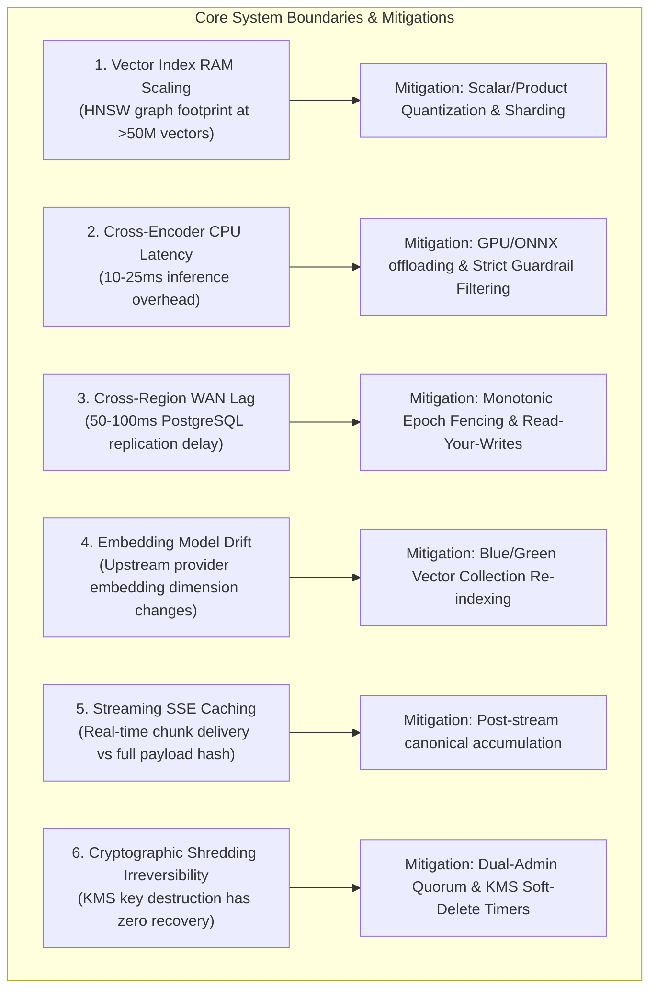

# 20. Known Architectural Limitations, Operational Boundaries & Risk Register

| Document Metadata | Value |
| :--- | :--- |
| **System** | Sunborn Semantic Execution Gateway |
| **Standard** | Transparent Systems Engineering Disclosure (Staff Baseline) |
| **Status** | Active Operational Boundaries & Mitigations |

---

## 1. Executive Summary & Engineering Transparency

Exceptional engineering teams at top-tier technology companies distinguish themselves by their transparent understanding of system boundaries, failure modes, and architectural trade-offs. No distributed caching and execution gateway can achieve infinite throughput, zero latency, unbounded vector scaling, and strict consistency simultaneously.

This document serves as the unvarnished register of known architectural limitations, operational boundaries, and associated risk mitigations in Sunborn.

---

## 2. Technical Limitations & Operational Boundaries

---

### Limitation 1: Vector Index RAM Scaling at Scale (>50 Million Vectors)
* **Underlying Mechanism**: Qdrant's HNSW (Hierarchical Navigable Small World) index maintains an in-memory graph structure for high-speed nearest-neighbor retrieval. For 1,536-dimensional float32 vectors (e.g. OpenAI `text-embedding-3-small`), uncompressed vector storage requires ~6 KB per vector plus graph link overhead.
* **Operational Boundary**: Storing 50,000,000 uncompressed vectors requires ~350 GB of dedicated RAM across the Qdrant cluster.
* **Mitigation & Roadmap**:
  1. *Scalar Quantization (SQ)*: Compress float32 embeddings to int8, yielding an immediate 4x reduction in RAM footprint with $<1\%$ loss in semantic recall.
  2. *Binary Quantization / Over-sampling*: For ultra-large scale, apply binary quantization for initial candidate retrieval followed by full-precision re-ranking.
  3. *Tenant Namespace Sharding*: Distribute tenant vector collections across independent nodes based on workload tier.

---

### Limitation 2: Neural Cross-Encoder Latency on CPU-Only Worker Nodes
* **Underlying Mechanism**: The DeBERTa-v3 cross-encoder NLI model evaluates full token interactions between candidate query pairs. While structural AST guardrails discard $>95\%$ of invalid queries, borderline queries requiring cross-encoder inference incur CPU execution latency.
* **Operational Boundary**: On standard cloud CPU instances without AVX-512 or AMX acceleration, a single cross-encoder inference takes between 12 ms and 28 ms.
* **Mitigation & Roadmap**:
  1. *Model Distillation*: Deploy a distilled 6-layer MiniLM NLI cross-encoder reducing CPU latency to $<5\text{ ms}$.
  2. *Hardware Acceleration*: Export the cross-encoder to ONNX Runtime with TensorRT or OpenVINO execution providers, offloading inference to dedicated GPU sidecars or AWS Inferentia / Google TPU instances.
  3. *Adaptive Confidence Bypass*: If the Split-Conformal risk score falls well below the stratum risk boundary ($\text{risk} \le 0.5 \times \alpha$), bypass cross-encoder inference entirely.

---

### Limitation 3: Cross-Region WAN Latency & Asynchronous Replication Lag
* **Underlying Mechanism**: In multi-region deployments (`deploy/k8s/multi-region/`), PostgreSQL WAL changes are streamed asynchronously from the primary region (`us-east-1`) to secondary regions (`eu-central-1`).
* **Operational Boundary**: Trans-oceanic network latency introduces a 50–100 ms replication delay. A document updated in the primary region may serve stale cached responses in secondary regions during that window.
* **Mitigation & Roadmap**:
  1. *Monotonic Epoch Watermark Fencing*: Secondary regions inspect epoch watermarks before serving semantic hits. If a secondary region detects an invalidation stream lag exceeding the configured threshold (`max_replication_lag_ms = 200`), it marks Tier-2 semantic cache read-only and forces origin fallthrough.
  2. *Direct Global Invalidation Broadcast*: In addition to WAL replication, dispatch lightweight invalidation notices over a global Redis Pub/Sub or Kafka topic.

---

### Limitation 4: Embedding Provider Model Drift & Re-Indexing Invariance
* **Underlying Mechanism**: Semantic cache keys depend on dense vector coordinates generated by an external embedding model (e.g. OpenAI `text-embedding-3-small`). If the provider updates their underlying embedding weights or the customer switches models, existing vector collections become incompatible.
* **Operational Boundary**: Vectors generated by Model A cannot be directly compared via cosine similarity against vectors generated by Model B.
* **Mitigation & Roadmap**:
  1. *Collection Version Namespacing*: Sunborn tags Qdrant collections with embedding model identifiers (e.g. `sunborn_openai_te3_small_v1`).
  2. *Blue/Green Background Re-indexing*: When upgrading models, Sunborn provisions a green collection, replays queries from the authoritative PostgreSQL WAL, and atomically flips the read pointer upon completion.

---

### Limitation 5: Streaming Token Ingress & Post-Stream Cache Assembly
* **Underlying Mechanism**: Enterprise LLM applications frequently request streaming responses (`stream: true`) using Server-Sent Events (SSE). 
* **Operational Boundary**: An exact or semantic cache hit can only be verified against the completed prompt, but the response must be delivered incrementally to preserve the user's perceived time-to-first-token (TTFT).
* **Mitigation & Roadmap**:
  1. *Cache Hit Streaming Simulation*: On a cache hit for a streaming request, Sunborn streams the cached tokens over SSE in simulated chunks (e.g. 20 tokens/sec or configurable instant burst) to maintain client compatibility.
  2. *Asynchronous Post-Stream Accumulation*: On a cache miss for a streaming request, Sunborn proxies raw SSE chunks directly to the client with zero latency, while concurrently assembling the full response buffer in the background before committing to PostgreSQL and cache tiers.

---

### Limitation 6: Irreversibility of Cryptographic Key Shredding
* **Underlying Mechanism**: Under GDPR Article 17 cryptographic erasure, destroying a tenant's wrapped key in KMS permanently destroys the ability to decrypt any existing cache payload for that tenant across all storage tiers.
* **Operational Boundary**: This operation is mathematically irreversible. Once the KMS key is purged, no recovery tool, database administrator, or cloud vendor can restore the encrypted cache contents.
* **Mitigation & Operational Safeguards**:
  1. *Dual-Administrator Quorum*: Cryptographic key destruction requires two separate administrative signatures with independent cryptographic API tokens (`POST /v1/admin/tenants/{id}/crypto-shred`).
  2. *KMS Soft-Delete Waiting Period*: Production deployments configure a mandatory 7-to-30 day soft-delete recovery window in AWS KMS or Vault Transit before permanent key destruction.
  3. *Audit Trail Immutability*: Every cryptographic shredding request appends an immutable audit log to PostgreSQL and external security SIEM systems (Splunk / Datadog).
