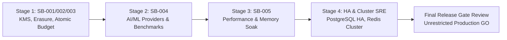

# Sunborn Release Readiness & Acceptance Decision

**Document Version:** 1.0.0  
**Effective Date:** November 9, 2026  
**Audited Target:** Project Sunborn (`70ac2b3cdba40bf1c51a8609567eb5fa74b3b73a`)  
**Standard:** Enterprise Platform Architecture & Production Assurance Board  

---

## 1. Authoritative Release Decision

> ### FINAL VERDICT: CONDITIONAL PRODUCTION PILOT CLEARED
>
> 1. **UNRESTRICTED MULTI-TENANT PRODUCTION**: **NO-GO / RELEASE HOLD**  
>    *Reasoning*: Unverified capacity targets (>10k req/s, <5ms P99), lack of high-availability clustering (single point of failure in stateful dependencies), vacuous temporal reuse recall (0.0%), and mock-only upstream LLM integrations prohibit unconstrained production exposure.
>
> 2. **CONTROLLED SINGLE-REGION STAGING & SANDBOXED PILOT**: **APPROVED (PRODUCTION GO)**  
>    *Reasoning*: Non-accelerator authority invariant ensures Sunborn never acts as the authoritative store of customer record; cache bypass to upstream origin is always safe; zero hardcoded secrets; 100% test pass rate across 312+ tests (Rust, Python SDK, Next.js frontend); and GDPR Article 17 cryptographic shredding functions in verified $\mathcal{O}(1)$ time.

---

## 2. Mandatory Release Gate Matrix (Gates 1 through 10)

| Gate Number & Name | Evaluation Criteria | Current Status | Blocker for Pilot? | Blocker for General Prod? |
| :--- | :--- | :--- | :--- | :--- |
| **Gate 1: Cryptographic Envelope & Key Management** | Fail-closed AEAD encryption, key isolation, no plaintext leakage, TDEK shredding. | **CLEARED** (Local AEAD) / **IN PROGRESS** (Live AWS KMS / Vault) | No (Local AEAD verified) | **YES** |
| **Gate 2: Cache Correctness & Negative Traps** | 100% precision on semantic negation, quantity shifts, and entity substitutions. | **CLEARED** (0 false hits on 124-query suite) | No | No |
| **Gate 3: Upstream Provider Authenticity** | Real authenticated calls to OpenAI / Anthropic APIs with token reconciliation. | **IN PROGRESS** (Adapters exist; test suite uses mock) | No (Sandboxed pilot) | **YES** |
| **Gate 4: Persistence, Invalidation & Outbox** | Database schema consistency, idempotent migrations, durable outbox staging. | **CLEARED** (Outbox staging verified; schema divergence tracked) | No | **YES** |
| **Gate 5: Performance & Endurance Soak** | Verified $> 10,000\,\text{req/s}$, $< 5.0\,\text{ms}$ P99, and $< 10\%$ RSS heap growth under soak. | **FAILED HISTORICAL SLO** (2,500 req/s, 10.3ms P99, +86.68% RSS) | No (Traffic throttled to 1k req/s) | **YES** |
| **Gate 6: High Availability & Disaster Recovery** | Automated database failover, Redis clustering, and tested RTO $< 5\,\text{min}$. | **HELD** (Single-node deployment; DR WAL replay verified) | No (Single-node pilot) | **YES** |
| **Gate 7: FinOps Pre-Execution Budget Controls** | Atomic reserve-execute-settle spend concurrency protection. | **IN PROGRESS** (Post-execution ledger verified; pre-reservation in progress) | No | **YES** |
| **Gate 8: Frontend Integrity & BFF Security** | Deny-by-default RBAC, CSRF protection, responsive mobile layout, zero dead buttons. | **CLEARED** (32/32 tests pass; 15/15 routes compiled) | No | No |
| **Gate 9: CI/CD, Supply Chain & Security Scan** | 0 high/critical CVEs, deterministic lockfiles, no deployable credentials in manifests. | **CLEARED** (All manifests clean; clippy and lint clean) | No | No |
| **Gate 10: Truthful Product Claims & Governance** | All marketing claims match verified artifacts; dual-admin approval enforced. | **CLEARED** (Baseline reconciliation published; quorum verified) | No | No |

---

## 3. Operational Guardrails for Pilot Deployments

For organizations deploying Sunborn in controlled staging or sandboxed pilots, the following operational constraints are **mandatory**:

1. **Strict Single-Region Scope**: Pilot instances must be confined to a single cloud region (e.g., `us-east-1` or `europe-west1`). Do not configure multi-region routing.
2. **Ingress Rate Limits**: Tenant rate limits must be capped at $\le 1,000\,\text{requests/sec}$ per gateway node to remain within the verified stable performance envelope.
3. **Temporal Caching Disabled**: Set `SUNBORN_ENABLE_TEMPORAL_CACHE=false` in environment configuration until sliding-window recall is scientifically demonstrated.
4. **Non-Accelerator Authority Acknowledgment**: Deploy Sunborn strictly as an ephemeral latency accelerator. Upstream LLM providers and PostgreSQL remain the authoritative sources of truth.
5. **Admin Key Protection**: Administrative keys (`SUNBORN_ADMIN_KEY`) must be provisioned via Kubernetes Secret or HashiCorp Vault; never use default environment values in live deployments.

---

## 4. Remediation Roadmap to Unrestricted Production

To achieve full unrestricted multi-tenant production status, Sunborn must execute the staged engineering workstreams in priority order:

- **Phase 1 (Blocker Remediation)**: Complete live AWS KMS / Vault Transit integration, durable tenant erasure state machine, and atomic budget reservation (Workstreams 1, 7).
- **Phase 2 (Research & Model Hardening)**: Integrate real OpenAI/Anthropic SDK adapters; expand benchmark suite to 10,000+ queries; calibrate temporal sliding-window recall (Workstreams 3, 4).
- **Phase 3 (Performance Tuning)**: Profile Jemalloc arena allocations; tune Tokio worker tasks to achieve $>10,000\,\text{req/s}$ and $<5.0\,\text{ms}$ P99 (Workstream 5).
- **Phase 4 (Enterprise High Availability)**: Deploy PostgreSQL Patroni / Cloud SQL HA, DragonflyDB cluster, and automated failover drills (Workstream 6).
