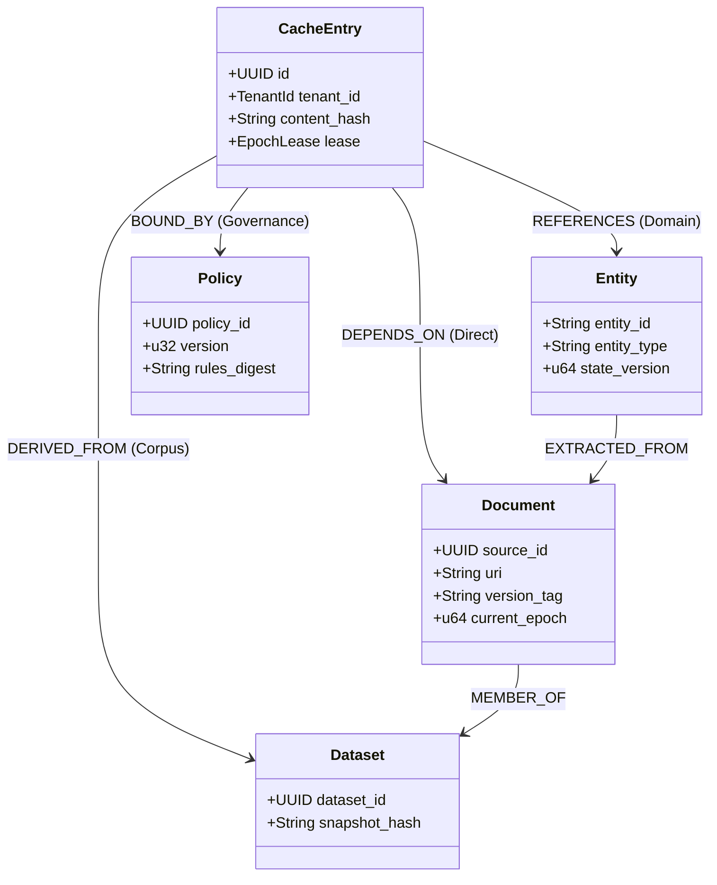

# Sunborn Dependency Graph Model & 13-Factor Validity System

**Author:** Principal Knowledge Architect & Formal Verification Board  
**Classification:** Graph Modeling & Invariant Verification  
**Status:** Canonical Reference Standard  
**Target Repository:** Sunborn (Rust Workspace + Next.js Gateway)  

---

## Executive Summary

In enterprise RAG (Retrieval-Augmented Generation) and multi-agent systems, a cached response is never a standalone entity. Its validity is contingent upon the exact state of external documents, database rows, security policies, and computational environments that existed when it was originally generated.

This document establishes:
1. The formal graph data model of the **Knowledge Dependency Graph ($G_K$)**.
2. The **13-Factor Dependency-Aware Cache Validity Matrix**, replacing naive embedding similarity with multi-attribute causal verification.
3. The **Conservative Abstention Semantics** ensuring that incomplete, ambiguous, or untrusted dependency metadata strictly triggers origin re-execution rather than serving potentially incorrect data.

---

## 1. Formal Data Model: Knowledge Dependency Graph ($G_K$)

### 1.1 Mathematical Formulation
The Knowledge Dependency Graph is defined as a directed heterogeneous graph:
$$G_K = (V_K, E_K, \phi_V, \phi_E)$$

Where:
- $V_K$: The set of all vertices in the system.
- $E_K \subseteq V_K \times V_K$: The set of directed dependency edges.
- $\phi_V: V_K \to \mathcal{T}_V$: Vertex typing function mapping each node to its domain type.
- $\phi_E: E_K \to \mathcal{T}_E$: Edge typing function defining relationship semantics.



### 1.2 Node Taxonomy ($\mathcal{T}_V$)
| Node Type | Symbol | Identifier Format | Description |
| :--- | :--- | :--- | :--- |
| **Document** | $D$ | `doc:{tenant}:{uuid}` | Primary unstructured source (PDF, Markdown, Wiki page, Confluence doc). |
| **Entity** | $E$ | `ent:{tenant}:{type}:{id}` | Extracted domain entity (Customer 42, Product SKU, Account Balance). |
| **Policy** | $P$ | `pol:{tenant}:{name}:v{v}` | Governance rule, system prompt, or safety guardrail definition. |
| **Dataset** | $S$ | `ds:{tenant}:{name}:{hash}` | Structured dataset, vector index collection, or database table. |
| **Cache Entry** | $C$ | `cache:{tenant}:{hash}` | Materialized LLM response or intermediate execution artifact. |

### 1.3 Edge Taxonomy ($\mathcal{T}_E$)
1. **Direct Causal Dependency ($C \xrightarrow{\text{dep}} D$):** Cache entry $C$ incorporated text from document $D$. If $D$ is updated, $C$ is invalid.
2. **Domain Entity Reference ($C \xrightarrow{\text{ref}} E$):** Cache entry $C$ references live entity $E$. If $E$'s state version advances, $C$ must be revalidated.
3. **Policy Binding ($C \xrightarrow{\text{bound}} P$):** Cache entry $C$ was synthesized under policy version $P$. If $P$ is updated, $C$ must be evicted.
4. **Transitive Derivation ($D_1 \xrightarrow{\text{der}} D_2$):** Document $D_2$ was generated or transformed from $D_1$. Invalidation cascades $D_1 \to D_2 \to C$.

---

## 2. The 13-Factor Dependency-Aware Cache Validity Matrix

When a query retrieves a candidate cache entry (either via exact hash match or semantic vector search), the gateway executes the **13-Factor Verification Protocol**. If *any single factor* evaluates to `FALSE` or is indeterminate, the gateway **abstains from cache reuse**.

```
┌────────────────────────────────────────────────────────────────────────┐
│                   13-FACTOR CACHE VALIDITY EVALUATION                  │
├────┬─────────────────────────────┬────────────────────────────────────┤
│ #  │ Factor Name                 │ Formal Verification Rule           │
├────┼─────────────────────────────┼────────────────────────────────────┤
│ 1  │ Tenant Identity             │ Req.tenant_id == Cert.tenant_id    │
│ 2  │ Model Identity              │ Req.model == Cert.model            │
│ 3  │ Model Version               │ Req.model_version == Cert.version  │
│ 4  │ Generation Parameters       │ Req.params == Cert.params          │
│ 5  │ Source Document Versions    │ ∀ s ∈ S, Epoch_curr(s) == Epoch(s) │
│ 6  │ Entity State Versions       │ ∀ e ∈ E, Version_curr(e) == Ver(e) │
│ 7  │ Policy Rules Digest         │ Digest(ActivePolicy) == Cert.pol   │
│ 8  │ Temporal Validity Window    │ Utc::now() ∈ [Issued, Expires]     │
│ 9  │ Dependency Graph Epoch Lease│ Lease_current == Cert.lease        │
│ 10 │ Execution Tool Provenance   │ CanonicalSignature(Tool) == Cert   │
│ 11 │ Tool Computational Purity   │ Purity ∈ {Pure, ReadIdempotent}    │
│ 12 │ Authorization Scope / RBAC  │ Req.auth_scope ⊇ Cert.auth_scope   │
│ 13 │ Outbox Invalidation State   │ DLQ_failures == 0 ∧ WatermarkFresh │
└────┴─────────────────────────────┴────────────────────────────────────┘
```

### Detailed Factor Specifications:

#### Factor 1: Tenant Identity Isolation
- **Rule:** `Req.tenant_id == Cert.tenant_id`
- **Enforcement:** Enforced in constant time via cryptographic envelope checks. Cross-tenant reuse is physically impossible because payloads are encrypted under unique per-tenant AES-256 keys (TDEK).

#### Factor 2 & 3: Model Identity and Architecture Version
- **Rule:** Identical model string and version tag (e.g. `gpt-4o-2024-08-06` vs `gpt-4o-2024-11-20`).
- **Rationale:** Different model checkpoints produce different reasoning depths and formatting styles. Caches must not mix model versions.

#### Factor 4: Prompt and Hyperparameter Parity
- **Rule:** Exact match on generation parameters: `temperature`, `top_p`, `frequency_penalty`, `presence_penalty`, and `seed`.
- **Constraint:** If a user specifies `temperature: 0.0` (deterministic query), a cached response generated at `temperature: 0.9` (creative query) is rejected.

#### Factor 5: Source Document Epochs
- **Rule:** For every document snapshot $s \in \text{Cert.source\_snapshots}$:
  $$\text{current\_epoch}(s.\text{source\_id}) == s.\text{snapshot\_epoch}$$
- **Mechanism:** Implemented in [`crates/sunborn-invalidation/src/epoch.rs`](file:///C:/Sunborn/crates/sunborn-invalidation/src/epoch.rs#L120-L136) via atomic multi-source lease validation.

#### Factor 6: Live Entity Versions
- **Rule:** Structured database entities referenced in RAG context (e.g. `Account:101`) must match current database sequence numbers.

#### Factor 7: Policy Rules Digest
- **Rule:** Hash digest of the system instructions, organizational compliance policies, and safety constraints must be identical to the certificate's policy hash.

#### Factor 8: Temporal Validity Window
- **Rule:** $T_{\text{now}} < T_{\text{expires}}$. Even if no document has mutated, cached entries expire after their maximum Time-To-Live (TTL).

#### Factor 9: Monotonic Epoch Lease (Meta TAO / McLease)
- **Rule:** The read lease token acquired at query inception must match the storage epoch at commit time, preventing the "slow origin write-back race."

#### Factor 10: Execution Provenance
- **Rule:** Tool execution arguments and context hashes must be canonically deterministically signed via RFC 8785 JSON canonicalization.

#### Factor 11: Computational Tool Purity
- **Rule:** Only nodes classified as [`ToolPurity::PureDeterministic`](file:///C:/Sunborn/crates/sunborn-execution/src/merkle.rs#L13) or [`ToolPurity::ReadIdempotent`](file:///C:/Sunborn/crates/sunborn-execution/src/merkle.rs#L15) can be reused. Any node depending on [`ToolPurity::SideEffectingMutator`](file:///C:/Sunborn/crates/sunborn-execution/src/merkle.rs#L20) is permanently barred from cache storage.

#### Factor 12: Authorization Scope (RBAC / ABAC)
- **Rule:** The caller's authorization token must have read access to all underlying documents in the lineage set. If Document A is confidential to HR, an engineering user cannot receive a cached answer derived from Document A even if their prompt is identical.

#### Factor 13: Invalidation Pipeline Health
- **Rule:** If the transactional outbox has uncommitted backlogged events or active Dead-Letter Queue (DLQ) entries for the tenant's sources, the gateway conservatively abstains until the invalidation queue is drained.

---

## 3. Conservative Abstention Semantics

When any dependency check fails, Sunborn avoids guessing or best-effort re-use. It enforces **Conservative Abstention**:

```rust
// Abstention Protocol in sunborn-gateway
match validity_result {
    Ok(Valid) => {
        // Safe reuse: Decrypt and serve
        serve_cached_hit(candidate)
    }
    Err(ValidityError::StaleDependency { source_id, expected_epoch, current_epoch }) => {
        tracing::warn!(%source_id, expected_epoch, current_epoch, "Causal staleness detected -> Abstaining to Origin");
        metrics::ABSTENTION_STALE_DEPENDENCY.inc();
        forward_to_origin_and_evict_stale_cache(candidate.key)
    }
    Err(ValidityError::MissingMetadata) => {
        tracing::warn!("Unverifiable candidate -> Abstaining to Origin");
        metrics::ABSTENTION_MISSING_METADATA.inc();
        forward_to_origin(request)
    }
    Err(ValidityError::PolicyMismatch) => {
        tracing::warn!("Policy drift detected -> Abstaining to Origin");
        metrics::ABSTENTION_POLICY_DRIFT.inc();
        forward_to_origin(request)
    }
}
```

### Invariant Guarantee:
**Under no circumstance will Sunborn return a cached response if any of its upstream knowledge sources have been updated since the response was created.**
