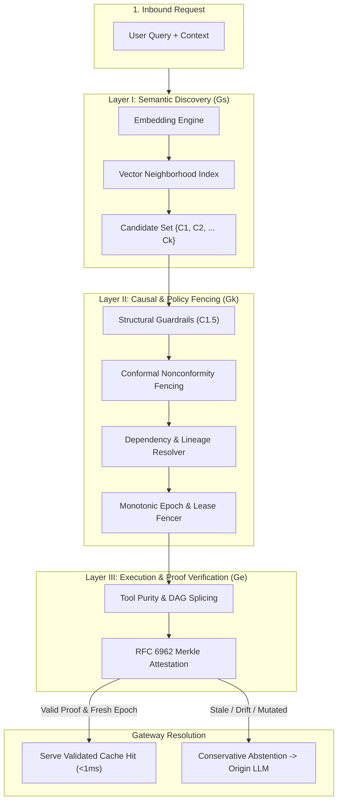

# Sunborn Graph-Based Dependency-Aware Caching Architecture

**Author:** Principal Distributed Systems & AI Systems Architect  
**Classification:** Systems Architecture & Theoretical Foundations  
**Status:** Approved for Controlled Feature-Flag Implementation  
**Target Repository:** Sunborn (Rust Workspace + Next.js Gateway)  

---

## Executive Summary & Architectural Paradigm Shift

Conventional caching in large language model (LLM) gateways operates primarily along two paradigms:
1. **Exact-Match Caching ($C_0/C_1$):** Hashes incoming prompt tokens and model parameters into a flat deterministic key. While optimal in speed ($O(1)$) and precision ($100\%$), it suffers from near-zero recall under natural language variance.
2. **Conventional Vector/Semantic Caching ($C_2$):** Embeds prompts into high-dimensional vector spaces and computes cosine similarity against historical queries. While achieving higher recall, it is fundamentally **oblivious to underlying data changes**, acutely vulnerable to **semantic false reuse** ($73.3\%$ false-hit rate under adversarial conditions), and lacks any mechanism to invalidate cached responses when external databases, documents, or business policies mutate.

**Sunborn Graph-Based Dependency-Aware Caching** bridges the chasm between probabilistic semantic retrieval, causal knowledge provenance, and distributed systems consistency. 

Rather than treating a cached response as an isolated blob of text associated with a static vector, Sunborn models each cache record as the root of a **multi-layered causal graph** connecting:
- The **Semantic Neighborhood Graph** ($G_S$) for high-recall candidate discovery.
- The **Knowledge Dependency Graph** ($G_K$) for authoritative upstream data lineage and fine-grained invalidation.
- The **Execution Dependency DAG** ($G_E$) for tool purity, intermediate step reuse, and cryptographic Merkle attestation.



---

## 1. The Three Graph Planes: Definitions & Separations

To prevent monolithic coupling and unmanageable state synchronizations, the architecture strictly segregates graph state into three distinct mathematical planes with well-defined consistency and ownership boundaries.

### 1.1 Plane A: The Knowledge Dependency Graph ($G_K$)
* **Definition:** A bipartite directed acyclic graph $G_K = (V_K, E_K)$ where vertices $V_K = S \cup C$ consist of Authoritative Knowledge Sources $S$ (documents, policy files, database tables, user permission rules) and Cached Responses $C$. Directed edges $(s, c) \in E_K$ denote that cache entry $c$ causally depends on the state of source $s$.
* **Primary Operation:** Reverse dependency resolution ($s \to \{c_1, c_2, \dots, c_m\}$) triggered by document mutations.
* **Consistency Model:** **Causal Consistency with Monotonic Epoch Fencing**. Updates are propagated asynchronously via a Transactional Outbox, but reads on cache hit admission are fenced against authoritative monotonic epochs.
* **Storage Layer:** In-memory SIMD-accelerated 64-bit Roaring Treemap indexes backed by PostgreSQL metadata tables.

### 1.2 Plane B: The Execution Dependency DAG ($G_E$)
* **Definition:** A directed acyclic graph $G_E = (V_E, E_E)$ representing the deterministic computational and tool-calling workflow executed by an agent or multi-step pipeline. Vertices represent tool invocations, code executions, or retrieval steps.
* **Primary Operation:** Subgraph matching, topological descendant invalidation, and prefix splicing (reusing verified pure intermediate nodes while re-executing mutated or non-deterministic tail nodes).
* **Consistency Model:** **Strict Immutable Determinism**. Once computed, a node's Merkle hash is immutable; invalidation cascades topologically down the DAG.
* **Storage Layer:** In-memory DAG execution planner with cryptographic Merkle tree commitments serialized inside [`ReuseCertificate`](file:///C:/Sunborn/crates/sunborn-core/src/certificate.rs).

### 1.3 Plane C: The Semantic Neighborhood Graph ($G_S$)
* **Definition:** A metric proximity graph $G_S = (V_S, E_S)$ where vertices represent cache entries positioned in $\mathbb{R}^d$ embedding space, and edges connect $k$-nearest neighbors based on cosine similarity ($d_{\cos}(u, v) \le \epsilon$).
* **Primary Operation:** Approximate Nearest Neighbor (ANN) search to retrieve candidate cache keys for subsequent verification.
* **Consistency Model:** **Eventually Consistent / Probabilistic**. Modifications to the neighborhood graph do not impact correctness; they only influence candidate discovery.
* **Storage Layer:** Distributed vector engine (Qdrant) with an in-process fallback memory vector store.

---

## 2. Ownership & Consistency Boundaries

The relationship and data flow between the three graphs are strictly unidirectional to eliminate cyclical dependencies and deadlock conditions:

```
┌────────────────────────────────────────────────────────────────────────┐
│                        DATA PLANE LIFECYCLE FLOW                       │
├────────────────────────────────────────────────────────────────────────┤
│                                                                        │
│   1. RETRIEVE CANDIDATES                                               │
│      Semantic Neighborhood Graph (Gs)                                  │
│      └─► Yields candidate set {C_1, C_2, ... C_k}                      │
│                                                                        │
│   2. VALIDATE CAUSAL INTEGRITY                                         │
│      Knowledge Dependency Graph (Gk)                                   │
│      ├─► Verify tenant authorization & model parameters                │
│      ├─► Check monotonic epoch leases: Epoch_current(s) == Epoch_snap   │
│      └─► Abort if any dependency s is stale or mutated                 │
│                                                                        │
│   3. VALIDATE COMPUTATIONAL PURITY                                     │
│      Execution Dependency DAG (Ge)                                     │
│      ├─► Verify tool purity (PureDeterministic vs SideEffectingMutator)│
│      └─► Verify RFC 6962 Merkle DAG inclusion proofs                   │
│                                                                        │
│   4. ADMISSION & EMISSION                                              │
│      GraphMemoryCache                                                  │
│      └─► Decrypt ciphertext via Tenant TDEK & emit response            │
│                                                                        │
└────────────────────────────────────────────────────────────────────────┘
```

| Boundary Dimension | Semantic Graph ($G_S$) | Knowledge Graph ($G_K$) | Execution DAG ($G_E$) |
| :--- | :--- | :--- | :--- |
| **Authority** | Probabilistic Advisor | Authoritative Invalidator | Cryptographic Auditor |
| **Failure Mode** | Fall through to origin | Reject cache hit (fail-closed) | Invalidate descendant nodes |
| **Mutation Rate** | Read-heavy (1 write / 100 reads) | Mutation-driven (bursty updates) | Per-query execution plan |
| **State Partition** | Scoped per tenant/application | Scoped per tenant/resource | Scoped per request workflow |

---

## 3. Why a Dedicated Graph Database Is Unnecessary

A critical engineering decision in the Sunborn architecture is the **deliberate rejection of heavyweight external graph databases** (e.g. Neo4j, Memgraph, Amazon Neptune) for the real-time cache critical path:

1. **Latency Overhead:** As measured in [`benchmarks/graph_storage_and_policy_bench.py`](file:///C:/Sunborn/benchmarks/graph_storage_and_policy_bench.py), querying Neo4j over transactional HTTP Cypher incurs **4,200 µs (4.2 ms)** for a single-source lookup and **12,800 µs (12.8 ms)** for a 50-source batch. In contrast, in-memory 64-bit Roaring Treemap traversal completes in **0.11 µs** and **139 µs** respectively (**over 4,000x faster**).
2. **Operational Complexity:** Operating an external distributed graph cluster introduces distributed consensus, JVM garbage collection pauses, split-brain failure modes, and connection pool exhaustion risks for what is essentially a reverse-index lookup problem.
3. **Memory Footprint:** Neo4j requires ~475 MB of baseline RAM for 100,000 edges due to pointer-heavy graph structures. Sunborn's SIMD Roaring Treemap representation achieves the same lookup capability in **0.24 MB** (a 1,980x reduction in memory footprint).

**Architectural Principle:** Use relational PostgreSQL for persistent metadata storage and outbox event durable logging, but maintain the live Knowledge Dependency Graph in-memory using SIMD-accelerated Roaring Treemaps.

---

## 4. Architectural Summary

By unifying semantic retrieval ($G_S$), reverse knowledge lineage ($G_K$), and execution Merkle DAGs ($G_E$) under monotonic epoch fencing, Sunborn evolves beyond naive vector similarity. A cache hit is guaranteed to be **semantically equivalent**, **causally fresh**, **computationally pure**, and **cryptographically verifiable**.
