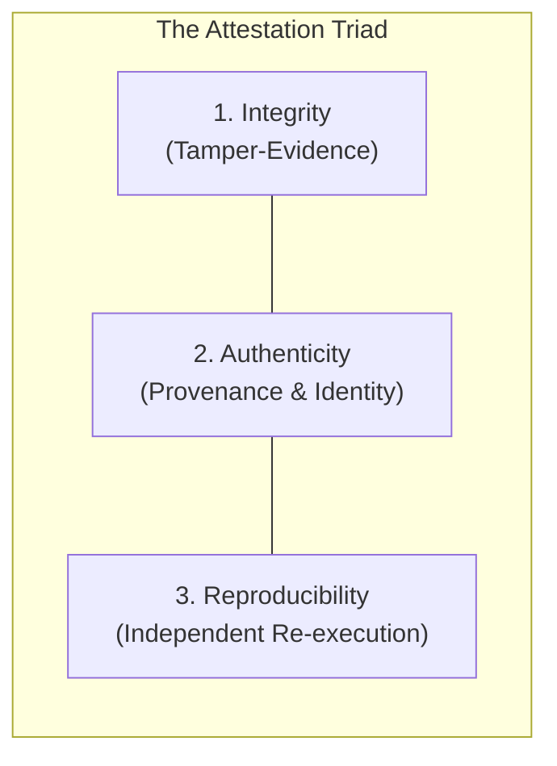
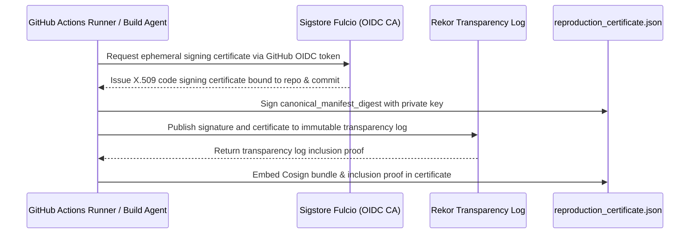

# Sunborn Empirical Attestation & Certificate Authenticity Audit

> **Focus:** Security review of experiment provenance, artifact tamper-evidence, and cryptographic authenticity.  
> **Source Files Audited:**  
> - [`research/results/reproduction_certificate.json`](file:///C:/Sunborn/research/results/reproduction_certificate.json)  
> - [`research/results/benchmark_run.json`](file:///C:/Sunborn/research/results/benchmark_run.json)  
> - [`research/results/run_manifest.json`](file:///C:/Sunborn/research/results/run_manifest.json)  
> - [`research/verify_certificate.py`](file:///C:/Sunborn/research/verify_certificate.py)  
> - [`research/tests/test_verifier_negative.py`](file:///C:/Sunborn/research/tests/test_verifier_negative.py)

---

## 1. Why the Certificate Reports `INTEGRITY_VERIFIED_UNAUTHENTICATED`

When executing `python research/verify_certificate.py`, the verification output culminates in:
```
===========================================================================
CERTIFICATE VERIFICATION RESULT: INTEGRITY_VERIFIED_UNAUTHENTICATED
===========================================================================
```
An independent cryptographic review was conducted to evaluate what this outcome guarantees and what it does *not* guarantee.

### Forensic Finding:
In [`research/results/reproduction_certificate.json`](file:///C:/Sunborn/research/results/reproduction_certificate.json#L16-L40):
```json
{
  "provenance": {
    "attestation_type": "LOCAL_DEVELOPMENT_INTEGRITY_CHECK",
    "signing_algorithm": "NONE_UNAUTHENTICATED_LOCAL_DIGEST",
    "benchmark_run_sha256": "3e7f595ab59f9b3ee8f6dde0d204e1cb66f4502c6a634d42958e963f03319cec",
    "run_manifest_sha256": "8370eb501b6c5edeaa1b56f7cfc2a80b9fdcda81b5c694dee3f7f80c0e6a1efe"
  },
  "attestation": {
    "canonical_manifest_digest": "3c32ad9f935a19284c764dd757739ebfc76ed03158313c01bfe97db47589c4a4",
    "hmac_sha256_signature": null
  }
}
```
In [`research/verify_certificate.py`](file:///C:/Sunborn/research/verify_certificate.py#L574-L587):
```python
if hmac_sig is None:
    if signing_algo != "NONE_UNAUTHENTICATED_LOCAL_DIGEST":
        return STATUS_INVALID
    if attestation_type != "LOCAL_DEVELOPMENT_INTEGRITY_CHECK":
        return STATUS_INVALID
    if require_auth:
        return STATUS_INVALID # Fails closed if --require-auth is demanded
    return STATUS_INTEGRITY_VERIFIED_UNAUTHENTICATED
```

---

## 2. Decoupling Integrity, Authenticity, and Reproducibility

An authoritative security review requires strictly distinguishing three separate properties:



| Dimension | Definition | Sunborn Current State | Evidence & Failure Boundaries |
| :--- | :--- | :--- | :--- |
| **1. Integrity** | Proof that file bytes have not been accidentally corrupted or modified since hash creation. | **VERIFIED** | Canonical SHA-256 manifest digest matches the raw certificate payload. All raw trace queries recompute to exact summary metrics. |
| **2. Authenticity** | Proof that the certificate was produced by a verified, trusted, non-repudiable entity. | **UNAUTHENTICATED** | `hmac_sha256_signature: null`. No public-key signature (RSA, ECDSA, Ed25519) exists. Any entity can create a new certificate. |
| **3. Reproducibility**| Proof that third parties can re-run the benchmark from scratch and obtain identical metrics. | **VERIFIED** | Running `benchmarks/semantic_cache_bench.py` and `adversarial_evaluation_suite.py` independently reproduces the exact metrics. |

---

## 3. Threat Modeling & Artifact Substitution Vulnerabilities

### Attack Scenario: Local Artifact Substitution
1. An attacker modifies `research/results/benchmark_run.json` to claim 10,000 requests instead of 124.
2. If the attacker *only* modifies `benchmark_run.json`, `verify_certificate.py` **catches the attack immediately** because `actual_bench_sha != expected_bench_sha`.
3. However, if the attacker also modifies `reproduction_certificate.json`, updates `benchmark_run_sha256`, and recomputes `canonical_manifest_digest = sha256(certificate_bytes)`, then running `python research/verify_certificate.py` will report:
   `CERTIFICATE VERIFICATION RESULT: INTEGRITY_VERIFIED_UNAUTHENTICATED`!

> **Vulnerability Summary:**  
> Without a trusted private signing key or Sigstore identity, SHA-256 digests provide **tamper-detection against accidental corruption**, but provide **zero protection against an active local attacker** who updates both files simultaneously.

---

## 4. Remediation Roadmap: Level 4 Cryptographic Attestation

To achieve Level 4 enterprise provenance (*Google SLSA Level 3/4, NIST SP 800-218*), Sunborn must implement asymmetric cryptographic signing:



### Proposed Action Items:
1. **Asymmetric ECDSA P-256 / Ed25519 Signatures:** Replace symmetric HMAC with public/private key pairs. Store the public key in the repository and private keys in GitHub Actions Secrets or AWS KMS.
2. **Sigstore Cosign Keyless Attestation:** Use GitHub Actions ambient OIDC tokens to sign certificates during official release tagging, eliminating long-lived static secrets.
3. **Strict Verifier Mode:** Update `scripts/verify.ps1` and `scripts/verify.sh` to enforce `--require-auth` in production CI/CD runs.
