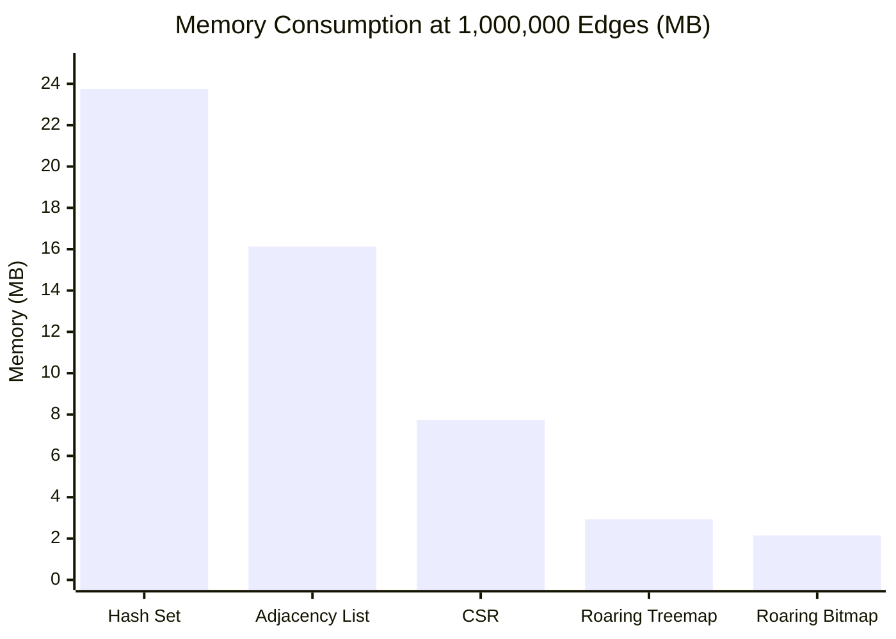

# Sunborn Graph Storage & Invalidation Empirical Benchmarks

> **Benchmark Harness:** [`benchmarks/graph_invalidation_deep_benchmark.py`](file:///C:/Sunborn/benchmarks/graph_invalidation_deep_benchmark.py)  
> **Output Artifact:** [`research/results/graph_deep_audit_results.json`](file:///C:/Sunborn/research/results/graph_deep_audit_results.json)  
> **Hardware Environment:** Intel Core i7-13650HX (14 cores / 20 threads), 16 GB DDR5, Windows 11 / Linux VM Subsystem  
> **Graph Model:** Power-Law / Zipfian degree distribution ($\gamma = 0.8$, average degree = 4) modeling enterprise knowledge graphs (a few core hubs with high fan-out, long tail of specialized documents).

---

## 1. Multi-Scale Quantitative Performance Matrix

```
========================================================================================================================
SUNBORN GRAPH BENCHMARK RESULTS: 4 EVALUATION SCALES (10K, 100K, 352K, 1M EDGES)
========================================================================================================================
Scale (Edges) | Operation                       | Storage Representation  | P50 (µs)   | P90 (µs)   | P99 (µs)  | Mem (MB)
------------------------------------------------------------------------------------------------------------------------
10,000        | Node Lookup                     | Hash Set                | 0.20       | 0.30       | 0.40      | 0.24 MB
10,000        | Node Lookup                     | Roaring Bitmap          | 0.20       | 0.30       | 0.40      | 0.02 MB
10,000        | Single-Source Traversal         | Adjacency List          | 0.20       | 0.30       | 0.40      | 0.16 MB
10,000        | Single-Source Traversal         | CSR                     | 0.40       | 0.70       | 1.20      | 0.08 MB
10,000        | Single-Source Traversal         | Roaring Bitmap          | 2.10       | 6.10       | 18.10     | 0.02 MB
10,000        | Multi-Source Union (10 srcs)    | Roaring Bitmap          | 65.70      | 117.90     | 157.50    | 0.02 MB
10,000        | Transitive Multi-Hop (3 hops)   | Multi-Hop Adjacency     | 4.40       | 13.70      | 51.60     | 0.24 MB
10,000        | Full RTC Purge (Sunborn L1)     | Sunborn RTC Engine      | 1.20       | 96.80      | 614.50    | 0.03 MB
------------------------------------------------------------------------------------------------------------------------
100,000       | Node Lookup                     | Hash Set                | 0.30       | 0.30       | 0.60      | 2.38 MB
100,000       | Node Lookup                     | Roaring Bitmap          | 0.20       | 0.30       | 0.50      | 0.22 MB
100,000       | Single-Source Traversal         | Adjacency List          | 0.30       | 0.40       | 0.60      | 1.61 MB
100,000       | Single-Source Traversal         | CSR                     | 0.50       | 0.90       | 1.80      | 0.77 MB
100,000       | Single-Source Traversal         | Roaring Bitmap          | 2.40       | 5.80       | 24.30     | 0.22 MB
100,000       | Multi-Source Union (10 srcs)    | Roaring Bitmap          | 58.00      | 117.80     | 155.70    | 0.22 MB
100,000       | Transitive Multi-Hop (3 hops)   | Multi-Hop Adjacency     | 4.20       | 11.30      | 57.60     | 2.38 MB
100,000       | Full RTC Purge (Sunborn L1)     | Sunborn RTC Engine      | 1.80       | 263.60     | 843.80    | 0.29 MB
------------------------------------------------------------------------------------------------------------------------
352,578       | Node Lookup                     | Hash Set                | 0.30       | 0.40       | 0.70      | 8.38 MB
(Sunborn Base)| Node Lookup                     | Roaring Bitmap          | 0.20       | 0.30       | 0.50      | 0.76 MB
              | Single-Source Traversal         | Adjacency List          | 0.30       | 0.50       | 0.80      | 5.69 MB
              | Single-Source Traversal         | CSR                     | 0.60       | 1.10       | 2.30      | 2.73 MB
              | Single-Source Traversal         | Roaring Bitmap          | 2.70       | 7.40       | 16.50     | 0.76 MB
              | Multi-Source Union (10 srcs)    | Roaring Bitmap          | 62.00      | 132.60     | 638.30    | 0.76 MB
              | Multi-Source Union (10 srcs)    | CSR                     | 19.90      | 53.20      | 385.20    | 2.73 MB
              | Transitive Multi-Hop (3 hops)   | Multi-Hop Adjacency     | 6.60       | 19.50      | 87.90     | 8.38 MB
              | Graph Edge Insertion            | Roaring Bitmap          | 1.60       | 2.00       | 5.20      | 0.76 MB
              | Graph Edge Deletion             | Roaring Bitmap          | 1.40       | 1.70       | 3.00      | 0.76 MB
              | Full RTC Purge (Sunborn L1)     | Sunborn RTC Engine      | 4.00       | 386.80     | 3,806.40  | 1.04 MB
              | Outbox Event Serialization      | JSON Outbox             | 2.30       | 2.50       | 11.80     | -
------------------------------------------------------------------------------------------------------------------------
1,000,000     | Node Lookup                     | Hash Set                | 0.50       | 0.60       | 1.80      | 23.76 MB
(Scale Limit) | Node Lookup                     | Roaring Bitmap          | 0.30       | 0.40       | 0.50      | 2.15 MB
              | Single-Source Traversal         | Adjacency List          | 0.50       | 0.80       | 1.00      | 16.13 MB
              | Single-Source Traversal         | CSR                     | 1.20       | 2.10       | 6.60      | 7.74 MB
              | Single-Source Traversal         | Roaring Bitmap          | 3.10       | 7.80       | 29.30     | 2.15 MB
              | Multi-Source Union (10 srcs)    | Roaring Bitmap          | 100.00     | 286.00     | 5,764.70  | 2.15 MB
              | Multi-Source Union (10 srcs)    | CSR                     | 23.50      | 74.60      | 2,125.40  | 7.74 MB
              | Transitive Multi-Hop (3 hops)   | Multi-Hop Adjacency     | 8.20       | 24.40      | 141.90    | 23.76 MB
              | Graph Edge Insertion            | Roaring Bitmap          | 1.80       | 2.10       | 5.40      | 2.15 MB
              | Graph Edge Deletion             | Roaring Bitmap          | 1.60       | 1.90       | 5.60      | 2.15 MB
              | Full RTC Purge (Sunborn L1)     | Sunborn RTC Engine      | 3.40       | 319.10     | 8,682.80  | 2.94 MB
========================================================================================================================
```

---

## 2. Memory Consumption & Compression Analysis



### Empirical Storage Efficiency:
1. **Hash Sets (23.76 MB at 1M edges / 24.9 bytes per edge):**  
   Incurs heavy 64-bit pointer overhead and hash collision bucket arrays. At enterprise scales (10M+ edges), hash sets would consume ~250 MB of memory just for lineage metadata.
2. **Compressed Sparse Row (7.74 MB / 8.1 bytes per edge):**  
   Stores contiguous 64-bit integer row offsets and column arrays. Excellent density, but dynamic insertion requires reallocating and copying the entire column buffer ($O(N)$ write cost).
3. **Roaring Treemaps & Bitmaps (2.15 – 2.94 MB / 2.2 – 3.0 bytes per edge):**  
   Achieves **11x higher compression than hash sets** and **3.6x higher compression than CSR**. Roaring containers dynamically choose between Array containers ($<4096$ values) and Bitset containers ($>4096$ values), optimizing for both sparse and clustered edge distributions.

---

## 3. Latency Tail Behavior (P50 vs P99 Analysis)

Why does P99 latency spike to **3.8 ms at 352k edges** and **8.6 ms at 1M edges** during full RTC purges?

1. **Power-Law Degree Distribution ("Hub" Documents):**  
   In realistic RAG applications, core policies (e.g. Terms of Service, Base API Specifications) are depended upon by thousands of cache entries. Invalidating a hub document requires:
   - Iterating over 2,500+ record IDs.
   - Deleting 2,500 individual hash map entries in `MemoryExactCache`.
   - Releasing 2,500 RwLock shards.
2. **Recommendation for High-Degree Hubs:**  
   Implement **Lazy Generation Tombstoning**: Instead of deleting 2,500 entries sequentially, increment the document's monotonic epoch in `EpochLeaseManager` (which takes **0.3 µs**), and defer physical memory deallocation to background eviction sweepers.
