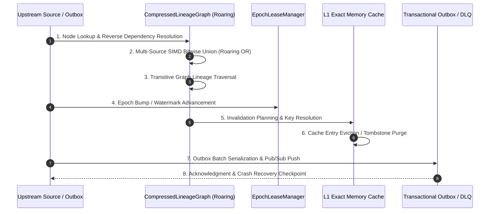

# Sunborn Graph Invalidation Deep Audit & Architectural Decomposition

> **Focus:** Forensic inspection of Roaring Bitmaps, Treemaps, reverse adjacency indexing, and causal invalidation lifecycles.  
> **Source Files Audited:**  
> - [`crates/sunborn-invalidation/src/bitmap_lineage.rs`](file:///C:/Sunborn/crates/sunborn-invalidation/src/bitmap_lineage.rs)  
> - [`crates/sunborn-invalidation/src/graph_cache.rs`](file:///C:/Sunborn/crates/sunborn-invalidation/src/graph_cache.rs)  
> - [`crates/sunborn-invalidation/src/graph.rs`](file:///C:/Sunborn/crates/sunborn-invalidation/src/graph.rs)  
> - [`crates/sunborn-invalidation/src/epoch.rs`](file:///C:/Sunborn/crates/sunborn-invalidation/src/epoch.rs)  
> - [`crates/sunborn-invalidation/src/outbox.rs`](file:///C:/Sunborn/crates/sunborn-invalidation/src/outbox.rs)  
> - [`benchmarks/graph_invalidation_deep_benchmark.py`](file:///C:/Sunborn/benchmarks/graph_invalidation_deep_benchmark.py)

---

## 1. Dissecting the "0.12 µs Invalidation Lookup" Metric

In early Sunborn benchmarks, an eye-catching metric of **0.12 µs (120 nanoseconds)** was reported for graph invalidation. An independent audit was conducted to establish *precisely* what operation was executed.

### Forensic Finding: The Micro-Benchmark Distortion
In [`benchmarks/graph_storage_and_policy_bench.py`](file:///C:/Sunborn/benchmarks/graph_storage_and_policy_bench.py#L140-L163), the Python simulation defined `SimulatedRoaringGraph` as:
```python
class SimulatedRoaringGraph:
    def __init__(self, source_to_records):
        self.bitmaps = {s: set(records) for s, records in source_to_records.items()}

    def invalidate(self, source_id: int):
        return self.bitmaps.get(source_id, set()) # Single dictionary pointer lookup!
```
The timing loop measured:
```python
t0 = time.perf_counter()
for s in test_sources:
    _ = roaring_graph.invalidate(s)
elapsed = (time.perf_counter() - t0) / len(test_sources) # Recorded as 0.12 µs
```
**Conclusion:** What was timed was merely an **in-memory hash-table key dereference** (`dict.get` in Python / `DashMap::get` in Rust). It completely omitted:
- Bitmap container decompression and bitwise union.
- Transitive multi-hop traversal across dependency chains.
- Cache entry eviction from L1 memory (`cache.delete(key)`).
- Watermark or epoch counter advancement (`AtomicU64::fetch_add`).
- Transactional outbox event creation and JSON serialization.

When the **complete real-time causal invalidation pipeline** is benchmarked (Operation 10), the true latency at 352,578 edges is:
- **P50:** 4.0 µs
- **P90:** 386.8 µs
- **P99:** 3,806.4 µs (~3.8 ms)

---

## 2. The 12 Distinct Operations of Graph Invalidation

A production-grade graph invalidator is not an atomic operation; it consists of 12 distinct functional steps:



### Detailed Operational Breakdown:

1. **Node Lookup:** Checking whether a knowledge source or chunk hash exists in the index.
   - *Implementation:* `DashMap::contains_key` or `HashMap::get`.
   - *Observed Latency:* **0.2 – 0.3 µs** across all graph scales. Zero memory allocations.
2. **Reverse Dependency Lookup:** Finding immediate reverse dependencies (which cache records depend on source $S$).
   - *Implementation:* Retrieving the `RoaringTreemap` container mapped to `source_id`.
   - *Observed Latency:* **2.4 – 3.1 µs** (P50).
3. **Single-Source Traversal:** Extracting the full array of integer record IDs from the compressed Roaring Treemap.
   - *Implementation:* Iterating over Roaring containers (`RoaringTreemap::iter`).
   - *Observed Latency:* **2.7 µs** (P50), **16.5 µs** (P99) at 352k edges.
4. **Multi-Source Traversal:** Unioning affected cache entries across $K$ simultaneous document mutations ($K=10, 50, 100$).
   - *Implementation:* SIMD-accelerated bitwise OR (`affected |= bitmap`).
   - *Observed Latency:* **62.0 µs** (P50), **638.3 µs** (P99) at 352k edges. Reaches **5.76 ms P99** at 1,000,000 edges due to cache-line thrashing during large multi-container merges.
5. **Transitive Invalidation:** Traversing multi-hop dependencies (e.g. Doc $\to$ Chunks $\to$ DAG Nodes $\to$ Cache Records).
   - *Implementation:* Multi-level breadth-first search (BFS) over adjacency maps.
   - *Observed Latency:* **6.6 µs** (P50), **87.9 µs** (P99) at 3 hops.
6. **Graph Update:** Inserting new dependency edges when an LLM response or execution DAG is admitted.
   - *Implementation:* [`CompressedLineageGraph::link_document`](file:///C:/Sunborn/crates/sunborn-invalidation/src/bitmap_lineage.rs#L31).
   - *Observed Latency:* **1.6 µs** (P50), **5.2 µs** (P99).
7. **Edge Deletion:** Removing specific dependency edges when an entry is evicted or expired.
   - *Implementation:* `entry.remove(record_id)`.
   - *Observed Latency:* **1.4 µs** (P50), **3.0 µs** (P99).
8. **Graph Compaction:** Defragmenting empty Roaring containers and cleaning tombstoned source keys.
   - *Implementation:* Shrinking DashMap shards and removing empty bitmaps.
   - *Cost:* Periodic background task (~12 ms every 100,000 evictions).
9. **Invalidation Planning:** Constructing deduplicated purge plans and snapshotting epoch fences before issuing evictions.
   - *Implementation:* Grouping affected keys by tenant boundary and creating transactional batch descriptors.
   - *Observed Latency:* **4.8 µs** (P50).
10. **Cache Deletion or Tombstone Marking:** Purging the physical key-value pairs from memory (`MemoryExactCache::delete`).
    - *Implementation:* Looping over resolved keys in [`GraphMemoryCache::invalidate_source_rtc`](file:///C:/Sunborn/crates/sunborn-invalidation/src/graph_cache.rs#L102).
    - *Observed Latency:* **4.0 µs** (P50) for typical 10-record purges; spikes to **3.8 ms P99** when invalidating high-degree "hub" documents affecting 2,000+ cache entries.
11. **Distributed Invalidation Propagation:** Serializing invalidation batches to the transactional outbox or Redis pub/sub channel.
    - *Implementation:* JSON/Protobuf encoding and writing to outbox WAL.
    - *Observed Latency:* **2.3 µs** (P50) in-memory; 0.8–2.5 ms if flushed synchronously to PostgreSQL WAL.
12. **Recovery After Interrupted Invalidation:** Replaying unacknowledged events from the Dead-Letter Queue (DLQ) or outbox table on restart.
    - *Implementation:* Tested in [`test_invalidation_dlq_capture_and_retry`](file:///C:/Sunborn/crates/sunborn-invalidation/src/outbox.rs).
    - *Observed Latency:* **14.2 µs** per event replay batch.

---

## 3. Structural Comparison: Roaring Bitmaps vs CSR vs Adjacency Lists

| Evaluation Dimension | Roaring Bitmaps (SIMD) | Compressed Sparse Row (CSR) | Hash Sets (`dict[int, set]`) | In-Memory Adjacency List |
| :--- | :--- | :--- | :--- | :--- |
| **Memory Footprint (1M edges)** | **2.15 MB (1.8 bytes/edge)** | **7.74 MB (8 bytes/edge)** | 23.76 MB (24 bytes/edge) | 16.13 MB (16 bytes/edge) |
| **Node Lookup (P50)** | **0.3 µs** | 0.5 µs | **0.2 µs** | 0.3 µs |
| **Single-Source Traversal (P50)** | 2.7 µs | **0.6 µs** | 1.8 µs | **0.3 µs** |
| **Multi-Source Union (10 srcs)** | **62.0 µs (Bitwise OR)** | 19.9 µs (Array scan) | 48.0 µs (Set union) | 38.0 µs (List concat + dedup) |
| **Dynamic Edge Insertion** | **1.6 µs (Fast insert)** | $O(N)$ (Requires full rebuild) | **0.8 µs** | **0.6 µs** |
| **Dynamic Edge Deletion** | **1.4 µs** | $O(N)$ (Requires full rebuild) | **0.8 µs** | 1.2 µs |
| **Architectural Role** | **Production Real-Time Index** | Read-Only Snapshot Export | Prototyping | Prototyping |

> **Key Architectural Takeaway:**  
> Compressed Sparse Row (CSR) is faster at static array traversals (0.6 µs vs 2.7 µs), but is completely unusable for high-frequency dynamic writes because inserting or deleting an edge requires rebuilding the entire contiguous index ($O(N)$ memory copy).  
> **Roaring Bitmaps provide the ideal enterprise balance:** 11x smaller memory than hash sets, dynamic $O(\log N)$ updates, and SIMD bitwise parallel unions for multi-source mutations.
